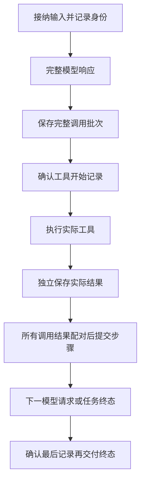

# 在执行边界记录完整任务事实

本增量把现有 Agent 循环产生的输入、完整模型输出、工具事实和终态接入会话存档。它使一次任务中已经完成的部分不必等到整轮成功才落盘，同时继续区分“已经显示”和“可以送给下一次模型请求”。

## 记录协议，不记录一份 UI 替身

采用 Conversation 定义的类型化事件，保存原始用户输入、输入身份、助手完整输出项、phase、reasoning 不透明内容、工具调用身份与顺序。ProtocolHistory 的受控序列化仍由模型层解释，存储只写封装后的数据。

调用与结果按 call_id 配对，工具声明和实际执行契约可追溯；普通文本和图片结果保持不同载荷类型。图片引用使用前置增量的已提交附件，不从 ToolView.output 或 UI JSON 还原。

命令输出仍是现有有界结果，保留截断标记；完整存档不意味着保存未被工具收集的全部 stdout。响应尚未完成时，增量只推进界面，不能成为可重放的完整助手协议项。正常 Stop 或失败收尾时保存已有的部分展示和真实终态，不逐 token 刷盘。

## 每一个副作用边界都能留下事实

完整模型响应经过身份与结构校验后，先保存整个调用批次。每项工具真正启动前确认开始记录，工具返回后立即保存实际结果；不把前几项结果全留在内存里等待最后一项。

完整输出和全部匹配结果取得终态后才记录封闭步骤。成功、业务失败、超时、取消和明确未执行各有真实语义。已封闭步骤进入后续工作上下文；已有提交点的任务继续沿现有规则禁止原样重试，避免自动重复副作用。

apply_patch 的已完成、失败和未开始动作，以及清理失败等事实原样保留。进程自动回收记录与普通工具结果分开，不改写历史中的 running 返回，也不伪造额外 function_call。执行线程或进程资源真实回收以后才发布任务终态。

若模型响应包含 A、B、C，A 已返回而 B 尚在运行，A 的结果必须已经有独立记录。后续异常退出至少能区分 A 的实际结果、B 的开始事实和 C 尚未开始，而不将整批恢复成“什么都没做”。具体恢复由下一增量承担。

## 用户输入和队列同样是业务事实

首次接纳普通消息后，以首个非空片段生成本地标题；没有额外命名模型请求。名称未被用户改过才采用这个默认值。输入活动和任务终态更新明确的最后活动时间，流式 token 不反复改列表排序。

Steer 保存接纳、实际应用、未生效及请求序号。可靠回执与累计展示快照继续分开，只有实际进入请求的补充消息进入工作历史。完成裁定关闭接纳通道后，迟到的输入仍按原逻辑拒绝并保留草稿，不能悄悄转成 Queue。

Queue 保存已接纳条目的内容、顺序、输入身份、移除、开始和暂停状态。未开始条目不进入模型上下文；开始时绑定本次运行分配的 operation ID。磁盘记录可以保留旧操作身份作诊断，但不能将其当成重启后的控制句柄。队列容量继续是现有的 8 条，正常任务结束和实际回收后才允许下一条启动。

Runner 独占活动协议历史，Conversation 仍能管理未开始队列；两者向同一写入者提交事件，由该写入者统一分配记录序号。提交回执按业务输入身份匹配，不能让后到的累计快照覆盖刚接纳的队列。

## 保存失败不是执行撤销

写入开始或调用批次失败时不启动新的副作用。工具真实结果已经取得但写入失败时，保留内存结果，停止后续请求和工具，显示保存失败并暂停队列；不得把已经修改的文件描述成未执行或已回滚。

关闭先禁止新输入与自动出队，取消并回收执行资源，归还最后记录和可靠回执，再等待 Store Flush 与关闭。原账号正在进行的凭据旋转由其原所有者完成，不因记录保存或聊天取消而丢弃。

原有每任务 32 次模型请求、64 次工具调用、串行工具执行、参数及结果限额继续有效。记录层不增加后台执行队列，不重试历史工具，也不提高原来上限。

## 随真实工具往返验证

在真实应用中完成多步命令与补丁操作，比较存档中的完整输出顺序、call_id、实际结果及封闭步骤，确认下一次模型请求只追加一次输入。一次同响应的多调用场景必须观察到真实的多个 call_id，不能用多次单调用替代。

在持续命令执行时提交 Steer、排入 Queue，再停止任务。检查已接纳与实际应用的区别、未开始条目不进入上下文、队列暂停、进程清理记录独立以及终态在真实回收和保存之后交付。

针对真实文件写入边界进行受控故障注入，确认工具已经产生的结果不被篡改，后续执行停止，原记录保持可读。故障只作用于本次验证会话，不改账号文件和其他会话。

GUI 的卡片、输入反馈和终态通过 BRP 实际交互、截图和安全状态检查；现有特殊键限制按已知问题处理并释放 Pointer。使用适用的静态检查和真实运行，不编写测试代码、模拟服务、Benchmark 或 Example，不退出或切换账号制造条件。

更新会话、工具、存储与执行生命周期设计的已落地部分。前置为[持久图片结果](02-durable-image-results.md)；下一增量[恢复会话历史](04-restore-session-history.md)消费这里的记录，不引入第二份历史真值。
