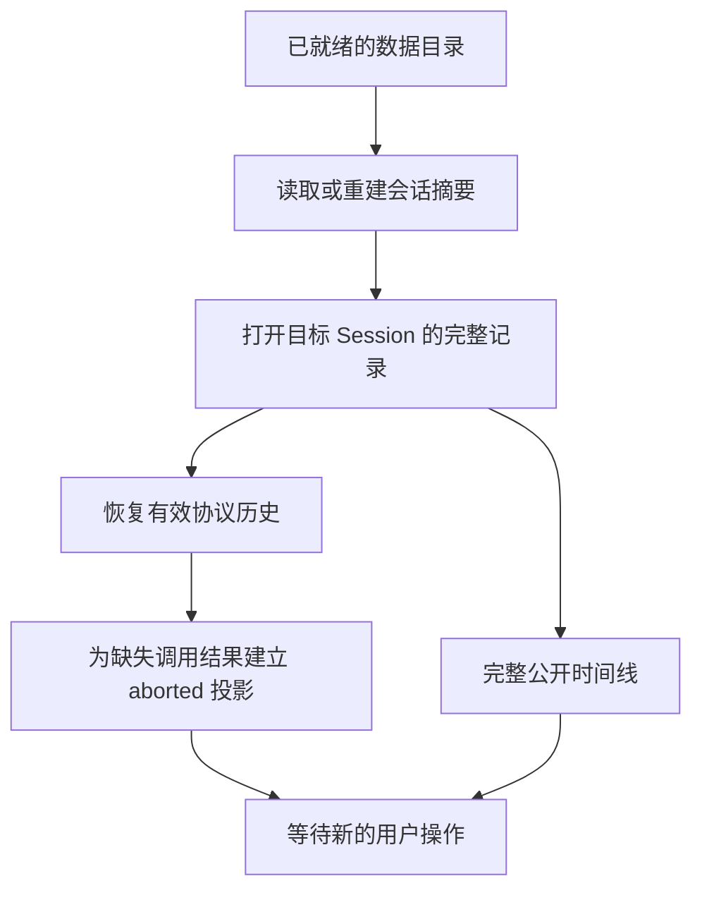

# 重启后打开可信的会话历史

本增量让已经写入磁盘的会话回到现有聊天区，并能够继续进行下一轮请求。恢复只还原数据，不恢复 PowerShell 进程、旧任务句柄或待执行命令。它依赖前面的真实任务记录，不从聊天气泡或模型最后一句“已完成”推断执行结果。

## 打开的是原来的身份和设置

存储加载稳定 Session ID、完整设置、消息、工具事实、输入状态及后续分配所需的序号。模型、推理设置、工作目录和 InstructionSnapshot 从存档恢复，不用当前准备区或提示词库覆盖；指令仍在每次请求前部注入一次。

启动时在数据目录就绪后读取摘要，默认打开按活动时间排序的第一份会话，无记录则显示现有准备区。这个动作不请求模型，不启动工具，不继续 Queue，也不依赖账号认证成功。目录列表和历史阅读与登录资格解耦；跨账号发送门控将在对应增量调整。

打开成功回执包含稳定身份和安全展示。只有目标读取、协议及附件校验完成后，才替换当前会话；失败保留原内容。列表摘要落后、丢失时从权威日志重建，摘要不能替代日志参与构造请求。

恢复时不将过去的 operation ID、取消令牌、任务句柄或进程会话 ID 重新注册。历史中的命令 session_id 只作为执行记录显示。后续新任务重新创建 ExecutionContext，并分配本次运行的控制身份。

## 中断后的记录要分层恢复

完整已封闭步骤恢复为可继续使用的工作历史。纯聊天未完成的模型输出只恢复已有展示，按原提交规则处理其输入和重试资格；不能将部分 SSE 内容伪装成完整 response。已有完整工具调用或实际提交点时，禁用可能重复副作用的原样重试，后续使用新消息继续。

参考 Codex 的请求规范化，完整响应中有 call_id 却缺少结果时，在模型请求投影中补 `aborted`，原存档不冒出一份假的成功结果。A 已有真实结果、B 已记录开始但没有结果、C 尚未开始时，分别显示实际结果、结果未确认、未执行；B 的“中断”不表示文件副作用已撤销。

规范化按稳定调用身份配对，重复打开不积累多个占位结果。真实结果已经存在的调用始终使用真实结果。请求中不能残留孤立结果或重复调用；结构损坏需要明确失败，而不是靠显示顺序猜配对。

已接纳但未应用的 Steer 恢复为未生效，不自动插入下一请求。已应用输入按原身份保留一次。Queue 保存已接纳条目的顺序与输入身份，但重启后总是暂停；明确继续时才绑定新操作并出队。

## 文件残缺与业务失败不同

末尾未完成一行可以保留有效前缀并呈现中断。准备继续写入时，先在本会话目录保存原件，再通过临时文件提交有效前缀和恢复说明；成功接管新的写入文件后才开放续接。中间坏记录、重复序号、未知格式和损坏附件不走自动前缀修复，也不覆盖原始材料。

损坏只影响该会话。能够安全显示的摘要和公开记录仍可供查看，并显示具体失败位置；其他会话继续可用。不能通过重置整个数据根、账号或提示词库处理一份历史损坏。

工作目录不存在时仍允许查看记录，执行工具前按原路径规则阻止启动，不悄悄改用当前进程目录。模型不可用或档位不支持也保留历史并说明原因，不自动换模型。工具历史能够显示旧声明，但当前工具契约无法安全续接时明确阻止执行，不加载存档中的任意代码。

## 真实重启与中断验证

完成包含文字、命令、补丁和图片的会话后正常关闭，再打开应用，核对 Session ID、标题、指令、phase、工具参数、call_id、真实结果和图片摘要一致。移走本次准备的源图片后仍从附件恢复；项目文件不应因打开会话再次被修改。

恢复后发送一条追问，核对实际模型请求使用恢复历史且没有重复插入用户输入或工具结果。普通失败与有提交点失败的重试资格分别符合原规则，旧进程 ID 不可重新使用。

用调试器在真实工具批次的受控边界中断应用，重启检查 A/B/C 三种事实和 aborted 请求投影。不能用“模型说它记得”作为唯一证据。对本次临时会话制造末尾残缺，验证原件保留、有效前缀恢复和续写；中间损坏则明确拒绝继续，另一会话保持正常。

检查已接纳队列不会在启动时自动执行，未生效补充不会凭空生效。打开失败、加载状态和历史展示通过 BRP 实际启动与截图、安全 ECS 和输入核对；原生行为按 BRP 能力边界另行验证并释放 Pointer。

运行环境继续 Windows x64、PowerShell 7 与现有锁定依赖。执行必要静态检查，不编写测试、Benchmark、Example、模拟模型服务或崩溃测试宿主。不要为恢复验证退出账号、重授权或替换数据目录。

同步会话、存储和启动生命周期的已实现行为。前置为[记录任务历史](03-record-task-history.md)；下一增量[多会话侧栏](05-session-sidebar.md)为这里的打开能力增加稳定的选择入口。
