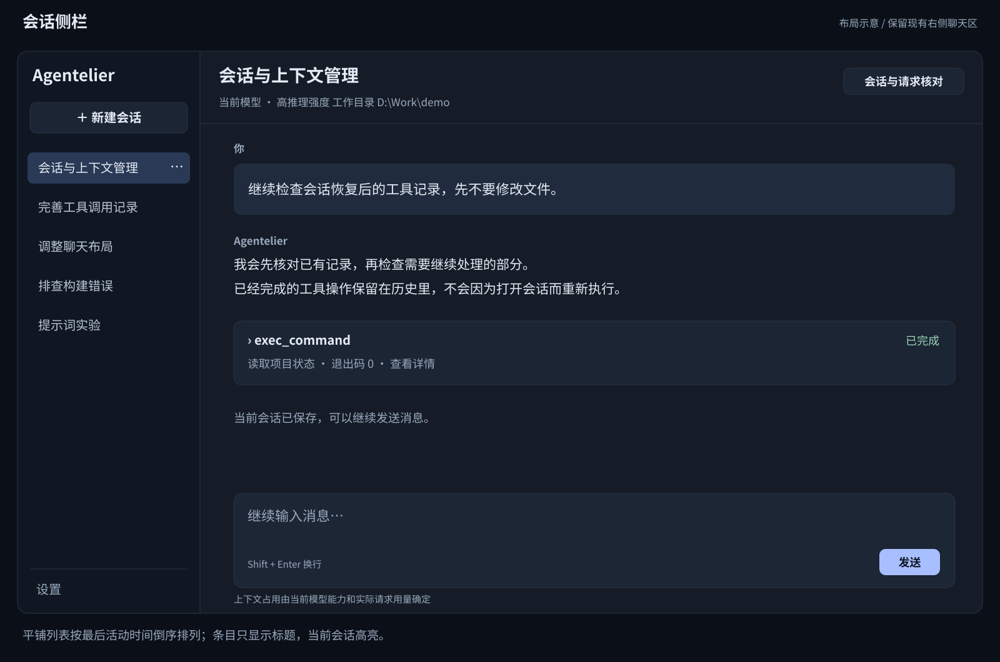
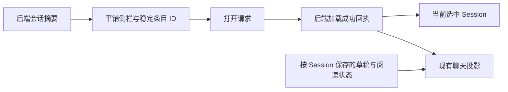

# 用平铺侧栏选择和切换会话

本增量在现有聊天区左边增加固定显示的会话列表，接入已经可用的创建、读取和恢复能力。侧栏负责选择，右侧继续负责聊天；不重写 Markdown、工具时间线和输入区。

布局与交互依据[会话界面](../../docs/design/session-context/04-session-interface.md)。条目更多操作中的重命名、删除由后续两个增量接入，本增量不提供未实现的空按钮。

## 列表没有第二套组织规则

侧栏顶部提供应用名称和新建会话，下面直接排列标题。列表按最后活动时间倒序，没有搜索、最近区、日期标题、项目副标题、项目筛选、账号分类、置顶或手动拖动排序。

新建以创建时间参与排序；接纳普通输入、Steer、Queue 和任务终态等业务活动更新后端活动时间。打开、滚动、展开卡片、重命名或内部压缩不改变排序。流式 token 不逐次重排；同时间使用稳定身份作次级顺序。

排序来源于后端摘要而非文件 mtime 或 UI 到达时间。选择始终绑定 Session ID，列表移动后仍选中同一会话。当前条目有选中底色，长标题在侧栏省略，完整名称可经现有提示能力查看；标题不是请求参数中的目标主键。

## 打开成功才替换右侧

新建复用现有准备区，创建失败保留当前内容和草稿；Reset 保留“沿用设置新建”的区别。点击历史先确认当前必要写入，再读取目标；加载中不先清空聊天，回执成功时同步选中状态、标题、设置摘要和时间线。

打开回执携带 Session 与操作身份。连续点击或迟到返回必须按当前请求关联，旧结果不能覆盖新选择，拒绝或错误反馈也不能释放另一个操作的占用。加载失败显示具体原因并保留原会话。

草稿、草稿修订、阅读位置和工具展开状态按 Session ID 在本次运行中分别保存。切换回原会话恢复自己的状态；新会话不会继承上一份未发送文字。未发送草稿跨重启持久化不在本阶段，已接纳输入则已经由业务存档负责。

## 多会话不扩展成并行执行

生成、工具执行、自动压缩及资源回收期间，新建、切换和删除等替换操作由执行侧拒绝，说明先等待或停止。点击另一会话不是隐式 Stop。当前会话阅读、Stop 和 Steer 不被一起禁用。

空闲切换时暂停并保存原会话待办。若 Queue 自动出队已经获得执行权，切换明确被拒绝；若切换先被接纳，旧队列暂停并不会在新会话打开后继续启动。Runtime 的串行决定是唯一事实，UI 不能自行抢占下一任务。

窄窗口中消息、输入和停止入口仍可用，长代码在原内容区域滚动。账号、模型和工作目录信息留在现有设置或当前会话摘要，不加入左侧分类。

## 复用 Widgetry 的身份与状态契约

使用有限高度的 ListView 或现有等价公开列表组合，并以稳定业务身份映射 Session。数据源、投影、选择与虚拟化物理行分离，事件读取实际绑定的条目身份；不能将旧行 Entity 或旧下标当成永久目标。

通过 BSN、Scene 和 SceneList 组合布局。Props 用于构造，持续状态保存在 Component/Resource；更新输入文字和选择通过 Widgetry 公开 API，不修改内部 Editor 或托管行状态。当前依赖组合没有某项方便接口时用公开组合完成，不复制或修改上游库。

空列表显示准备区，加载失败、存储失败和损坏会话有各自反馈。下方正文仍保留 phase、可展开工具详情、Queue 与原发送语义，侧栏更新不重建整个输入框。协议历史、图片字节和加密载荷不放入列表资源。

## 通过真实交互确认选择不串线

使用真实应用建立多份会话，检查排序和切换；让一份旧会话产生新活动，确认它移到顶部但选中身份不变。构造足够滚动的实际列表，滚动后点击复用行，确认打开正确 Session。

在两份会话分别输入不同草稿、调整阅读位置和工具展开状态，来回切换核对隔离。快速切换、加载错误和旧回执到达时，右侧不短暂显示另一会话的正文。

运行持续工具时点击另一会话，确认任务没有隐式取消或并行启动，Stop 仍可用；验证队列自动出队与切换竞争的真实身份。通过 BRP 实际 Pointer、焦点、键盘、滚动、截图和安全状态核对，不直接修改 ECS 冒充输入。特殊键按已有 KeyboardInput 路径处理，结束释放 Pointer 并确认 inactive。

同步界面、会话与整体依赖设计，执行适用的编译、格式和 Clippy 检查，不建设测试、Benchmark 或 Example。保护当前账号和数据目录。前置为[恢复历史](04-restore-session-history.md)；下一增量[重命名](06-rename-session.md)只扩展条目管理，不改变这里的排序和选择规则。
