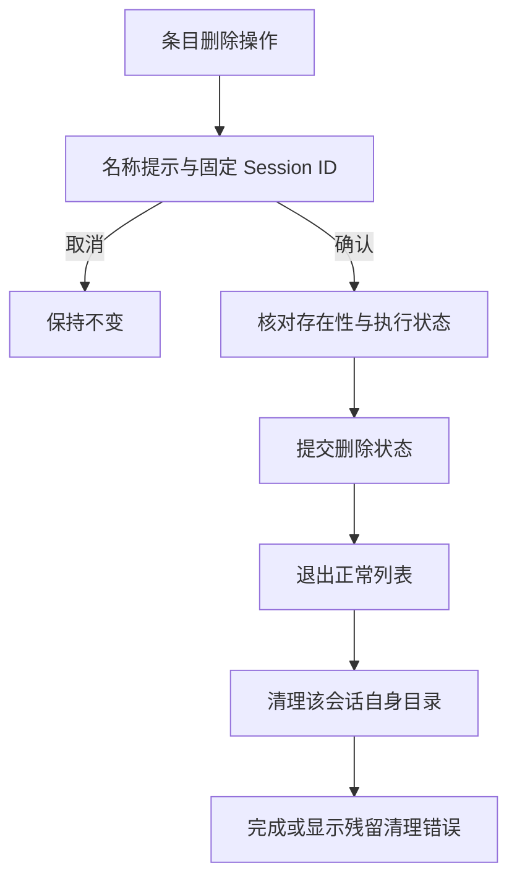

# 删除一份会话而不碰它操作过的项目

本增量提供本地会话删除。删除对象是会话记录、摘要和该会话拥有的附件，不是历史中出现的任何路径；apply_patch 已经修改的文件、命令创建的项目和账号凭据都保持原样。

## 确认固定目标，而不是固定一行

条目更多操作加入删除，确认交互显示目标名称，并说明不撤销项目文件修改。目标身份在弹出确认时就固定，列表排序或同名条目不能改变它。取消只关闭确认，不提前写入删除标记或移走文件。

正在生成、执行工具、自动压缩或回收资源的 Session 不能删除。执行侧重新核对状态，不能只依赖按钮变灰；需要等 Stop 真正完成或任务结束后再次处理。删除不隐式停止任务，不抢占队列已经开始的下一项。

删除当前打开会话后显示空白准备区，清理其本次运行中的草稿、阅读和展开状态，不自动发送消息。删除其他会话不改变当前右侧内容或草稿。已接纳但未开始的目标队列随会话删除，不再启动。

## 删除状态先于物理清理

权威日志先提交删除状态，摘要反映该状态，随后移出正常列表并清理文件。扫描发现删除记录时即使摘要落后，也不能把条目重新显示。通过同一存储根下受控的内部待删除目录名完成清理，可以避免半删目录被误认成正常会话。

内部待删除位置只用于完成一次已确认操作，不提供归档、回收站、恢复删除或保留历史版本界面。应用启动识别这类残留，继续或报告本次清理，不把它们加入普通会话列表。

物理删除只作用于已验证属于该 Session 的日志、摘要、附件、修复原件和临时文件。路径来自稳定身份和存储布局，不从标题、工作目录、工具参数或附件原始来源路径构造。遇到不属于本会话的路径、重解析目标或无法确认的文件归属时停止清理并报告，不递归跟随到外部目录。

同一会话附件可以去重，但没有跨会话全局共享，因此清理不需要删除其他会话的资源。auth.json、prompts.json、应用配置、运行日志和项目文件都不在删除范围。

## 失败反馈要与已发生的动作一致

删除状态尚未提交时失败，条目保持原样并报告错误。状态已提交而物理清理失败时，保持逻辑删除，显示存在未完成的本地清理；不能说数据已经全部消失，也不能重新开放这份会话继续写入。

删除、重命名、打开和任务接纳由执行侧按身份串行裁定。已删除目标的迟到打开或重命名回执不能重建条目；正在打开但尚未替换当前会话的删除竞争，同样以最终业务回执为准。Store 的写入者关闭并释放文件句柄以后才执行目录清理，不能边写边删除。

## 只用本次创建的会话验证破坏性操作

建立两份可丢弃会话，其中一份含图片和已完成的项目文件修改。删除它，确认日志、摘要和附件清理，另一份会话、原项目文件和账号状态不变。验证同名条目、长标题和列表重排不会改变确认目标。

分别取消确认、删除当前会话和删除非当前会话，检查右侧与草稿变化符合上述规则。运行持续工具时尝试删除，执行侧明确拒绝；Stop 与资源回收完成后才允许删除。

在真实存储清理边界注入一个文件删除失败，确认逻辑删除与实际残留反馈分开，重启不复活条目。验证待删除目录识别只作用于受控名称与真实身份，不扫描或清理整个应用数据根。

使用 BRP 实际点击、键盘和截图验证确认交互、取消和错误状态，并用安全 ECS 与文件事实核对结果；结束释放 Pointer。测试对象必须是本次验证专门创建的数据，不删除用户已有会话，不操作凭据或改变数据目录。

同步存储和界面设计中的删除生命周期。继续 Windows x64、现有公开 Widgetry API 和 Workspace 依赖约束，执行受影响的静态检查；不写测试代码、Benchmark、Example 或删除测试宿主。

前置为[重命名](06-rename-session.md)，两者在实施顺序上相邻并共享条目操作入口，删除不依赖名称改动才能成立。下一增量是[跨账号继续](08-cross-account-continuation.md)，不改变这里的删除范围。
