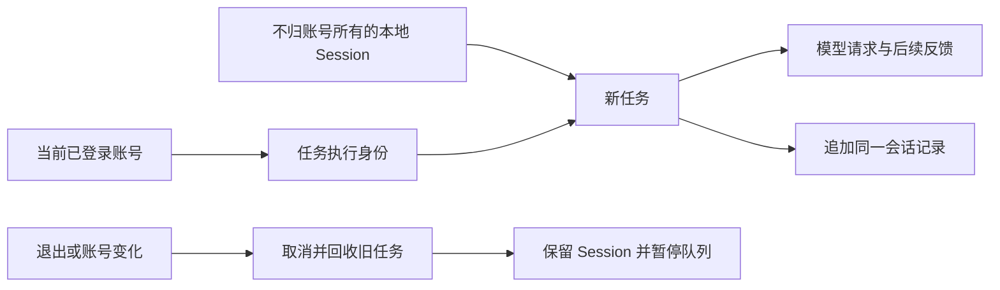

# 让同一份本地会话使用当前登录账号继续

本增量解除会话历史与创建账号之间的执行绑定。所有本地记录共用同一列表、同一 Session ID 和连续历史；新任务选择当前已登录账号，任务进行中仍保持固定执行身份。

## 解除三处会话归属检查

当前 Conversation.synchronize_account 会在主体不同后丢弃内存会话；UI 的发送资格也比较 Session 账号；模型生成请求再次比较持久设置中的主体。三处都需要改为本次任务身份，不能只让侧栏显示全部条目。

持久设置继续包含模型、推理选项、指令快照、工作目录和工具契约，不保存作为权限门槛的创建账号。读取、列表、选择、重命名和删除都是本地会话操作，不能因为未登录而看不到已有记录。

开始新任务时捕获当前可用账号主体和认证代次，并沿本次普通模型请求、工具反馈后的请求及后续 Remote V2 使用同一执行身份。记录可以保留必要的安全执行标识，但不保存 Token，也不据此过滤列表。账号正常续期保留同一主体，凭据恢复不能把一轮重试切换到别的主体。

## 退出只结束执行资格

退出或切换账号沿用现有认证门控、取消和回收，先让旧任务结束、工具资源收敛、最后记录提交，再允许新账号执行。旧账号的迟到模型结果和控制回执只匹配旧任务，不写进新任务状态。

账号变化不清除时间线、工作上下文、压缩检查点、会话标题或存档。待办保留且暂停，不因新账号登录成功就继续消耗其额度。用户明确继续队列时，每条新任务开始才取得当前执行身份，不能沿用旧队列预留的认证资格。

普通关闭应用不等于退出账号，仍按原凭据保存流程处理。新会话与 Reset 仍产生新身份；跨账号继续不强制新分支或复制存档，也不生成另一份“迁移后会话”。

## 设置保持原义，能力随当前账号核对

新账号重新获取自己的模型目录。恢复会话的模型、推理设置、完整指令和工作目录保持原快照；当前账号看不到该模型或不支持原设置时显示真实原因，不自动选择别的模型或将会话归属拦截伪装为服务权限错误。

后续上下文预算增量会使用当前模型能力刷新窗口数据；旧能力快照只供回看。加密 reasoning 和 compaction 按原协议保存、发送，不在客户端解析或删改。当前服务拒绝旧不透明项时保留记录并报告，不能通过丢弃历史“修复”成功，也不重新引入账号隔离。

这一增量不增加多账号池、自动轮换、额度耗尽自动切号、多个同时登录身份或凭据导入器。用户仍通过原账号界面主动完成账号操作。

## 验证跨账号行为需要明确授权

先使用当前账号完成普通任务、停止、队列暂停与本地历史操作，确认去除归属字段没有削弱单任务身份校验和正常 Token 续期。审查真实数据中没有凭据被写入会话文件或反射状态。

跨账号运行验证由用户明确授权或亲自执行切换：账号 A 完成一段含工具结果的会话，正常退出并登录 B，确认列表相同、Session ID 相同、原始指令和工具结果仍在；发送后续消息，核对新请求使用 B，历史没有重复执行。切回 A 后仍是同一份连续记录。

同时检查退出时已有任务会正确收尾、队列暂停，B 登录后不会自动执行 A 的待办。当前模型在 B 不可用时保留可读记录和明确错误，不静默换模型。此处的实际账号操作不得通过编辑 auth.json、复制 Token 或更换数据根替代。

没有授权时完成代码路径、静态检查和同账号真实运行，明确记录跨账号运行范围未执行，不能把客户端不再拦截等同于服务已经接受旧载荷。后续 Remote V2 接入后还需在最终完成条件中覆盖压缩后换账号续接。

UI 涉及登录状态变化后的会话保留和发送资格，使用 BRP 观察真实交互、截图与安全投影，结束释放 Pointer。不编写测试代码、Benchmark、Example 或模拟认证服务，继续原 Windows x64、Workspace 和公开 API 约束。

同步认证协作、会话、请求和 UI 中已经改变的生命周期说明。前置顺序为[删除会话](07-delete-session.md)，并不依赖删除算法；本增量实际建立在存档、恢复和侧栏之上。下一增量[上下文预算](09-context-budget.md)把当前账号模型能力贯通到窗口判断。
