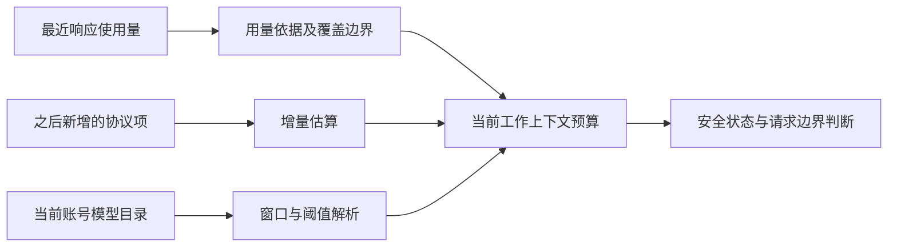

# 让模型窗口和当前上下文占用可计算

本增量建立自动压缩所需的预算事实：当前模型的容量、当前工作窗口占用、自动阈值及它们的来源。它先让正确的数值贯穿模型层、会话和安全展示，不在这里替换历史，也不提供手动压缩。

## 从现有目录增加真实能力字段

当前 ModelInfo 尚未传递上下文窗口、有效比例和自动阈值。扩展模型目录解析、Bridge 和会话执行设置，保持原 slug、推理与图片能力语义。字段使用真实服务返回及 Codex 对应的解释，不凭模型名称、营销最大容量或旧缓存推导当前窗口。

窗口优先取 context_window，缺失时再取可解释的 max_context_window。有效比例使用模型给出的 effective_context_window_percent，缺省沿用 Codex 的 95%；自动阈值为明确 auto_compact_token_limit 与完整窗口 90% 中较小值，未给明确阈值时计算 90%。有阈值但无窗口只能判断阈值，不显示总容量或剩余百分比。

只有实际输入为 500,000 且使用默认规则，结果才是有效窗口 475,000、自动阈值 450,000。不要给全部模型、账号或新会话写死 500K。非法数值、缺失和互相矛盾的能力保持错误或未知，不用零代表无限容量。

若当前链路没有提供窗口也没有阈值，历史浏览仍可用，发送前明确缺少能力数据；先核对真实目录与 Codex 的数据来源，不擅自换地址、登录方式或硬编码一个猜测值。能力快照可以持久回看，但新任务以当前账号的同一模型目录为依据。

## 区分窗口占用与会话累计用量

保存响应中可取得的输入、输出及其他相关使用量字段，并记录它们属于哪个请求和哪个工作窗口。累计费用或全部历次 usage 的求和不能作为当前窗口占用，否则多轮对话会被重复计数。

参考 Codex 的最近服务端用量锚点与其后新增项估算。请求完成后更新锚点及实际覆盖位置，追加用户输入、工具结果或其他项时只估计尚未覆盖的部分。失败请求提供的真实使用量不能因失败而清零；没有依据也不能沿用不匹配的旧数值。

范围包括固定指令、工具声明、用户与助手消息、调用结果、图片和必要的不透明协议内容。缓存命中的输入仍占窗口。Base64、JSON 和密文长度不是模型 token 数，不能直接当作精确值；无法精确计算的部分标为估算并保留来源，不在 UI 表现成服务端实测。

## 计量状态随工作窗口而不是随文件大小

当前完整历史尚未压缩时可作为初始工作窗口。后续安装检查点或恢复不同窗口时必须重建或重新校准锚点，不能恢复一个指向旧内存数组的下标。持久化保存能解释的窗口身份和使用量依据，运行内索引根据实际重放结果重建。

工具定义和指令只按实际请求出现次数计量，不把固定指令重复累计进历史。待办尚未开始不计入请求；Steer 只有应用时才进入工作上下文。最新待发送输入需要纳入下一请求的容量判断，不能只监测上一轮结束时的值。

保留独立的 32 MiB 请求字节上限、16 MiB 当前窗口图片预算及单图、工具结果边界。完整存档在磁盘上的大小不等于当前请求大小；容量充足也不能绕过网络序列化限制。过大的单个新输入不应被默默截断。

## 状态展示不扩展成配置面板

安全投影提供当前窗口、有效上限、自动阈值、占用依据与估算标记。未知容量显示未知而非虚构进度条；通过现有状态区或会话核对区展示，不增加统计看板、手动阈值调节页或压缩按钮。

这一步提供可供 Runner 使用的判断结果；下一协议增量和自动调度增量才消费它。UI 不能自行发网络请求，也不能用显示字符串重新计算控制条件。

## 用真实请求核对计量

读取当前账号真实模型目录，检查原始能力与安全投影的字段对应。完成至少两轮含工具结果的任务，核对每次响应的 usage、覆盖边界和新增估算，没有把历次完整输入累加成当前占用。

在真实应用解析边界注入缺失、非法或不同窗口值，检查未知与错误状态；数值注入只验证客户端规则，不声称服务实际返回这些能力。核对条件式 500K 示例及显式较小阈值的结果，不改现有账号或模型权限。

重启恢复后检查计量依据能够对应当前历史，而不是沿用旧数组位置。图片和大工具结果分别触及字节、图片及 token 判断，确认三者没有混为一个限额。GUI 展示通过 BRP 截图和安全状态核对，结束释放 Pointer。

同步模型请求、会话上下文和 Bridge 的已实现数据契约。继续 Windows x64、现有依赖与认证保护，执行受影响静态检查，不编写测试代码、Benchmark、Example 或模拟服务。

前置为[跨账号继续](08-cross-account-continuation.md)；下一增量[Remote V2 协议](10-remote-v2-protocol.md)使用这里的模型能力和窗口身份，但不会改变预算来源。
