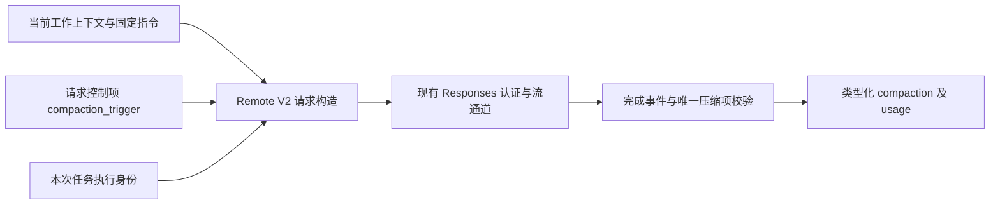

# 接入 Remote Compaction V2 的模型协议

本增量让模型层能够使用当前认证和 Responses 链路完成一次 Remote V2 往返，并交付经过校验的类型化压缩结果。它不安装新的历史，也不提供手动压缩入口；何时触发、怎样持久化并安装结果由下一增量完成。

## 与普通生成共享通道，分开结果语义

扩展 LLM Model 的请求与返回类型，明确普通生成和压缩的目的。两者共用 CredentialClient、任务身份校验、实际 Responses 地址、HTTP/SSE 和错误分类，不另读认证文件，不使用第二份 Token 缓存。

按 Codex Remote V2 的实际结构，在压缩输入末尾加入 compaction_trigger 控制项，携带当前固定指令、工作历史、适用工具声明及服务实际要求的协议元数据。控制项不是普通消息，不写入可重放历史，不需要手工压缩提示词。

不能将公开 `/responses/compact` 入口或“请总结历史”的普通生成视为等价实现，也不自动切换到另一订阅后端地址。当前链路返回不支持时，交付真实错误并保留会话材料，后续不得用本地摘要绕过本阶段选择。

## 只有合法的唯一压缩结果才能交付

流解析必须观察到 response.completed，并取得恰好一个可用 compaction 输出项。输出项身份、内容完整性和完成对象按现有流解析的权威边界校验；缺失、重复、畸形或完成前断流都返回协议错误。

压缩结果保存不透明载荷原义、response ID、实际使用量和返回的兼容信息。不能把 encrypted_content 解密、润色、重编码成一段“摘要文本”，也不能向 UI 发布它的原文。

压缩响应和普通助手回复分开处理。普通可重放 reasoning 的要求不能错误地套在压缩结果上；反过来，一个普通 message 也不能冒充 compaction 成功。压缩响应里的工具调用不能进入 Tools 分发器，这条请求没有执行工具副作用的资格。

后续持久化能够通过受控协议表示编码和解码压缩项，安全摘要只说明它的存在、窗口身份和必要计量。图片与密文仍不进入反射状态和日志。

## 网络和取消沿现有边界

压缩使用本次任务捕获的当前账号，不能根据恢复记录中的旧账号取凭据。认证恢复仍限定同一主体，401 只在允许的输出前边界恢复，429 继续按既有策略返回，不因为上游有另一套重试参数就增加无界重试。

保留当前连接期限、流空闲期限、单事件、响应总量和完整请求字节限制。压缩输入也经过有界序列化，不能因为它不是普通回复就跳过 32 MiB 校验。存在图片时使用实际类型化载荷，不将 data URL 当成普通摘要文字处理。

Stop 可以取消压缩网络等待，凭据所有者已经开始的更新独立完成。返回失败时只交付错误和已经取得的诊断，不修改现有 ProtocolHistory，不删除调用结果，不自动重发普通请求。

## 在真实应用链路验证协议

使用当前已授权账号、真实模型和已经封闭的会话历史，在真实应用的受控调试边界临时将一次模型请求路由到 Remote V2 入口。观察真实请求类型、合法完成事件、唯一 compaction、使用量和后续可编码载荷；验证后移除临时路由改动，不保留产品按钮、命令或专门测试宿主。

这个验证只确认协议链路，不能把它记录成自动调度已经完成。实际服务不支持时记录原始安全错误分类与请求标识，不用模拟响应制造成功，也不修改用户认证设置。

在真实流解析边界对本次响应进行受控故障注入，覆盖缺失或重复压缩项、提前断流和非法结构，确认都不交付可安装结果。调试注入证据与真实服务结果分开记录；不得创建脚本化模型服务或持久测试程序。

取消等待时确认任务控制可达、网络和进度通道正常收尾；检查日志仅包含安全身份、阶段、字节数和错误，不输出压缩密文、Base64 或认证头。现有普通生成、完整 reasoning 续接和工具图片结果没有因新增解析分支而改变。

实现只扩展模型协议及对应 Bridge 的安全返回；不在 Runtime 填充 HTTP 逻辑，不在 UI 组合请求。继续 Windows x64、Workspace 和原依赖限制，执行受影响的格式、编译与 Clippy；不编写测试、Benchmark 或 Example，也不未经授权切换账号。

同步模型请求和协议数据的已实现契约。前置为[上下文预算](09-context-budget.md)；下一增量[自动压缩与检查点](11-automatic-context-compaction.md)把本增量结果纳入任务历史和重启恢复。
