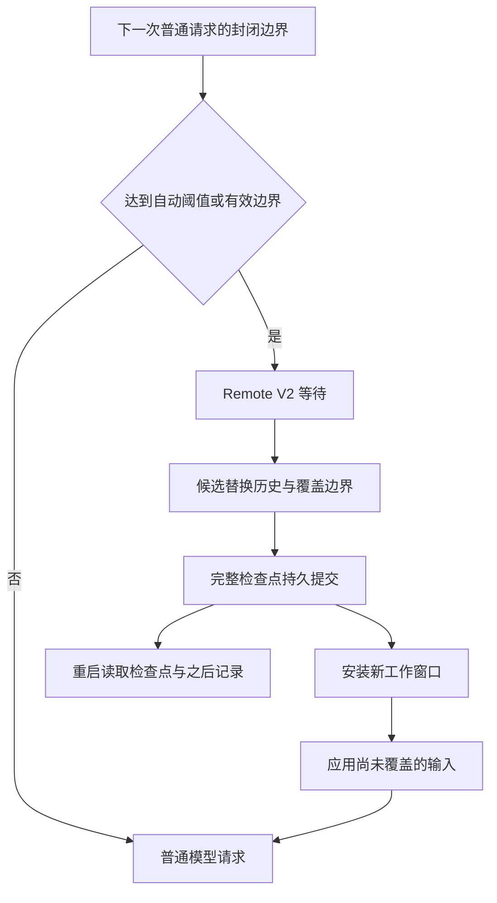

# 自动压缩当前窗口并保存可恢复的检查点

本增量把窗口预算、Remote V2 和持久历史接成完整行为：下一次普通请求需要空间时自动压缩，检查点提交后切换工作窗口，重启后直接恢复该窗口。完整本地时间线保持不变，没有手动压缩或摘要备用路线。

## 自动检查仍属于原活动任务

Runner 在每次普通请求前判断：既包括新一轮用户输入，也包括同一任务工具批次封闭后的下一次请求。未封闭的 call/result 批次不能被压缩切断，工具执行中不替换历史。

采用总工作上下文口径，使用前置增量提供的真实模型窗口、阈值和计量依据。达到条件后进入“正在自动压缩上下文”阶段，仍占用同一个任务与控制身份。此阶段不新建独立聊天 Turn，不并行运行另一会话，也不启动投机式后台压缩。

当前最新输入在接纳后已经有持久身份。它是否进入本次压缩输入必须有明确覆盖记录；未覆盖的输入留在边界之后，成功后进入下一普通请求。不能因重试或恢复丢掉它，也不能在检查点和后续消息中重复携带。

## 保留消息和密文按同一协议装配

Remote V2 合法返回后，按 Codex 的保留项选择、原顺序和 64,000 token 保留预算构造候选历史，包含返回的 compaction 项与本项目适用的保留用户消息等材料。只适配当前存在的消息、固定指令、工具和图片，不引入 Hook、子 Agent、音频或其他扩展体系。

固定 InstructionSnapshot 每次在请求前部注入一次，不改成当前提示词库版本，也不在替换历史中重复累积。旧助手和工具详细记录仍在存档中，不能把它们全部再拼到新检查点前面。压缩请求用的 compaction_trigger 不成为历史项。

压缩后的图片保留遵循协议和活跃窗口预算。磁盘保留全部已经存档的附件，模型请求只加载当前窗口需要的部分；16 MiB 活跃图片和 32 MiB 请求字节边界独立检查。压缩不会触发附件删除，也不会修改原工具结果。

## 检查点提交后才能安装

检查点包含候选替换历史、覆盖到的会话记录位置、窗口身份或序号、模型与响应身份、实际返回的兼容信息及使用量依据。读取未知的 comp_hash 等字段不能自行生成假值。

安装时核对目标 Session、活动任务、原工作上下文代次和真实覆盖范围。压缩等待期间只新增队列事件，不等于协议工作历史被同样覆盖；接纳但尚未应用的 Steer 保留在待应用区。不能仅比较日志最后序号就覆盖它们。

先将完整检查点交给单写入者并取得确认，再切换内存上下文与计量锚点。写入失败保留旧窗口和真实失败状态。成功提交后进程退出，即使 UI 尚未显示完成，重启也能从最近完整检查点重建；只有开始记录而没有完整结果时，恢复此前窗口。

取消与持久提交竞争时，提交前保留旧窗口；提交后先完成内存状态收敛，再交付停止终态，不能把已经写入新检查点的会话按旧窗口归还并继续运行。无法恢复一致的活动记录时阻止发送，重新从存档加载。验证要覆盖这两个取消时刻，而不只检查普通成功路径。

恢复采用最新有效 replacement history 与窗口号，再按顺序读取之后的有效协议记录。使用量锚点随新窗口校准，旧内存下标不直接恢复；完整时间线则继续读取压缩前后的公开记录，两种读取不能混在一起。

## Stop、Steer 和 Queue 仍然可预测

压缩等待期间 Stop 走原独立控制路径；已接纳 Steer 通过可靠回执显示等待应用，不冒充模型已经读到。压缩结束后、下一普通请求前应用未覆盖的补充输入，顺序和身份保持原样。停止导致来不及应用时保留为未生效。

失败、取消或预算触限使当前任务非正常结束并暂停 Queue。原任务完成、工具资源回收及记录归还之后才允许下一条启动，压缩不能越过这条顺序。队列容量和草稿清理回执继续沿现有规则。

Remote V2 计入每任务 32 次模型请求预算，不刷新 64 次工具调用额度。拒绝、重复无效结果、压缩后仍容纳不了请求或单个新输入过大时，保留材料并结束本次任务，不能无限自动压缩。现有 401、429、大小与空闲期限边界不因接入压缩而放开。

失败不切到普通文本总结，不出现手动压缩按钮，也不自动换账号或模型。跨账号共用 Session 保持成立；服务不接受旧不透明项时返回实际错误，不删除存档或重新建立账号隔离。

## 让用户看见阶段，而不是操作一套压缩系统

右侧现有状态区显示自动压缩和可用的停止操作，完成后返回普通任务过程。上下文占用显示当前窗口依据，压缩前历史仍能滚动查看；侧栏不新增压缩分组、统计页、手动入口或排序变更。

压缩阶段同样阻止新建、切换或删除正在执行的会话。阅读和补充输入仍沿已有行为。终态在真实任务回收、记录确认与最后快照交付后发布，不能先显示完成再丢最后一段回复。

## 验证自动往返与完整续接

在真实应用中通过受控调试配置临时降低自动阈值，使用正常消息与工具结果触发自动压缩；触发来源必须仍是预算判断，不是手动压缩按钮。验证后撤回调试阈值，按实际模型目录运行。

检查真实 V2 请求、唯一合法结果、检查点提交、窗口替换和下一次普通请求。后者包含正确压缩项与保留消息，不重复旧全部历史、固定指令或最新用户输入。压缩前的文字、工具结果和图片记录仍可回看。

在等待压缩时 Stop 和 Steer，在工具批次封闭后触发压缩，在检查点提交前后中断并重启，分别核对旧窗口、完整新窗口及未覆盖输入。故障注入只作用于真实应用本次边界，不创建模拟服务或测试宿主。存储失败、网络失败、协议错误和无法缩小的请求都不形成无限循环或摘要 fallback。

本增量的完成条件同时收口整条功能链：建立至少两份会话，按活动排序切换，保留各自本次运行内草稿和阅读状态；重命名不改排序，删除只影响目标会话；正常关闭和强制中断后恢复 typed 历史而不重跑旧工具；压缩后重启继续使用检查点而不恢复成超长原窗口。

获得用户明确授权或由用户亲自切换账号后，验证压缩前和压缩后的同一 Session 都能由另一账号继续，并观察实际模型请求及服务结果。无授权或服务不接受时保留真实未完成范围，不用只读文件可见性冒充跨账号执行成功。

GUI 通过 BRP 实际输入、滚动、截图和安全 ECS 核对，特别观察压缩结束与新回复之间的中间状态、工具卡片和输入焦点；结束释放 Pointer 并确认 inactive。特殊逻辑键与固定 Render 端口按现有已知问题处理。使用 Windows x64、PowerShell 7 和当前锁定依赖，完成受影响静态检查，不编写测试、Benchmark 或 Example，不操作用户凭据制造场景。

同步总体架构以及会话、模型请求、数据目录和聊天界面的实际新契约。前置为[Remote V2 协议](10-remote-v2-protocol.md)；这份方案以自动压缩和检查点的真实功能交付结束，不另设只有检查工作的尾部验收阶段。
