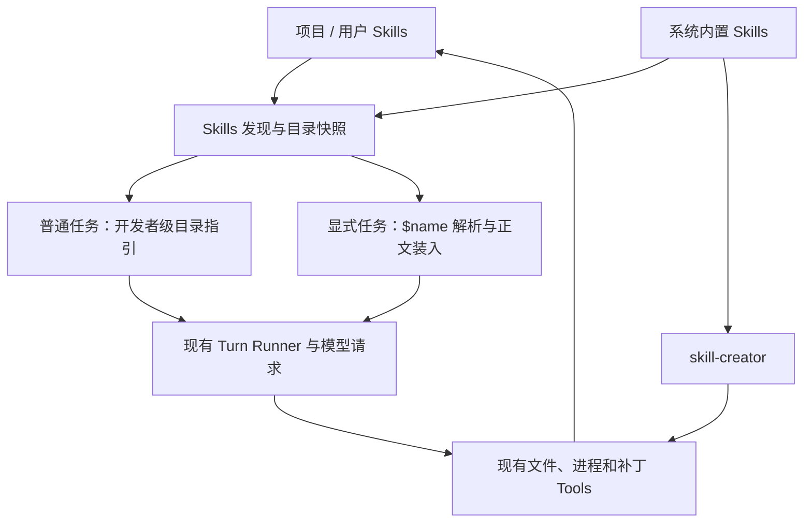

# Skills 系统的整体设计与实施关系

Skills 在现有 Agent 执行体系之外增加一条**可复用工作流的材料来源**，不增加第二套任务运行器。磁盘上的 Skill 目录先变成可用目录；普通任务允许模型按描述自行读取，显式 `$name` 则提前确定要使用的正文。最后将官方 `skill-creator` 作为内置 Skill 纳入同一发现链，让模型通过既有工具创建、更新其他 Skills。

发现阶段只处理标准文件和有界元数据。自动使用阶段把目录信息交给模型，模型有理由时才通过原有工具读取 `SKILL.md` 及必要资料；显式阶段把唯一选中的正文作为本任务单独的 user 内容送入请求。两者最终都依靠正常工具结果与协议历史完成任务，不拥有特殊执行权限。

核心职责保持单向：Skills 材料由 Agent 业务层管理，任务调度及读取时机由 Turn Runner 决定；Conversation 负责活动记录、工作历史和请求事实，LLM Model 负责组装和冻结请求，Tools 负责实际操作，Session Store 负责持久确认。固定 Prompt、动态 `AGENTS.md` 与 Skill 目录是三种独立来源；不把 Skill 变成新的 Prompt 版本或项目规则文件。

这条实施链刻意把“可发现”“自然匹配”“显式选择”“生成新技能”分开，因为它们各自有独立的可观察结果。目录快照是后续两种选择的共同基础；显式使用需要的任务级材料保存也属于显式调用自身。创建 Skill 依赖系统已经能发现并使用内置 Skill，但并不需要专门的编辑界面。

所有增量只面向 Windows x64 与 PowerShell 7。验证使用现有真实应用、请求核对、静态检查和必要的 BRP 输入与状态检查，不增加测试代码、Benchmark、Example 或模拟服务。第三方技能的脚本依赖不自动赋予新工具、MCP 或权限；用户文件和系统内置文件由不同所有者管理。现有登录凭据、会话收尾及外部参考库均不因接入 Skills 被改写。

## 唯一实施顺序

1. [把本地 Skills 整理成可查询的目录快照](01-discover-skills-catalog.md)
2. [让普通任务根据目录按需读取并使用 Skill](02-implicit-skill-use.md)
3. [让 `$name` 在本任务显式选择并固定 Skill](03-explicit-skill-invocation.md)
4. [通过内置 `skill-creator` 创建和更新 Skills](04-skill-creator-self-authoring.md)

## 实施状态

四个增量均已实现：01 本地发现（`5a96790`）、02 普通任务按需使用（`b5d2abc`）、03 显式任务快照（`46cda49`）及 04 内置创建器。当前行为与边界以 [Skills 设计](../../docs/design/skills/README.md) 和实际源码为准。
