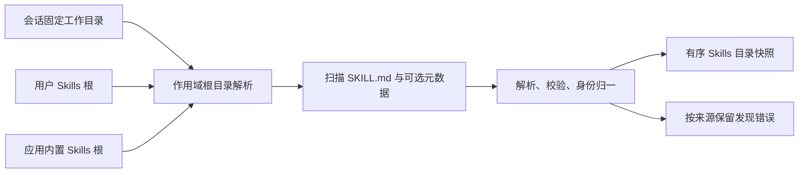

# 把本地 Skills 整理成可查询的目录快照

这一增量让应用能够从实际文件系统取得一份**有来源、有作用域、可核对的 Skills 目录**。交付结果是后续任务可复用的业务目录能力，而不是一个尚不能使用的空 Crate：运行中的 Agent 可以根据会话工作目录请求目录快照，并明确看到有效项目技能、用户技能、内置技能，以及相应的加载错误。模型匹配与显式调用分别由后续增量接入。

设计依据：[Skills 的材料、来源与发现边界](../../docs/design/skills/README.md#从工作流文件到可发现能力)。

## 为什么发现要独立于 Prompt 和项目规则

`prompts` 保存创建会话时固定的完整 Developer 指令版本；`project_context` 在逻辑模型请求边界采集适用的 `AGENTS.md` 规则链。Skills 虽然也以 Markdown 存储，但其业务对象不是一条总要发送的指令，而是一个可能被任务选中的目录包。

因此 Skills 需要有独立的 Agent 业务所有者，负责解析、身份和文件读取，避免在 Prompt 库中保存 Skill 副本，也避免借 `AGENTS.md` 采集逻辑递归扫描整个项目。按工程职责原则可使用独立的 `agent/skills` Crate；是否落到新 Crate 取决于最终依赖边界，但业务接口必须与 UI、网络、Bridge 和 Runtime 解耦。

目录快照只存放后续路由所需的身份、名称、描述、来源、作用域、有效性、可选显示信息和策略。不在扫描时执行 `scripts/`，不提前读入全部 `SKILL.md` 正文，不将所有 references 或 assets 载入模型上下文。

## 标准文件与 Codex 扩展的边界

一个 Skill 的入口为 `SKILL.md`，使用 YAML frontmatter 表达 `name` 和 `description`，正文作为之后按需加载的工作流。允许目录中不存在 `scripts/`、`references/`、`assets/`。保留相对引用路径，而不是编造成单独注册表。

与 Codex 兼容的 `agents/openai.yaml` 是可选扩展：可描述 `interface` 的展示信息、`policy.allow_implicit_invocation` 和工具依赖声明。一个合法 Skill 不因没有该文件而失效。附加元数据无效时保留可用的 `SKILL.md` 并产生可诊断的警告，不悄悄把坏元数据解释为自动拥有某种工具。`policy.allow_implicit_invocation=false` 表示不提供给自然语言自动匹配，但后续仍可显式选用。

字段解析与字符串清理遵循标准/Codex 的实际格式约束，至少能够拒绝缺失必要描述、无效 YAML、超出合理上限的文件和不正常的文件类型。单个 Skill 错误应隔离为该来源的发现失败；不会让其他健康技能全部消失。对于含有链接的路径，保留规范身份并在使用时重新核对可访问性，避免扫描路径和实际读取指向不同来源。

## 作用域、路径与目录合并

项目根边界沿用会话固定 `working_directory` 的项目识别原则。从项目边界到该目录，沿路径链收集各级 `.agents/skills/`；不扫描所有兄弟目录，也不因临时工具 `workdir` 跳转而更换可用技能集合。没有可用项目边界时，只使用当前会话目录的项目技能位置。

跨项目用户根使用当前应用数据目录下的 `skills/`，由 Runtime 从已采用的数据根显式传入；不扫描或回退 HOME 下的共享目录。内置技能放在应用维护的只读系统根中，和用户可写根分离。该目录随应用数据环境确定，与会话项目目录和只读内置根分开。Codex 的历史 `.codex/skills`、插件缓存和云端 Skill 属于兼容扩展，不能为了复制其配置体系而破坏本应用简单的来源模型。

不同路径产生的同名 Skill 均须保留可辨身份，不依据名称覆盖整个对象。扫描时保留确定性排序及来源信息；别名或符号链接指向同一主文件时按规范身份去重。目录应能解释一个技能为什么可用、为什么仅限显式调用，或者为什么被排除；重复名称由后续选择阶段处理，不能在目录合并时静默随机舍弃。

读取需要限制扫描深度、目录数量、文件大小及材料字节量，以可回收的文件工作方式运行，遵守用户停止和进程收尾。正常不存在的根目录表示空来源；目录不可访问、文档失效或路径类型错误应与普通空目录区分。错误不能误报为该 Skill 已载入。

## 目录快照的生命周期

本增量提供按会话环境生成目录快照的能力；任务启动时使用已固定的工作目录请求它，运行期间避免在不明确的时刻更换已选材料。下一任务重新检查根目录与变更，使后续新增、修改和删除的技能可以生效。对文件缓存、变更通知和后台扫描采用满足这一结果的最小机制，不预先移植 Codex 的远端文件系统观察器。

发现属于读取磁盘的业务行为，UI 只得到安全的名称、描述、来源、状态与诊断，不直接执行扫描或持有 Skill 本文。当前只需让运行侧能够取得并核对目录结果；不建立技能商店、专属编辑器或完整管理后台。

## 在真实应用中确认结果

在用户和项目的标准根分别放置一个最小合法 Skill，并在相邻目录增加同名、无效 frontmatter 和仅显式调用的变体。使用实际运行过程和必要调试信息观察目录快照：各来源身份、范围和策略必须正确；错误技能有明确来源和原因，健康技能仍存在；重复路径不生成重复对象，重复名称不随机覆盖。

随后删除、修改、新增文件并启动下一个任务，核对新目录会反映文件变动；将一次工具命令的工作目录切换到其他位置，确认不会影响会话固定的技能作用域。无规则项目、不存在的用户根和不可访问目录应分别表现为空目录或真实错误，而不是程序崩溃。

完成此能力所需的静态检查与实际应用检查即可，不创建 Unit Test、Integration Test、Regression Test、Benchmark 或 Example。若没有新增可观察 GUI 行为，不引入无意义的 GUI 改动或 BRP 验证。下一增量将把这一目录交给模型，完成自然任务的按需使用。
