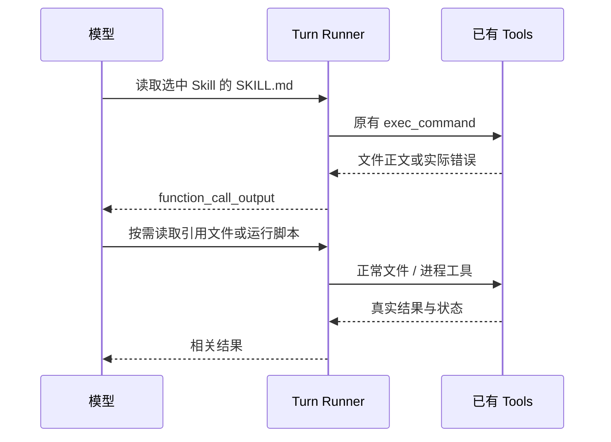

# 让普通任务根据目录按需读取并使用 Skill

用户不需要知道 Skill 名称，也不需要为普通请求手动选择工作流。这个增量使模型在自然语言任务中能看到本任务适用的 Skills 摘要，判断是否匹配，再通过已有本地工具读取 `SKILL.md` 和需要的资源，并完成实际任务。可验证的结果是**普通任务能按已发现的 Skill 工作，且不会因为发现了某个目录就自动执行其中的脚本**。

基础目录来自[本地发现增量](01-discover-skills-catalog.md)，请求与运行机制见[Skills 设计](../../docs/design/skills/README.md#模型如何真正使用-skill)。

## 从目录快照到模型可理解的选择信息

已经生成的 Skills 快照包含 `name`、`description`、来源和读取位置；本增量把其中允许隐式调用的有效条目整理为本次模型请求的目录说明。目录由宿主控制，作为独立的 `developer` 调度材料进入请求。它只告诉模型“有什么 Skill、什么任务适用、怎样读取”，不提前复制每份 Skill 正文。

正文与目录采用不同的上下文预算。目录的长度应有有界策略，必要时缩短展示而不捏造技能能力或悄悄丢弃某个错误状态；大篇幅步骤留在 Skill 正文和关联参考文件中。模型请求仍遵守现有 32 MiB 完整序列化上限和模型上下文规则。不能为了支持大量 Skill，把原有 Prompt 或原始协议历史直接截断。

当 `agents/openai.yaml` 声明 `allow_implicit_invocation=false` 时，该技能不进入自然匹配的模型目录，但仍存在于目录快照，留给下一增量的显式选用。有效技能的额外依赖只表示需要何种工具；当前执行环境没有 MCP 时，不在目录准备时自动连接 MCP、不为其伪造工具，更不把 `dependencies.tools` 变成一组直接可调用的 Responses function tool。

## 实际访问依靠已有 Tools

模型决定使用一个本地 Skill 后，按照目录中给出的正确位置，通过 PowerShell 7 命令读取入口文件。读到的工作流如果指向 `references/` 中某段说明，继续按相对路径读取；如果指向 `scripts/` 中的已有程序，仍由 `exec_command` 执行，运行结果是正常的 function_call_output。Skill 的静态文件、工具执行结果和模型最后输出是三个不同对象，不合并成“Skill 执行成功”的虚拟结果。

目录中的名字不是新的命令名；不是每个 Skill 都需要脚本。已经具备的 `apply_patch`、`view_image`、`exec_command` 和 `write_stdin` 可以按工作流使用，调用顺序、业务错误、权限与停止信号仍由 Turn Runner 和 Tools 的既有规则裁定。临时工具 workdir 不更改 Skill 的来源作用域，读取关联资料时以该 Skill 的真实目录解释其相对路径。

Codex 会在已访问的 `SKILL.md` 或 `scripts/` 命令上识别隐式调用，用于把“模型真的读取或运行过这个 Skill”与“目录里存在这个 Skill”区分开。这里可以保留轻量的来源关联与运行事实，但不能把命令识别当成安全审批，或仅凭模型最后一句话推断脚本执行成功。没有真正读取的 Skill 不应出现在“实际使用”的诊断事实中。

## 请求与会话边界保持原样

`InstructionSnapshot` 仍由 `prompts` 在创建会话时固定，继续生成原有 Developer 消息；`AGENTS.md` 仍由 `project_context` 按逻辑模型请求采集并发布为独立 user 项。可用 Skills 目录是新的宿主调度材料，不是第三种 Prompt 版本，也不写入已提交的用户/助手协议历史。下一任务的目录可重新发现；本次任务的模型—工具多次往返使用一致的发现来源，避免先前指向的路径与之后的目录身份无故不同。

现有 `llm_model` 只消费确定的目录文本并按 Responses 规则准备请求，不能自己扫描磁盘。目录由 Agent 的 Skills 职责产生，Turn Runner 在请求边界取得并传入；Conversation 和 Session Store 按已有请求准备事实和历史机制记录实际发送的上下文摘要、角色及顺序。任务中执行工具后重新请求模型时，仍可以获得本任务必要的目录指引，但每次请求只能有一份该调度材料，不能在 `ProtocolHistory` 中不断累积副本。

工具文件读取失败，应以真实的工具结果交还模型，由模型判断是否另选有效工作流或说明失败。因目录文件失效而导致的单个 Skill 不可用，不应改写已存在的 Prompt 快照、旧的请求记录或会话用户输入。任务取消、工具执行上限、序列化大小限制以及 Store 持久化失败仍按照原任务链处理，不开启独立 Skills 执行任务。

## 用真实任务确认自动使用

在项目目录放置一个清晰描述适用范围、正文带有可观察独特步骤的 Skill，并设置一个描述相似但标记仅显式调用的 Skill。启动实际应用，用不含 `$name` 的自然语言请求该任务。核对模型请求中的开发者级目录说明、随后真实发生的文件读取及模型按正文完成的操作；仅发现目录但没有读取正文，不能当作调用成功。

把任务改成与现有 Skill 无关的普通问答，确认不需要强行读取技能也可以直接回答。把正文中的必要资源分到 `references/`，检查模型只按需读取相应文件；加入可运行脚本时检查 PowerShell/进程执行事实，而不是只看模型的总结。让依赖不存在或脚本失败，核对反馈为实际失败，不自动安装程序或启动 MCP 服务。将某技能设为仅显式调用，确认普通任务目录不把它当成自动可用项。

真实操作和必要静态检查在此增量内完成，不编写测试、Benchmark、Example 或模拟服务。若本阶段只影响请求和后台执行，不改动 GUI，则使用实际模型请求和现有诊断核对即可。随后显式调用增量可以复用相同的 Skills 目录，而无需重建文件发现与执行体系。
