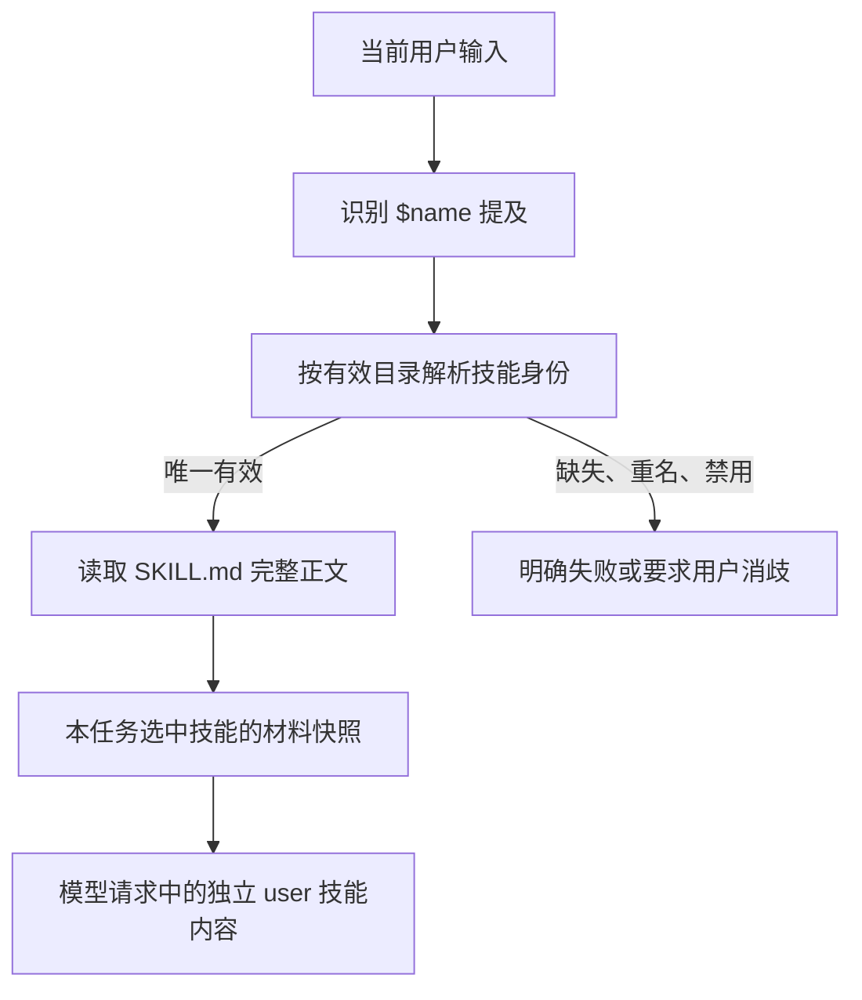
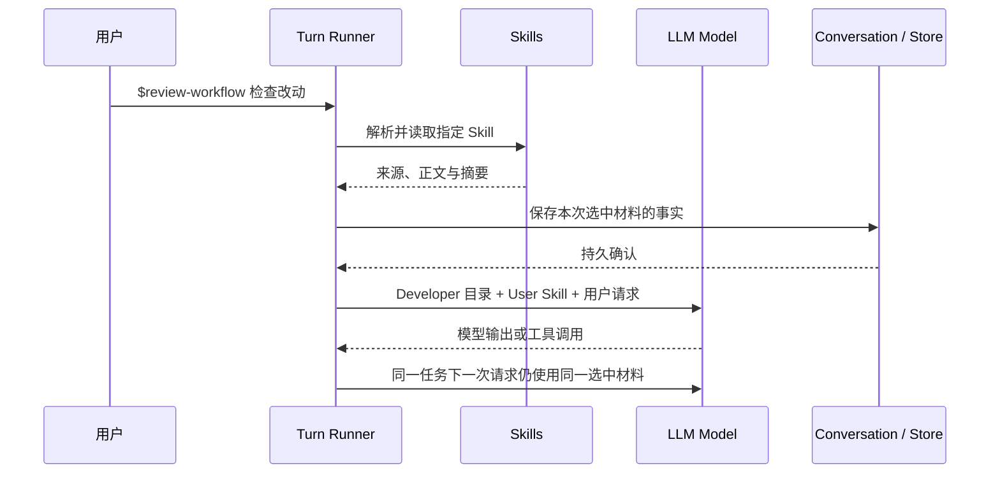

# 让 `$name` 在本任务显式选择并固定 Skill

这一增量允许用户在当前聊天输入中明确指定工作流，例如 `$review-workflow 检查改动`。与自然匹配不同，显式选择时运行侧必须在首个模型请求前解析唯一技能、读取完整入口文件，并让模型在这次任务的全部必要推理步骤中获得同一份工作流指令。**选择影响当前任务，不修改 Session 的固定 Prompt，也不使后续任务自动绑定这个 Skill。**

前置能力是[可用技能目录](01-discover-skills-catalog.md)和[普通任务的技能目录注入](02-implicit-skill-use.md)。完整设计见[Skills：显式选择与上下文](../../docs/design/skills/README.md#显式选择在请求前装入指定正文)。

## 选择必须对应一个真实来源

现有聊天输入是普通文本；不用为了引入 `$name` 建立另一套消息协议。当前增量只需在实际提交给任务运行器的用户文本中识别显式 `$skill-name`，用同一份目录快照解析到唯一、启用的技能身份。若用户一次指定多个不同技能，依其在输入中的顺序载入，同一来源只载入一次。

不可因相近名称或目录发现顺序，私自选择一个不同的技能。对于重名或别名，记录规范来源路径、发现时的路径与名称，使用唯一身份核对；如果文本名无法消歧，应明确提示，而不是让模型凭猜测替用户决定。用户没有选中技能时保持普通任务行为。仅显式调用的技能可以在这里被选用，但已经因来源或用户状态被禁用的技能不能绕过禁用。

读取时须核对标准入口文件，保留其完整 Markdown 工作流和源路径。主文件失效、编码不正确、内容过大或引用路径异常均形成具体错误，不注入残缺正文；相关错误不能篡改旧会话的历史内容或已固定的基础 Prompt。选中正文是从磁盘取得的任务材料，其信任级别不能因为“显式选中”就自动变成 System 或 Developer 指令。

## 选中的正文如何进入模型请求

Codex 将选中 Skill 的正文包装为独立 user 片段，并区别于开发者级的可用技能目录。应用沿用这一边界。固定基础与 supplements 仍按会话原有 `InstructionSnapshot` 输出 Developer 指令；项目 `AGENTS.md` 仍是独立的动态 user 项；选中 Skill 作为本次任务单独的 user 材料，与用户真实要求及原始 `ProtocolHistory` 明确区分。

选中技能属于 ActiveTurn 的运行上下文，不加入创建会话时固定的 `SessionSettings.instructions`。后续模型—工具往返继续使用该任务捕获的正文，且每个请求只放入一份 Skill 内容；不能因为每次准备新请求而把它追加成多个“用户再次选择”的历史项。任务完成后，下一次用户输入重新决定是否调用 Skill。

`llm_model` 仍是唯一的 Responses 请求构造与冻结入口。Skill 材料进入 prepare 前应已明确解析；发送使用已准备的相同字节。认证内部重发不重新读取文件，不因磁盘上 `SKILL.md` 的修改而改变同一请求。网络失败、用户停止和预算触限仍遵守既有任务终态与工具结果封闭语义，已经完成的工具副作用不会因为 Skill 选择而自动回滚或重跑。

为了之后能核对当时实际采用了什么工作流，Conversation/Session Store 保存本次选中的技能身份、来源、内容摘要、完整已用正文和在请求中的角色与顺序，并在请求准备事实中关联它。历史存档恢复不通过读取当前同路径来伪装当时的旧正文。诊断展示仅提供原有安全投影，不公开凭据、加密 reasoning 或不必要的完整工具结果；原始文本不写入普通日志。

## 与原有 UI、控制和项目上下文协作

聊天输入框继续承担文本录入，`$name` 可以直接输入，不要求技能浏览器、可视化编辑器或新的发送按钮。Bridge 只传递已确认输入及之后的安全运行投影；不用在 Bevy ECS 中解析 Markdown 文件或决定角色优先级。

Steer 在同一任务的安全边界追加用户要求，不能悄悄更换已经选中的技能；若明确提交新的技能选择需求，需要以能够保持任务历史一致性的正常任务边界处理。Queue 启动的是新任务，因此它对 `$name` 的解析发生在该条输入真正开始执行时，不继承前一任务选择。取消或任务失败仍保留已发生的工具结果及当前可重试资格，遵循原有 Conversation 规则。

工作目录中的 `AGENTS.md` 由原有项目采集器按每个逻辑请求刷新，Skill 选择不触发一次额外的项目规则扫描，更不能使 `AGENTS.md` 被看作 `SKILL.md`。两者的角色、来源和保存事实在同一请求核对中仍可区分。需要在现有核对视图增加技能字段时，复用业务 Bridge 的安全投影和 Widgetry 的公开接口，不引入独立的技能管理 UI。

## 使用场景与完成条件

先在可用目录放入一个不允许自动调用、但入口合法的 Skill。用户使用明确的 `$name` 发送任务，核对首次请求前选中身份已解析、完整正文以 user 角色出现、开发者级目录仍保持单独来源；即使 `allow_implicit_invocation=false`，显式选中也应成功。普通未带 `$` 的请求不被改造成显式调用。

再使用能产生实际工具往返的工作流，让模型分多次请求执行。核对每次请求引用同一选中正文，没有重复追加用户技能消息；修改磁盘上的 Skill 文件并触发当前任务下一次请求，确认旧任务仍保留已经确认的内容，而新任务可以取得更新版本。检查完成、停止、失败、工具结果封闭及存档重新打开后的来源、正文摘要和请求顺序一致。

构造两个不同路径但相同名称的 Skill，以及不存在、被禁用和无效正文的技能，确认明确报错且不随机选用其中一份。使用 Steer、Queue 和重试的实际操作，检查技能不会在任务之间无意继承，也不会跳过现有历史或副作用保护。

仅修改后台逻辑时以实际运行和协议核对验收；若现有核对 UI 有可观察变化，必须通过真实应用的 BRP 输入、截图与状态核对验证，结束后释放 Pointer。禁止新写测试、Benchmark、Example 或模拟服务，不能通过重置账号、数据目录或再次 OAuth 来完成场景。
