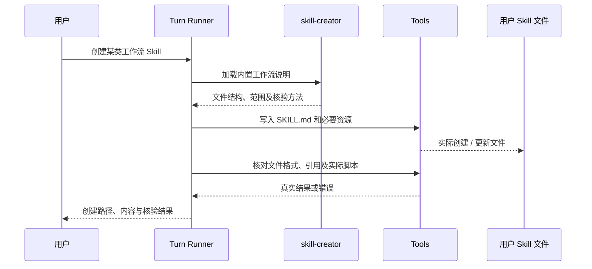

# 通过内置 `skill-creator` 创建和更新 Skills

这一增量把 Codex 已有的 `skill-creator` 当作普通内置 Skill 提供给模型。用户只需用自然语言描述想复用的任务流程，模型就能读取创建规范、使用现有文件工具生成合格的 Skill 目录，并在之后的任务中使用它。**交付的是 Skill 自举能力，不是技能商店、安装框架或编辑器。**

前序增量已支持[发现目录](01-discover-skills-catalog.md)、[普通任务使用](02-implicit-skill-use.md)和[显式选择](03-explicit-skill-invocation.md)；创建工作流本身沿用[Skills 设计中的自举机制](../../docs/design/skills/README.md#skill-creator-如何让系统自己扩充工作流)。

## 内置创建器仍是普通 Skill

Codex 的系统技能目录包含一个以 `SKILL.md` 为入口的 `skill-creator`。正文指导 Agent 确定实际任务、组织必要的工作流说明、选择参考文件或脚本、使用标准格式初始化并检查 Skill。该目录还包含初始化、生成 `agents/openai.yaml` 和验证用的辅助脚本及参考资料。它的调用方式与其他 Skill 一致，没有专有的后台“创建 Skill”执行协议。

因此当前目标不是重写创建器工作流，而是把 Codex 的样本完整地作为兼容的内置资源移入应用，使其入口及引用文件在用户选择时能够被正常找到。与前面计划一致，系统所有者只负责发现和读取；实际创建仍由 Turn Runner 发起的 `apply_patch`、`exec_command` 等工具完成。

## 系统资源与用户写入目标分开

参考 Codex 的系统技能安装思想，应用提供自己维护的只读内置技能根，可通过随应用携带的资源在启动或更新时供发现。内置 `skill-creator` 的更新不得覆盖用户自行创建或修改的同名技能，不要求用户已有 Codex 配置，也不写入 `.codex` 的内部缓存。

用户生成的新技能写入项目 `.agents/skills/` 或当前应用数据目录下的 `skills/`；任务目录给出实际用户技能根，不使用 HOME。目标位置应由当前任务和用户要求决定，不能因执行了 `skill-creator` 就擅自写入某个无关工程。项目级 Skill 只影响相应工作目录的发现范围；跨项目需要使用时才选择用户级目录。目录如果已经存在，则按明确的“更新既有 Skill”要求处理，不默认删除或覆盖整个目录。

内置资源沿用上游的入口、引用关系和必要许可材料，并根据本应用运行环境修正路径和不适用的操作假设。不得把 Codex 的插件配置、TUI、网络提供者、权限升级或云端安装器作为启用创建器的前置依赖。普通 Skill 在只有 `SKILL.md` 的情况下也必须可以成功创建，不强制生成空 `scripts`、`references` 和 `assets`。

## 创建流程与验证含义

模型依据用户描述决定这个 Skill 要解决哪类可重复任务，编写明确的名称、描述和 Markdown 工作流；只有重复性计算、需要权威资料或模板时才增加实际有用的脚本、参考或资源文件。`name`、`description` 必须符合标准要求，说明何时应被匹配；支持 `agents/openai.yaml` 的可选展示和策略字段，不随意删除已存在的策略、工具依赖或用户资源。

对已经存在的 Skill，更新只修改用户要求涉及的工作流和必要关联文件。保持本来的用途、命名与仍有效的资源关系；未经明确要求，不把一个特定任务里的临时解决办法升级成适用于所有项目的强制规则。生成后的完整目录应能独立被普通 Skills 发现功能重新解析。

“验证成功”指具体文件内容通过解析、相对引用存在、所需脚本在实际环境中能运行并给出预期结果；不能仅根据模型声称“格式正确”来当作通过。文件格式验证属于创建 Skill 的工作功能，不是为应用编写 Unit Test、Integration Test 或 Example。没有脚本的纯文档 Skill 只需要验证其文件与工作流结构，不制造额外的演示程序。Codex 初始化器提供的可选示例占位内容不能据此变成应用仓库的 Example 程序。

## 与 Windows 工具环境的适配

当前执行平台固定为 Windows x64，命令调用使用 PowerShell 7。Codex 的 `skill-creator` 辅助脚本使用 Python，部分验证脚本依赖 PyYAML；本应用不以 Python 已安装为前提。

因此技能说明必须在执行前探测相应解释器与依赖；环境具备时可以按原脚本流程初始化和验证，不具备时应使用已有 `apply_patch`、PowerShell 文件读写与符合规范的结构核对完成同一目标。缺少某个脚本依赖时不得谎称脚本已运行、自动安装未经批准的软件或因为工具不足就改写用户的登录状态。此处适配的只是 Skill 内容与脚本运行环境，不引入新的 Python Runtime Crate、包管理器或脚本自动执行后台。

生成脚本应放入用户 Skill 自己的 `scripts/` 并明确其实际用途；执行脚本是普通工具调用，需要遵守进程、工作目录、输入输出、停止和回收约束。模板、资料以及二进制 Asset 不应不加区分地作为模型指令加载。

## 生成后什么时候可用

本次任务获得成功写入和校验结果，并不意味着正在执行的模型请求会自动替换自己的 Skills 目录。新建或更新的文件在下一任务重新发现后成为可选能力；若当前任务还要使用新内容，必须明确读取该文件并由正常工具和上下文流程处理。

创建器不能让模型把 `skill-creator` 本身永久绑定为会话 Prompt。后续普通任务仍由描述匹配决定是否读取新 Skill，明确 `$name` 则沿显式选择规则加载；同名多来源继续按原来的消歧要求处理。错误或部分写入应报告实际保留下来的文件，不把未通过校验的目录宣称为已经安装成功。

## 实际应用中的完成条件

在实际应用里明确调用内置 `$skill-creator`，要求创建一个只有 `SKILL.md` 的小型工作流。核对目录位于用户指定的可写根、文件 frontmatter 和正文正确、没有无关占位目录；启动下一任务，通过自然语言或 `$name` 调用新 Skill，观察真实读取与执行链路。这是自举闭环的关键验收，不仅是检查写出了文件。

再创建一个确实需要 `references/` 的 Skill，核对入口能找到参考文件；对已有 Skill 做一次局部更新，确认旧目录中未要求改动的资源、策略和有效指令没有被破坏。构造重名、写入权限不足、路径错误及缺少 Python/PyYAML 的情况，核对实际错误和替代执行路径；能执行 Python 辅助脚本时，再检查其真实输出，不以环境不存在为由伪造成功。

如有实际脚本被加入用户 Skill，按它的业务操作在当前环境中直接运行核验；不新增应用测试框架、Benchmark、Example 或模拟服务。除非创建流程改变了应用可观察 UI，否则不需要增加 GUI 控件；若新增了 UI 展示字段，按工程规则以真实 BRP 输入和安全状态核对。不得修改 `bevy_widgetry`、`bevy_brp` 的上游源码，也不得为验证而退出登录、切换账号或清理数据目录。

此增量闭合后，整套 Skills 已经可以被发现、按需使用、明确选择并由模型自身创建或维护。实现引入新的模块职责或请求契约时，同步更新当前架构与相关模块设计文档；在实现完成前，待实现机制仍保留在本设计与方案中，不提前写成已有行为。
