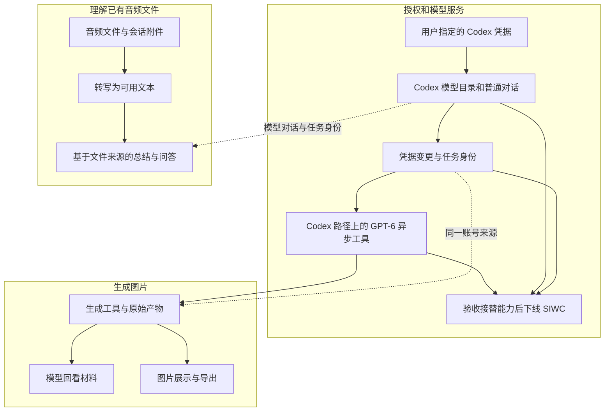

# 订阅认证与媒体能力的整体实施关系

Agentelier 先将模型服务从 SIWC 迁移到 Codex OAuth，再接入 GPT Image 2 图片生成和已有音频文件理解。认证迁移沿用现有 Account、LLM Model、Turn Runner、Conversation、Session Store 与 Bevy UI 的职责边界。Codex 外部凭据选择已经落地，SIWC 在过渡期继续承载原有模型请求。Codex 接替目录、普通对话、凭据生命周期、原生异步工具和会话恢复后，单独下线 SIWC，使用户指定的 Codex `auth.json` 成为唯一登录来源。

下线 SIWC 依赖 Codex 接替现有执行能力。图片生成依赖已接入的 Codex 服务和工具执行链。音频附件独立保存，文稿问答复用模型对话与身份边界。图片原件、音频文件和文稿都服从已有 Session Store 的单写入者与提交确认原则。

所有实施目标面向 Windows x64 / DX12，保持既有 Agent/Bridge/UI 依赖方向、用户账号主动控制、跨 Turn 工具调用身份和存档恢复。验证采用编译与静态检查、真实应用运行及受影响 GUI 的 BRP 操作。项目约束禁止新增 Unit Test、Integration Test、Benchmark 或 Example。麦克风、实时语音、语音输出、Computer Use、浏览器控制、图片编辑及 GIF 留在本方案范围之外。

## 依次实施

- 01 [选择并读取现有 Codex OAuth 凭据](01-codex-credential-source.md)（已实现）
- 02 [使用 Codex OAuth 完成模型目录和普通对话](02-codex-model-routing.md)
- 03 [处理外部凭据更新与跨账号执行边界](03-external-credential-lifecycle.md)
- 04 [让已有原生异步工具在 Codex 模型路由上工作](04-codex-native-async.md)
- 04a [下线 SIWC 并收束到 Codex OAuth](04a-retire-siwc.md)
- 05 [通过 Function Tool 生成并持久保存 GPT Image 2 图片](05-image-generation-tool.md)
- 06 [让模型读取生成图片并保持历史关联](06-generated-image-model-feedback.md)
- 07 [在聊天中查看、恢复和导出生成图片](07-generated-image-ui.md)
- 08 [将已有音频文件作为不可变会话附件](08-audio-attachment.md)
- 09 [把音频文件转写成有来源的文稿](09-audio-transcription.md)
- 10 [围绕音频文稿开展多轮理解与问答](10-audio-analysis.md)

下线排在图片生成之前，便于先完成认证迁移。图片工具依赖 Codex 授权和工具链的实际可用性。音频转写引擎仍需在可用授权与本地模型选项之间确定。
