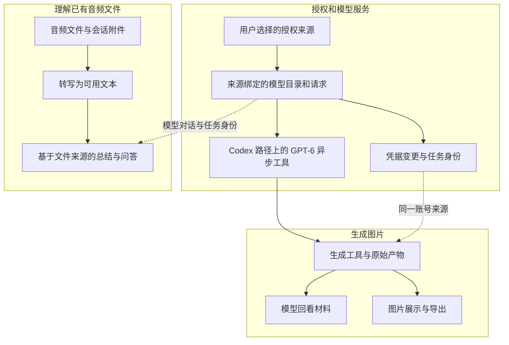

# 订阅认证与媒体能力的整体实施关系

这组方案不重建 Agentelier 的工具执行器或 GPT-6 原生异步机制，而是在现有 Account、LLM Model、Turn Runner、Conversation、Session Store 与 Bevy UI 边界上增加三组可交付行为：可选择的 Codex OAuth 授权来源、GPT Image 2 图片生成、已有音频文件理解。

上图中的实线表示真实的能力依赖，虚线表示共享当前模型与账号约束。音频附件的选择与保存不依赖图片生成；将它排在图片之后只是统一的实施顺序，不代表二者必须互相调用。图片原件、音频文件和文稿都服从已有 Session Store 的单写入者与提交确认原则。

所有实施目标面向 Windows x64 / DX12，保持既有 Agent/Bridge/UI 依赖方向、现有 SIWC 行为、用户账号主动控制、跨 Turn 工具调用身份和存档恢复。验证采用编译/静态检查、真实应用运行及受影响 GUI 的 BRP 操作，不新增 Unit Test、Integration Test、Benchmark 或 Example。方案内不包含麦克风、实时语音、语音输出、Computer Use、浏览器控制、图片编辑及 GIF。

## 依次实施

1. [选择并读取现有 Codex OAuth 凭据](01-codex-credential-source.md)
2. [使用 Codex OAuth 完成模型目录和普通对话](02-codex-model-routing.md)
3. [处理外部凭据更新与跨账号执行边界](03-external-credential-lifecycle.md)
4. [让已有原生异步工具在 Codex 模型路由上工作](04-codex-native-async.md)
5. [通过 Function Tool 生成并持久保存 GPT Image 2 图片](05-image-generation-tool.md)
6. [让模型读取生成图片并保持历史关联](06-generated-image-model-feedback.md)
7. [在聊天中查看、恢复和导出生成图片](07-generated-image-ui.md)
8. [将已有音频文件作为不可变会话附件](08-audio-attachment.md)
9. [把音频文件转写成有来源的文稿](09-audio-transcription.md)
10. [围绕音频文稿开展多轮理解与问答](10-audio-analysis.md)

顺序兼顾中间可交付性。第 9 项的处理引擎仍需在实际可用授权与本地模型选项之间确定；不能因为前面完成了 Codex OAuth 路由就假定音频服务已经获授权。
