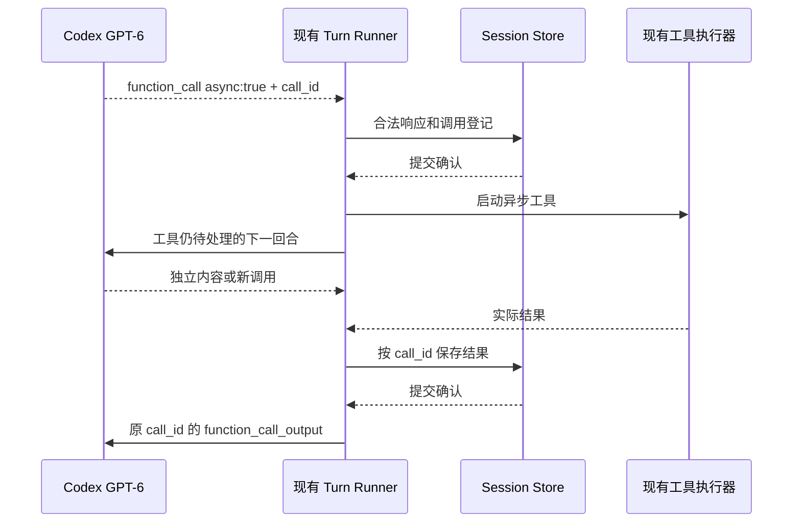

# 让已有原生异步工具在 Codex 模型路由上工作

## 这一增量完成什么

让 Codex OAuth 模型路径可以使用当前已经存在的 GPT-6 原生异步工具系统，重点覆盖实验验证过的 `gpt-6-astra`：服务返回 `async: true` 的调用后，Agentelier 可在工具结果未完成时继续下一回合，再按原始 `call_id` 送回结果。**不重新实现任务账本、任务查询、取消或跨 Turn 历史**。

## 复用现有协议，不误用另一条路由

当前 SIWC 已通过 `additional_tools` 在 `gpt-6.2-sol` 路径定义异步 Function Tool。Codex OAuth 的有效实验是在 Codex Responses 服务的 WebSocket 上进行的，因此路由适配必须以实际模型、传输和连续请求语义为准。不能简单把 SIWC HTTP 的所有封装字段改个主机名，也不能把“并行工具调用”冒充原生异步。

一次完整的协议循环如下：

协议要保留响应中真实的异步标志、工具身份、完整参数、来源 Turn 与序号；新的 Codex 适配仍通过已有执行器注册的冻结工具目录校验调用。工具派发不能提前到完整响应合法且保存成功之前。只有已声明异步并获得实际 `async:true` 的调用才解除同步等待；同一调用不能重复启动或重复交付。

同一任务内已有 Steer/Queue、后台结果保存、调用取消和 Context Compaction 的安全边界继续适用。跨会话、跨账号及断开来源时，旧的 WebSocket 续接不能成为执行另一个账号工具的入口。

## 验收

在真实应用内使用已支持的异步工具触发一项耗时操作，观察服务发出 `async:true`、持久任务登记、工具未完成时的独立回复，以及结果用原 `call_id` 被下一回合正确消费。另观察既有 SIWC 同步和原生异步会话不回退；取消时工具与任务状态按已有语义收敛。使用日志、会话事件和模型响应判断，不增加专门测试程序；相关界面更新使用 BRP。

## 与前后方案的关系

依赖已可正常运行并保持身份的 Codex 模型请求。这项完成后，图片生成作为一个普通可注册 Function Tool 接入，而不是另造第二套并发执行机制。
