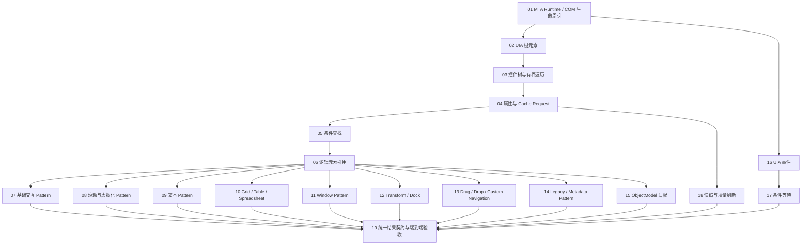

# UI Automation 实施方案总览

UI Automation 的实施从稳定的 COM 执行环境开始，逐步建立窗口元素、控件树、属性、查找和逻辑引用，再接入各类 Control Pattern、事件、条件等待与快照更新。每个方案在本增量内同步完成对应 Rhai API，不把 API 注册、功能实现和验收拆成互不相关的任务。

图中依赖表示后续能力需要的基础，不表示所有 Pattern 之间存在运行时调用关系。所有 Pattern 方案都依赖逻辑元素引用；事件、等待和快照共享同一个 MTA Runtime。

## 唯一实施顺序

1. [建立会话级 UIA MTA Runtime 与 COM 生命周期](01-uia-mta-runtime.md)
2. [接入窗口与桌面 UIA 根元素](02-uia-root-elements.md)
3. [实现三种视图的控件树遍历与有界继续读取](03-control-tree-traversal.md)
4. [读取元素属性并使用 UIA Cache Request](04-element-properties-and-cache-request.md)
5. [实现多条件元素查找](05-element-search.md)
6. [实现跨调用逻辑元素引用与失效恢复](06-element-references.md)
7. [接入基础交互 Control Pattern](07-basic-control-patterns.md)
8. [接入滚动与虚拟化 Control Pattern](08-scroll-and-virtualization-patterns.md)
9. [接入文本与 TextRange Pattern](09-text-patterns.md)
10. [接入 Grid、Table 与 Spreadsheet Pattern](10-grid-table-spreadsheet-patterns.md)
11. [接入 Window Pattern](11-window-pattern.md)
12. [接入 Transform 与 Dock Pattern](12-transform-and-dock-patterns.md)
13. [接入 Drag、DropTarget、CustomNavigation 与 SynchronizedInput](13-drag-drop-navigation-patterns.md)
14. [接入 LegacyIAccessible 与元数据 Pattern](14-legacy-and-metadata-patterns.md)
15. [补充 ObjectModel Pattern 适配](15-object-model-pattern.md)
16. [实现 UIA 事件订阅与回收](16-uia-event-subscriptions.md)
17. [实现事件驱动的 UIA 条件等待](17-uia-condition-waiting.md)
18. [实现控件树快照、失效与增量刷新](18-tree-snapshot-incremental-refresh.md)
19. [统一模型可见结果并完成 Notepad / File Explorer 验收](19-result-contract-and-application-acceptance.md)

各方案按一个独立功能增量组织，包含该增量的设计、Rhai API、错误行为和验收条件。Notepad、File Explorer 和 Accessibility Insights 的整体验收纳入第 19 方案；各 Pattern 的应用支持情况仍在对应方案中记录。

所有方案遵守 Agentelier 当前规则：Windows x64、只修改当前需求涉及的模块、不编写 Unit Test / Integration Test / Regression Test / Benchmark / Example，直接运行真实应用验证。UIA 与 Computer Use 共用现有 `ToolAdmission::Exclusive`，不引入 Codex 式沙箱、Guardian、权限审批或安全审查体系。
