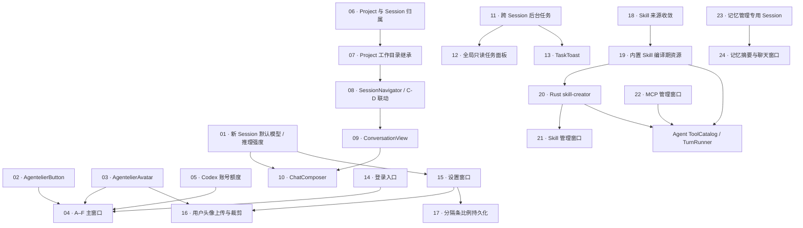

# Agentelier UI 改造的整体设计与实施关系

设计依据：[主窗口与交互体系](../../docs/design/ui/README.md)、[视觉体系](../../docs/design/ui/visual-system.md)、[控件体系](../../docs/design/ui/components.md)。

这组改造把主窗口视为一套跨 UI、Bridge 和 Agent 的工作流，而不是单独替换聊天页面。UI 负责主窗口 A–F、Project / Session 导航、消息展示和管理窗口；Agent 继续持有 Session、任务、账号额度、Skill、MCP 和记忆事实；Bridge 与 Agent Host 负责安全投影、命令关联和运行期唤醒。

## 整体关系

### Session 工作流

Project 只组织 Session 并为新 Session 提供默认工作目录。Session 创建后保存自己的工作目录快照。C 选择 Session，D 展示该 Session 的聊天；E 始终观察全部 Session 的任务。切换 C 不停止其他 Session 的后台工作。

### 任务工作流

Conversation 和 Runtime 保持任务身份、执行、进程、保存与交付事实。Runtime 将后台资源按 Session 保留并汇总全局状态；Bridge 投影安全字段；E 只读展示，TaskToast 只在成功、失败或需要用户操作时通知。

### 管理能力

账号额度属于 Account；Skill、MCP 和 Memory 分别由其 Agent 模块拥有。管理窗口只是这些业务能力的 UI 入口。内置 `skill-creator` 的资源从编译期嵌入读取，确定性文件操作由 Rust 实现。记忆管理使用当前进程唯一的专用 Session，不占用 C 区普通聊天。

### 项目级控件

`AgentelierButton` 与 `AgentelierAvatar` 是跨页面基础控件。ConversationView、ChatComposer、SessionNavigator、GlobalTaskPanel、TaskToast 和 LoginContextMenu 是 Agentelier 的组合控件。底层复用 `bevy_widgetry` 公开能力，不修改上游。

## 唯一实施顺序

1. [新Session默认模型与推理强度](01-新Session默认模型与推理强度.md)
2. [AgentelierButton基础控件](02-AgentelierButton基础控件.md)
3. [AgentelierAvatar基础头像控件](03-AgentelierAvatar基础头像控件.md)
4. [A至F主窗口与可调整布局](04-A至F主窗口与可调整布局.md)
5. [Codex账号额度状态与标题栏投影](05-Codex账号额度状态与标题栏投影.md)
6. [Project目录与Session归属持久化](06-Project目录与Session归属持久化.md)
7. [Project默认工作目录继承](07-Project默认工作目录继承.md)
8. [SessionNavigator与C-D切换](08-SessionNavigator与C-D切换.md)
9. [ConversationView消息展示](09-ConversationView消息展示.md)
10. [ChatComposer输入与模型选择](10-ChatComposer输入与模型选择.md)
11. [Agent跨Session后台任务生命周期与投影](11-Agent跨Session后台任务生命周期与投影.md)
12. [GlobalTaskPanel只读全局任务面板](12-GlobalTaskPanel只读全局任务面板.md)
13. [TaskToast终态通知](13-TaskToast终态通知.md)
14. [登录入口与手动授权窗口](14-登录入口与手动授权窗口.md)
15. [设置窗口与全局配置](15-设置窗口与全局配置.md)
16. [用户头像上传与圆形裁剪设置](16-用户头像上传与圆形裁剪设置.md)
17. [分隔条比例持久化与设置联动](17-分隔条比例持久化与设置联动.md)
18. [移除ProjectSkill并收敛Skill来源](18-移除ProjectSkill并收敛Skill来源.md)
19. [内置skillCreator编译期资源读取](19-内置skillCreator编译期资源读取.md)
20. [Rust原生skillCreator操作](20-Rust原生skillCreator操作.md)
21. [Skill管理窗口](21-Skill管理窗口.md)
22. [MCP管理窗口](22-MCP管理窗口.md)
23. [记忆管理专用Session生命周期](23-记忆管理专用Session生命周期.md)
24. [记忆摘要与专用聊天窗口](24-记忆摘要与专用聊天窗口.md)

各项按唯一顺序实施，但序号相邻不表示它们一定存在代码依赖。真正的设计关系以本页关系图和各方案正文为准。

## 贯穿所有增量的工程约束

- 依赖方向保持 `ui → agent / bridge`、`bridge → agent`；禁止 Agent 反向依赖 UI、Bevy 或 Bridge。
- UI 结构统一使用 BSN、Scene 和 SceneList；运行期状态由持久 Component / Resource 持有。
- 项目级控件优先复用 `bevy_widgetry` 公开 Button、Headless、Window、Splitter、Tree、ListView、FileDialog、Theme、Ui Scale 等能力。
- 不修改 Bevy、Widgetry 或 BRP 上游，不访问 Widgetry 私有内部状态。
- Agent 继续拥有 Session、任务、账号、Skill、MCP 和 Memory 事实；UI 不建立第二份权威状态。
- 目标环境沿用 Windows x64、DX12、PowerShell 7。
- 本项目不编写 Unit Test、Integration Test、Regression Test、Benchmark 或 Example。编译和静态检查之外，GUI 变化使用真实应用与 BRP 针对性验证；BRP 无法模拟的原生窗口行为在实际 Windows 窗口观察。
- 未经用户明确授权，不通过开发验收主动登出、重新授权、切换账号或破坏现有数据目录。
- 本阶段不包含 System Tray、Splash 和 Agent 自主 UI 操控。
