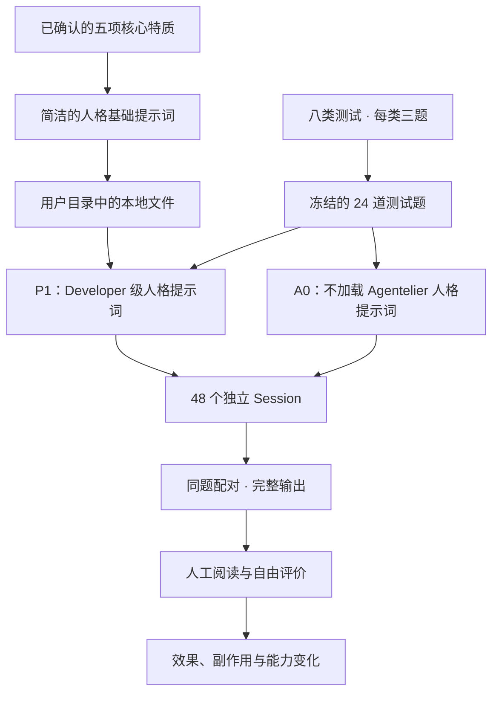

# GPT 人格基础提示词与实验设计总览

Agentelier 的人格设计以已经确定的五项核心特质为基础：全能、天才、客观、温柔、善良。目标是让助手在长期个人使用中稳定体现这些特质，同时保留模型原本的知识、推理、创造和任务执行能力。

这项工作分成三个可分别交付的部分：先把已经讨论的人格定义转化为简洁的 Developer 级基础提示词，并保存在用户目录；再独立准备并冻结 24 道测试题；最后用 A0 与 P1 对同一组题目进行配对实验，收集完整回答供人工比较。人格提示词不进入 Git，具体兴趣、幽默感、好奇心等个性表现也不预先写成强制要求，留给自然交流与后续长期记忆逐渐积累。

A0 与 P1 是本次实验唯一的对照条件。A0 不加载本次新增的人格提示词，但仍保留模型服务本身及应用正常运行所需的基础指令；P1 在相同基础条件上额外加载本地人格提示词，并以 Developer 消息发送。两组固定使用 `gpt-6.2-sol`，推理强度为 `high`，并保持工具权限和用户输入一致。

测试固定为八类内容，每类三题，共 24 道题。每题在 A0 和 P1 下各运行一次，因此共 48 个独立 Session。不再区分长短题，不做重复运行。每题使用独立 Session，避免其他测试题的对话历史影响结果。

三个方案按以下顺序执行：

1. [01 · 整理并保存人格基础提示词](01-整理并保存人格基础提示词.md)
2. [02 · 准备并冻结 24 道人格测试题](02-准备并冻结24道人格测试题.md)
3. [03 · 执行 A0/P1 配对实验并整理结果](03-执行配对实验并整理结果.md)

前两个方案分别产出实验所需的人格提示词和测试题，彼此没有技术依赖；第三个方案需要两者都已冻结。执行顺序统一采用上述顺序，避免在看到正式实验结果后再修改测试题或提示词。

冻结的 24 道题、运行记录、A0/P1 配对阅读材料和结果汇总统一保存在仓库根目录下的 `experiments/persona-v1/`。人格提示词文件及其完整内容保存在本地用户数据目录，由 Git 忽略。
