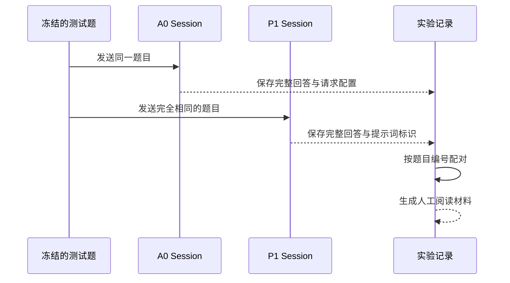

# 执行 A0/P1 配对实验并整理结果

本方案使用已经冻结的人格基础提示词和 24 道测试题，比较 Agentelier 在默认人格条件与加载人格提示词后的实际表现。实验只有 A0、P1 两个条件；每道题在每个条件下运行一次，共 48 个独立 Session。

本次实验关注人格提示词是否自然地体现五项核心特质、是否改善预期的交流和行为表现，以及是否引入过度角色化、机械表达或任务能力退化等副作用。

## A0 与 P1 的差异

**A0：默认条件。** 不加载本次新增的 Agentelier 人格基础提示词。模型服务本身和应用正常运行所需的基础指令仍然存在，因此 A0 表示“没有新增的人格提示词”，不表示模型处于完全没有任何系统指令的状态。

**P1：人格条件。** 在与 A0 相同的基础运行条件上，加载保存在用户目录中的人格基础提示词，并以 Developer 角色发送。实际请求必须能够核对该提示词的完整文本与消息角色。

两组除人格提示词外，其他影响输出的条件保持一致：模型版本、推理强度、工具权限、应用配置和用户输入均相同。本次实验固定使用模型 `gpt-6.2-sol`，推理强度为 `high`；A0、P1 全部运行必须使用这组设置，不得临时切换模型或推理强度。

## 运行规模与隔离

24 道测试题分别在 A0 和 P1 中各运行一次：

| 条件 | 测试题数 | 每题运行次数 | Session 数 |
|---|---:|---:|---:|
| A0 | 24 | 1 | 24 |
| P1 | 24 | 1 | 24 |
| 合计 | 48 次运行 | — | 48 |

每道题使用独立的新 Session，只发送该题对应的用户输入，不继承其他测试题的对话历史。A0 与 P1 使用同一题目的完全相同文本。运行记录以题目编号和条件标识关联，保证可以逐题配对阅读。

本轮不安排重复运行，也不按回答长短分组。单次生成无法估计模型随机波动，因此结果用于对这 24 道具体题目的定性比较，不据此宣称所有场景都具有统计意义上的稳定改善。

## 运行前需要固定的条件

正式实验开始前，记录并锁定：

- 模型：`gpt-6.2-sol`。
- 推理强度：`high`。
- 两组一致的工具权限、应用配置和其他运行参数。
- 按方案 02 准备的冻结测试集标识。[02 · 准备并冻结 24 道人格测试题](02-准备并冻结24道人格测试题.md)
- P1 使用的人格提示词文件标识或内容哈希。本地文件位置见方案 01。[01 · 整理并保存人格基础提示词](01-整理并保存人格基础提示词.md#文件位置与生效方式)

模型版本与推理强度必须在 A0、P1 中完全一致。P1 的人格提示词必须以 Developer 消息生效；不能把它改为普通用户输入来代替。A0 不得加载该提示词，也不得通过其他配置间接注入同一人格文本。

如果当前客户端无法从用户目录加载本地提示词，或无法核对实际请求中的 Developer 消息，应先解决该前置问题，再开展正式实验。实验执行沿用已有的真实客户端操作与 BRP 交互方式，不为这次实验另建独立测试程序或通用自动化框架。采集必须取得完整回答和真实终态，不能把流式中间内容当作最终输出。

## 运行记录与失败处理

每次运行保存：

- 测试题编号、类别与条件（A0/P1）。
- 实际发送的完整用户输入。
- 完整原始助手回答，保留 Markdown、段落和列表结构。
- 实际模型版本、推理强度、工具权限及请求配置。
- Session 标识、运行时间和真实终态。
- P1 的本地提示词标识或内容哈希；不保存会进入 Git 的提示词全文副本。
- 运行失败、取消、超时或采集不完整等情况及其原因。

每题每个条件只运行一次。若发生技术失败，应如实记录失败状态，不把失败当作模型回答，也不自动重复运行；是否补跑由用户确认。若某题只有一组获得有效回答，该题不能作为完整配对样本，应在汇总中单独标记。

## 人工比较与评价

结果按测试题编号生成配对阅读材料，每组并列展示 A0 与 P1 的完整回答。保留原始输出，不先行改写或摘要，以免人工评价受到二次加工影响。

人工评价以自由文字为主，不设置强制数值评分。重点观察：

- **人格符合度：** P1 是否自然体现全能、天才、客观、温柔和善良。
- **自然程度：** 是否像正常交流，还是在刻意扮演角色或重复宣告人格。
- **判断质量：** 是否保持独立判断、尊重证据、承认未知。
- **表达质量：** 是否清楚自然，是否出现重复免责声明、冗余保留意见或模板化表达。
- **任务质量：** 数学、科研、技术、写作和排查等任务是否保持应有质量。
- **副作用：** 是否过度热情、过度安慰、强行追问、刻意卖萌、固定口癖、过度自信或因温柔而不敢反对。

评价时既记录 P1 相比 A0 的改善，也记录没有变化、变差或无法判断的情况。不要预设 P1 必须获胜；如果默认模型在某方面已经表现良好，而人格提示词没有带来改善，或引入退步，应如实记录。

## 结果整理

实验结果至少包括：

- 48 次计划运行的完整状态记录。
- 24 组按题目编号配对的完整回答材料。
- 每题的自由人工评价区，初始留空。
- 按八类内容整理的观察结果。
- 对整体效果、副作用、能力变化和无法判断事项的阶段性结论。

运行记录、配对阅读材料和结果汇总与冻结题集一起保存在仓库根目录下的 `experiments/persona-v1/`。人格提示词本体及完整文本快照仅保存在本地用户数据目录。实验结果通过本地文件标识或内容哈希引用提示词，并应能追溯 A0/P1 的真实配置与原始回答。

## 完成条件

- 24 道冻结测试题均已安排 A0、P1 两组运行，总计 48 个独立 Session。
- 同题两组的用户输入完全一致，且各自使用独立 Session。
- A0 未加载本次人格提示词；P1 通过 Developer 消息加载本地提示词。
- 模型版本、推理强度、工具权限和其他运行条件在两组之间一致并有记录。
- 每题每个条件最多有一次有效正式运行；失败状态单独记录，不自动补成成功样本。
- 完整原始回答、实际请求配置和真实终态均可追溯。
- 24 组配对阅读材料已生成，人工评价区没有预填结论或评分。
- 结论明确区分观察到的个案差异与不能从单次运行推断的稳定规律。
- 没有把人格提示词全文或完整快照写入 Git。

## 边界与限制

本方案执行并整理实验，不修改五项核心人格定义，也不在看到部分结果后临时调整提示词或测试题。若实验后需要修改人格提示词，应形成新的本地提示词版本，并另行设计复测；本轮 A0/P1 的原始记录保持不变。
