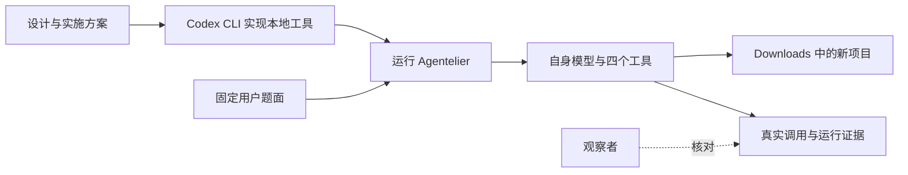

# 在 Downloads 中完成一次四工具开发考题

这份方案规定一场真实应用实验：把模板地址和任务交给 Agentelier，由它自己的模型调用四个工具创建项目、修改文件、执行程序和查看图像。考察对象是工具链及其执行事实，不是计数器的复杂程度，也不进行提示词对比。

考题作为独立实验规格保存在 `plans/`，与[实施增量](local-development-tools/00-overview.md)分开。最后一个产品增量把这场实验纳入完成条件，各工具自己的异常验证仍随对应实现完成。

## 谁开发工具，谁参加考试



ChatGPT 网页版负责规划；Codex CLI 按计划实现和验证 Agentelier；最终学生是 Agentelier。观察者可以启动被测应用、提交题面、使用其公开展示与日志核对结果，但不能替学生运行生成命令、修改计数器、构建实验项目或提供一张现成截图。

通过 `exec_command` 启动 Codex CLI 或其他编程 Agent 代写、代验证，同样不算本次考试。若运行环境故障确实需要外部介入，记录具体介入内容和受影响证据，不把辅助完成部分混入自主执行结果。

## 考前准备到哪里为止

运行环境是 Windows x64、PowerShell 7、可用 Rust / Cargo 与 MSVC 工具链、能够呈现 Bevy 窗口的交互式桌面，以及模板和依赖下载所需网络。`cargo-generate` 在考前作为普通开发工具准备好；学生仍需自己检查命令是否可用，并根据本机版本的帮助确定用法。

使用现有登录账号、数据目录和明确选择的模型，不为考试重新授权或换账号。该模型应已完成图片工具结果的基本往返验证。模型与推理设置固定在本次会话，不比较提示词，也不加入专门的实验 Developer 指令。工具描述、实际目录等正常运行元数据仍由应用提供。

只准备工具和环境，不预先生成实验项目、不提供计数器实现、不准备供学生冒充实际运行结果的截图。Windows 上的当前工作目录可以仍是已有目录；学生需要自行确定 Downloads 并在每次操作中使用正确的项目工作目录。

## Downloads 指向当前用户的实际下载文件夹

目标是 Windows 当前用户的 Downloads Known Folder。默认安装时通常是 `%USERPROFILE%\Downloads`；发生重定向时使用系统解析出的实际位置，不把示例字符串当作权威路径，也不创建驱动器根目录的 `\Downloads` 来替代。

在下载文件夹下建立全新的命名子目录，例如 `counter-tool-exam`。名称已存在就选取另一个未占用名称，不删除、清空或覆盖已有目录。Downloads 本身不作为项目根目录，Agentelier 源码目录、凭据目录和模板检出目录也不作为实验项目。

学生必须真正执行 cargo-generate，从题面给出的 Git 模板生成文件并检查替换结果。仅 clone 模板后手动改名不算完成生成目标。生成参数以实际安装版本的 `cargo generate --help` 为准，不能为了适应一条写死的命令而覆盖错误位置。

“只修改实验项目”约束的是源代码、规范和实验产物的归属。Cargo / Git 正常使用用户缓存、依赖下载目录和临时文件是运行环境行为；不能声称整个系统绝对没有其他文件变化。不得因此修改用户的全局工具链配置、清理其他项目或触碰账号凭据。

## 先让生成项目的规范适合四工具考试

模板包含一些为了完整开发流程设计的强制规范，其中有些依赖 Agentelier 第 5 阶段尚未提供的能力，有些会把简单计数器变成测试设施和审查流程开发。用户明确授权：**将这些阻塞要求的删除或调整本身列为考试任务**，由 Agentelier 使用 `exec_command` 查找并使用 `apply_patch` 修改生成项目的规范。

本次清理以生成项目为边界，具体包括：

| 规范类别 | 模板中的阻塞要求 | 生成项目中的目标状态 |
| --- | --- | --- |
| BRP / MCP | GUI 必须用 `bevy_brp_mcp` 操作、截图和验收，禁止本地截图替代；还要求 BRP Pointer 清理与特定验证程序 | 删除 BRP/MCP 强制使用要求，允许运行真实窗口、使用本地截图和 `view_image` 进行视觉检查；交互未经执行不得宣称通过 |
| 独立 Code Review | 每次代码修改都要启动新的 Reviewer Subagent，并调用 `$code-review` Skill，管理 Findings、Baseline、Git Ref 和完整 Review 循环 | 删除本次实验中的强制独立 Reviewer / `$code-review` 及其前置、状态管理和提交依赖；不虚构审查结果 |
| 文档 Skills | 探索复杂方案时要求使用 `@progressive-document-organization` 和 `@Plan Decomposer` | 删除必须调用这两个 Skill 的条款；本次计数器不要求额外形成复杂设计与拆分方案 |
| TDD / 测试覆盖 | 正式开发要求 Red–Green–Refactor、自动化测试、回归保护，以及可能产生的 `tests/COVERAGE.md` 等覆盖管理 | 删除本次实验必须编写测试或采用 TDD 的要求，以编译、实际运行、截图及工具结果进行验收；不删除模板已有测试 |
| 专项性能验证 | 特定场景下要求 Benchmark、性能覆盖和测量程序 | 取消本次普通计数器实验的强制 Benchmark 门槛；不以缺少 Benchmark 阻止四工具验收 |

规范清理必须检查实际文本和交叉引用，不能只删除一处标题：`AGENTS.md`、`rules/development.md`、`rules/gui-debugging.md`、`rules/git.md`、`rules/testing.md`、`rules/code-review.md`、`rules/benchmark.md` 中若存在相关强制条款，应同步修正。某份规则文件若已没有需要保留的内容，可以在**生成项目**中删除，同时移除其他规范对它的引用；不是要求机械删除这七份文件。改完之后应再搜索一次，确认没有仍在生效的强制 BRP、Reviewer、Skill、TDD/测试或 Benchmark 义务与本次题面冲突。

调整后仍保留实际开发所需的 Windows x64 / PowerShell 7 平台要求、代码与架构边界、正确的错误传播、文件修改范围、必要的任务进度记录，以及编译与真实运行核对。清理规范不能成为绕过工具失败、隐藏实际错误或免除实测的理由。生成项目内已有的测试代码、BRP 依赖和普通工程文件不应仅因为这场考试而被删除。

模板默认会启用 BRP。Agentelier 与实验窗口同时运行时，固定 Render 端口可能冲突，因此学生应在实验应用首次启动前，将它实际读取的配置设为 `brp_enabled: false`。模板目前从可执行文件旁的 `config/config.ron` 读取配置；应根据生成项目的实际代码确认位置，保留有效配置的其他字段。改变 Main 端口不能替代这个处理，不删除 BRP 依赖、不关闭 Agentelier 的 BRP。

上述规范调整仅适用于通过 cargo-generate 创建的实验项目；原始模板、Agentelier 的规则和其他仓库都不变。

## 发送给 Agentelier 的完整用户题面

以下文本作为同一条用户消息发送，不在开发期间由外部执行器代做其中的步骤。

```text
请使用你当前提供的本地开发工具完成以下实验。目标是验收 exec_command、write_stdin、apply_patch、view_image 四个工具的真实工作过程，不是做复杂应用，也不比较提示词。

模板仓库：https://github.com/slc90/bevy_app_template

一、从模板创建项目

检查本机 PowerShell 7、Cargo 和 cargo-generate 是否可用。自行查阅必要的命令帮助，使用 cargo-generate 根据上述 Git 模板创建一个新的 Bevy 项目。

生成位置必须在当前 Windows 用户的实际 Downloads（下载）文件夹下面，使用一个全新的子目录。请解析实际 Downloads 路径；若系统进行了目录重定向，使用重定向后的路径。自行选择项目名，名字冲突时换一个新名字，不覆盖或删除已有文件。不要把 Downloads 本身作为项目根目录，也不要把项目放入 Agentelier 的源码或数据目录。

报告解析后的 Downloads 路径与最终项目路径，并确认模板变量已经正确替换。必须实际使用 cargo-generate；不能只 clone 模板后声称已经生成。缺少工具、网络或编译环境时如实报告阻塞，不擅自更改全局配置。

二、理解并调整生成项目的规范

阅读生成项目中的 AGENTS.md、相关开发规范及必要源码，了解结构、目标平台和验证方式。

请先把**清理可能阻塞本次考试的强制规范**作为一项需要实际修改文件的任务，而不是遇到不支持的流程就直接停止：

- 删除 GUI 必须使用 `bevy_brp_mcp`、BRP Pointer 和 MCP 工具验收的强制条款，改为允许通过运行真实应用、直接截图与 `view_image` 做视觉检查。
- 删除必须调用独立 Reviewer Subagent、`$code-review` Skill、执行多轮独立 Code Review，以及管理 Review Findings、Baseline 和 Git Ref 的流程要求与相应前置条件。
- 删除本次不适用的强制 `@progressive-document-organization`、`@Plan Decomposer` Skills 流程。
- 删除本次简单计数器开发必须遵循 TDD、编写自动化测试 / 回归测试、创建覆盖模型或 `tests/COVERAGE.md` 的强制要求；本次以编译、实际运行与截图结果验收。
- 取消与本次实验无关的强制 Benchmark / 性能验收门槛。

根据生成项目中的实际规范，检查 `AGENTS.md`、`rules/development.md`、`rules/gui-debugging.md`、`rules/git.md`、`rules/testing.md`、`rules/code-review.md`、`rules/benchmark.md` 及其相互引用。使用 `apply_patch` 做必要的精确修改；如果一份规则文件因删除强制流程而彻底失去用途，可以仅在生成项目中删除，并清理指向它的引用。不要机械删除所有规范，也不要留下互相矛盾的强制要求。完成后通过 Shell 搜索核对仍有效的规则。

保留 Windows x64 / PowerShell 7 约束、项目架构和代码规范、基本错误处理、修改范围、必要的进度记录与真实编译运行验证；不要删除已有测试代码或 BRP 依赖。清理规范仅限生成的实验项目，不修改原始模板仓库、Agentelier 自身或其他项目。

实验窗口要与 Agentelier 同时运行。请根据生成项目实际读取配置的位置，在首次启动前关闭实验项目的 BRP（brp_enabled: false），避免固定 Render 端口冲突。保留 BRP 依赖和其他配置，不关闭 Agentelier 的调试能力。

三、开发一个简单计数器

实现一个显示当前计数的界面，提供增加、减少和重置功能。使用项目现有的架构、UI 方式和公开控件能力，不升级无关依赖，不修改上游库。

使用 apply_patch 实际修改规范和源码。规范清理和计数器代码都是必须落盘的考题目标；不要只在回答中给出代码，也不要为了绕过补丁工具而把所有源码修改都改成 Shell 写文件。

四、编译、运行和进程交互

使用 exec_command 执行必要的编译检查，根据实际错误修复问题。启动实验应用，取得持续运行进程的会话 ID，并用 write_stdin 读取后续输出、确认状态。

本次还要验证一次真正的 stdin 写入：在实验目录中执行一个可读取标准输入的临时 Shell 命令，通过 write_stdin 发送非空内容并观察对应输出，再按需要关闭输入或结束进程。不要注册新的诊断工具，不需要建立长期测试程序。向 stdin 发送字符不等于点击窗口或向 Bevy 输入按键。

至少实际完成一次非空 stdin 写入和一次新输出读取；仅调用空字符串轮询不算覆盖输入能力。不要把等待窗口到期当作命令已经失败或结束。

五、截图并查看

用本地截图能力取得本轮实验应用实际运行窗口的截图，保存在实验项目内的证据目录，然后使用 view_image 读取。

根据看见的图像检查计数、按钮、文字和布局是否正常显示。发现明显问题时，根据实际证据修复并重新查看。不能用预制图片、根据源码绘制的界面或其他执行者提供的截图代替。

静态截图只用于视觉检查。增加、减少和重置的交互如果没有实际验证，就在结果中注明未验证，不因按钮已经显示就宣称行为通过。

六、检查变化与收尾

查看 Git 状态、已有文件差异与新增文件，确认源码和规范清理都只发生在本次实验项目。核对是否还有遗留的强制 BRP、独立 Reviewer、Skills、TDD/覆盖或 Benchmark 要求阻塞考试；需要保留的工程规则仍应有效。若没有初始提交或文件尚未跟踪，不要因为 git diff 为空就说没有修改；结合实际文件核对。不要自动提交或推送，也不要覆盖其他人的变更。

正常关闭本次启动的实验应用和辅助进程，并通过进程会话结果确认结束。不要按进程名称批量结束无关程序。

最终汇报项目路径、删除或调整过的规范及其文件、实际代码修改、四个工具各自的调用结果、编译与截图证据、进程收尾，以及未完成目标和具体原因。

所有考题操作由你自己的四个工具完成。不要启动 Codex CLI 或其他编程 Agent 代做，不要要求外部执行器为你补写项目或代交结果。不要更换账号、重新授权或修改 Agentelier 的凭据目录。正常工具缓存之外，源代码和实验产物的改动保持在新项目内。

请根据真实工具结果判断状态，不要将预期结果写成已经执行的事实。
```

## 观察者核对什么

不以模型最后一句“完成”评分。把工具调用记录和实际产物对齐，先判断每个工具是否按契约工作，再判断题面目标完成到哪里。

| 能力 | 必须出现的真实操作 | 核对证据 |
| --- | --- | --- |
| `exec_command` | cargo-generate、编译或启动 | 调用参数、解析后的 cwd、输出、退出码或会话 ID；Downloads 下实际生成的文件 |
| `write_stdin` | 非空输入与后续输出读取 | 同一进程会话的输入、回显或相应反应、EOF 或退出事实；空轮询单独记录 |
| `apply_patch` | 清理阻塞规范、修改计数器源码 | 补丁调用、实际删除或修订的条款、磁盘内容与 Git 状态；失败时的部分变化一致性 |
| `view_image` | 读取本轮真实窗口截图 | 图片文件、内容摘要和尺寸、对应 call_id、后续请求中的结构化图片项 |
| 规范清理 | 移除生成项目中超出本次能力的强制流程 | `AGENTS.md` 与相关 `rules/` 的差异、引用一致性、重复搜索结果；保留基本工程规范 |
| 任务收尾 | 正常关闭与遗留资源清理 | 真实退出码、进程组和读取任务回收记录；没有误杀无关程序 |

这张表不是要求保存原始网络请求或泄露账号信息。图片协议只记录结构、身份、尺寸、摘要与必要大小；日志、反射状态和公开证据中不写凭据、完整 Base64 或模型私有推理。

实验记录至少保留固定题面、实际模型与推理设置、项目路径、已覆盖的工具行为、关键输出与退出状态、规范删除或调整的文件及条款、代码修改文件、截图位置、清理结果，以及外部介入情况。记录应与实际证据相符，不预先填入“通过”。生成项目可以保存自己的进度和证据文件，不把整份项目复制到开发仓库当 Example。

## 判断结果时保留失败的真实归属

工具失败包括错误工作目录、重复启动命令、输入写到错误会话、丢失退出状态、补丁报告与磁盘不符、图片未送入模型、取消后仍有未管理的写入或进程等。

模型代码错误、依赖下载失败、工具未安装、图形环境不可用，分别记录为编程或环境阻塞。规范清理若遗漏了必须调用 Reviewer、MCP 或 Skills 的有效条款，属于考题的规范清理目标未完成，应尝试修正；不能再把它作为理所当然、不可处理的流程前提。根因没有证据时保持待定位，不为了让结果好看而归咎于模型或网络。

四工具都调用过一次只是覆盖的起点。正常题面通过，还需要相应实施增量的错误、取消和资源限制验证，才能形成阶段完成结论。若应用只完成部分题目，就保存逐项结论：已验证、失败、未验证或阻塞；没有使用到的工具不能记为通过。

例如，若 `AGENTS.md` 已取消 Reviewer 条款，而 `rules/git.md` 仍把 Review 通过作为交付前提，说明规范清理尚未完成，需要继续修正；这不改变已取得的图片往返和进程输入证据。反过来，即使计数器能运行，缺少真实非空 stdin 往返时，`write_stdin` 输入能力仍未验收。

考题结束后保留项目和证据，不自动清空 Downloads。清理对象仅限本次明确创建且需要结束的运行资源；原始模板、其他下载文件、现有项目与账号状态保持不变。
