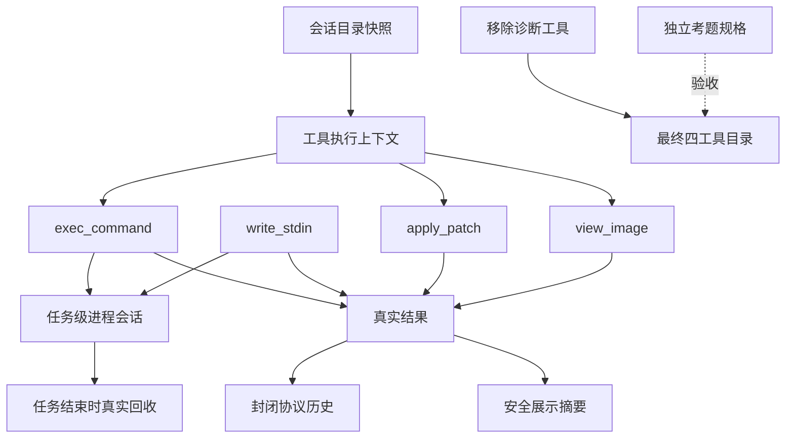

# 本地工具怎样接入现有任务循环

这组增量让现有工具循环获得本地命令、文件修改和图片读取能力。目录快照确定路径基准，任务级进程所有者负责真实进程，工具结果同时服务协议历史与安全展示，Runtime 在所有资源实际回收后完成任务。

箭头表达设计关系。执行顺序另外给出：目录先落地，命令从有界执行发展为持续会话，然后接入补丁和图像，最后移除旧诊断能力。补丁与进程交互之间没有技术依赖，只是安排为相邻增量；图像也不依赖补丁算法，但需要自己的协议与展示改动。

每个增量包含本功能的真实运行验证、错误路径和文档同步。没有单独追加一个“运行全部测试”的实施阶段，也不创建测试设施。用户要求的考题独立成篇，作为最终运行实验的规格；它不是又一个产品功能增量。

## 唯一实施顺序

1. [固定会话的本地工作目录](01-working-directory.md)
2. [执行并回收一个本地命令](02-exec-command.md)
3. [继续操作同一进程会话](03-process-sessions.md)
4. [用 JSON 补丁修改本地文件](04-apply-patch.md)
5. [把本地图像作为真实工具结果送给模型](05-view-image.md)
6. [移除诊断工具并收口四工具目录](06-retire-diagnostics.md)

最后一个实施增量的完成条件包括运行[独立考题方案](../local-development-tools-exam.md)。考题题面、Downloads 路径、模型实际操作与观察者证据分开写在该方案中。

整体设计从[本地开发工具](../../../docs/design/local-development-tools/README.md)进入。各增量正文保留实施所需的行为和验证要求，不要求通过总览推测缺失契约。
