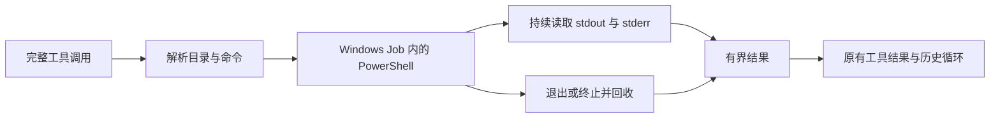

# 执行并回收一个本地命令

本增量接入 `exec_command` 的有界执行形态：模型要求在指定目录运行命令，应用真实启动 PowerShell 7，持续收集输出，并在命令完成或被停止后返回实际结果。这是一个可单独验证的命令执行能力；持续会话和 `write_stdin` 在下一增量加入。

## 一个调用对应一项真实命令

此增量的参数先提供 `cmd` 和 `workdir`，严格 JSON，全部声明字段列为 required，`workdir` 用 `null` 表示会话目录。工具描述明确当前为有界执行，不提前暴露不能继续操作的会话 ID，也不假装已支持 `yield_time_ms`。

Shell 固定为 `pwsh`，不回退到 PowerShell 5，不暴露任意 Shell、login、审批或沙箱字段。解析可执行文件并返回启动错误；命令和工作目录通过独立进程参数传入，关闭 Logo 与用户 Profile，不改变应用全局 cwd。

继承正常开发需要的用户环境和系统代理，不自动注入账号凭据或 CredentialClient。标准输入输出使用明确 UTF-8 约定，正确拼接跨读取块的字符；外部程序输出需要解码替换时标明替换事实。

模型执行的命令具有当前 Windows 用户权限，工作目录不是访问限制。不增加沙箱、命令审批、提权重试或 UAC；操作系统拒绝访问时保留实际错误。

## 输出、退出与失败各说清楚

结果至少包含实际工作目录、stdout、stderr、Shell 的真实退出码、输出截断和解码替换标记。Shell 退出码不是所有嵌套程序退出码的汇总；需要保留某个原生命令的退出码时，由命令显式传播，工具不从日志文字猜测成功。

启动失败、工具输入错误、命令非零退出和用户取消分别表达。命令非零退出保留错误输出和退出码，工具记录显示失败，但仍作为完整业务结果交给模型，由模型决定后续操作。

stdout / stderr 从进程启动后持续读取，不能等命令结束才读取。单命令待取输出上限为 1 MiB；对超量内容做有标记的截断，继续排空管道，避免输出把进程堵住。最终文字结果序列化后不超过 64 KiB，截断文字而不是切断 JSON，保留丢弃字节数。参数仍受 64 KiB 上限约束。

当前错误结构只容纳静态消息，本增量需扩展到受控的动态错误详情，保留必要路径、操作系统错误和退出信息；错误继续传播，不靠日志代替结果，不记录完整敏感输出。

## 停止必须等到进程真正结束

本增量暂时保留 15 秒的有界命令期限。期限到达或用户 Stop 时，终止本命令所属进程组，等待子进程、尾部输出和读取任务完成，再返回超时或取消。不是丢弃执行 Future 后立刻宣布结束。下一增量会用有界等待和持续会话替换这个执行时长限制。

采用 Windows Job 持有一次启动产生的进程树。优先使用 `process-wrap` 的 Tokio、JobObject、KillOnDrop 和必要 creation-flags 安全封装，并为 Tokio 增加 process feature；依赖和版本由 Workspace 管理。确认公开接口在实际 Windows、嵌套 Job 与当前构建工具链下可用，不复制修改版上游源码，不违反 unsafe 禁令。

普通 Shell 不弹新控制台，但不妨碍命令启动正常 GUI。不能按进程名批量终止系统进程，也不能仅杀父 Shell 后声称编译器等子进程已经回收。异步显式收尾为主，KillOnDrop 是异常释放兜底。

## 保持任务循环和展示的一致性

`agent/tools` 负责本地启动、输出和回收；Runner 继续只推进模型与工具步骤，Runtime 继续等待任务真实结束。普通业务错误可继续下一次模型请求；历史损坏、事件交付故障或所有权异常必须在收尾后作为任务失败交回。

完整响应前不执行，串行批次、调用身份、Steer 边界、原有提交点和 Queue 规则不变。取消时保留已完成结果，未开始调用保持未执行。新的命令记录显示实际目录、退出码与输出摘要，不把调用“已接收”当“命令成功”。

此时诊断工具仍在默认目录中。下一方案扩展同一命令能力为任务级进程会话；不会建立第二条 Shell 执行路径。设计细节见[工作环境](../../../docs/design/local-development-tools/01-working-environment.md)与[进程会话](../../../docs/design/local-development-tools/02-process-sessions.md)。

## 完成条件

通过真实 Agentelier 会话调用命令，检查实际目录、中文和空格路径、UTF-8 输出、stdout / stderr、零与非零退出以及模型接收到的结果。使用不存在的目录、无法启动的可执行环境和超过参数限额的输入核对错误边界，不用虚构工具结果代替真实执行。

运行超过 15 秒的命令，以及启动普通子进程的命令，分别触发超时和 Stop，确认返回前关联进程已经结束、读取任务收敛、界面响应正常。命令完成与 Stop 竞态时保留已经确认的真实退出。大输出应得到明确截断结果，不能卡住或形成非法 JSON。

取消期间原有 Steer / Queue 与可靠回执仍能收敛；清理失败如实显示，不让后续任务误以为环境已经干净。只验证当前改动直接影响的旧流程，不机械重跑全仓场景。

执行适用的 Windows 编译、格式和 Clippy 检查；运行证据来自应用调用记录、系统进程事实和必要日志。Agentelier 自身 UI 变化仍用 BRP 验证，保护登录和数据目录，完成后释放 Pointer。禁止在应用仓库新增测试、Benchmark、Example、模拟服务或持久化测试脚本。

同步当前工具功能、错误语义、模块职责与实际有界执行限制，维护临时进度记录。不得在本增量文档中提前宣称长时间编译可持续交互。
