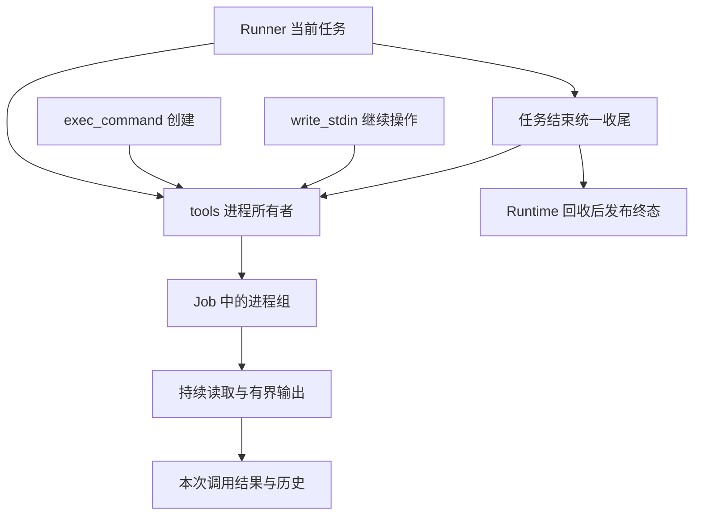

# 继续操作同一进程会话

本增量把已经能够执行和回收的命令扩展为“本次调用先返回，进程继续工作”。`exec_command` 返回可继续使用的进程会话，`write_stdin` 向它写入输入、取出新输出或明确终止。进程只属于当前用户任务，不跨到后续任务中继续运行。

这张图表示运行协作。保留现有 Tokio、Runner 和串行工具分发，进程读取任务不交给 UI 的 JobManager。前一增量提供启动、输出与进程树回收；本增量增加会话身份及跨工具调用的生命周期。之后的补丁增量与这里顺序相邻，但不依赖 stdin 的实现。

## 调用可以完成，命令仍然在运行

最终 `exec_command` 的参数为 `cmd`、`workdir`、`yield_time_ms`。严格 schema 将全部字段列为 required；后两项允许 null，分别使用会话工作目录和 10000 毫秒等待窗口。等待时间范围是 0–30000 毫秒，超范围返回参数错误，不静默猜测单位。

工作目录的相对值从固定会话目录解析，绝对值直接使用。Shell 继续固定为 PowerShell 7，关闭 Logo 与用户 Profile，继承正常开发环境，不注入账号凭据。工作目录通过进程 API 传入，不改变应用全局 cwd；当前用户权限下运行，目录不是访问隔离。

等待窗口内进程组结束，返回新输出和实际退出码；窗口到期而进程仍在运行，返回 `state: running`、`session_id`、本次新输出和空退出码。窗口到期不是超时失败。删除前一增量对整个命令生命周期施加的 15 秒期限，不在另一层保留隐藏的 15 秒终止器。

结果区分调用是否成功、进程是否运行、命令是否以非零退出码结束。非零退出需要带回错误输出和真实退出码，不能只给一个没有细节的“执行失败”。显示成功取得会话时，同时显示“进程仍在运行”，不能让工具卡片的成功状态冒充构建成功。

每个 `session_id` 使用内部唯一标识，绑定当前会话、任务与创建调用，不直接采用 PID。查找时验证归属；未知、已回收或其他任务的 ID 返回明确错误，不重放原命令，也不访问某个碰巧同号的系统进程。

## 标准输入、轮询与结束各有含义

`write_stdin` 的参数为 `session_id`、`chars`、`yield_time_ms`、`close_stdin`、`terminate`。全部字段 required，拒绝未知字段；`yield_time_ms` 为 null 时使用 10000 毫秒，范围同样为 0–30000。两个布尔字段必须明确填写，没有该意图时填写 false。

- `chars` 为空字符串时，只等待并取得新输出；非空时写入原内容，不自动添加换行。
- `close_stdin: true` 在本次输入写入完成后关闭管道，使程序收到 EOF。之后仍能读取输出，再次写入则返回输入已关闭的错误。
- `terminate: true` 终止这个会话对应的进程组。它与非空 `chars`、`close_stdin: true` 互斥，必须等实际回收和尾部输出收敛后返回。

同一会话的写入、关闭与输出取出串行处理。一次 stdin 写入若只完成部分内容，或取消时无法确认对端是否已经处理，返回已知的写入状态与错误，不自动重试或重放非空输入。轮询可以继续，输入不能因自动重放而执行两次。

本阶段使用普通管道，不提供 PTY / ConPTY、任意 Shell 选择或登录 Shell 配置。向 stdin 写字符不是向 Bevy 窗口发送按键；向普通管道写 Ctrl+C 字节不作为终止机制。需要终止时使用明确的终止意图，任务 Stop 则回收该任务的全部会话。

## 输出持续读取，结果有界交付

从启动起持续读取 stdout、stderr，分别保存流身份。无人轮询时仍排空管道，不能让程序因为输出量大而阻塞。按字节增量解码，正确处理跨读取边界的 UTF-8；发生替换解码时在结果中说明，不能把乱码当成正确文本。

每个会话的待取输出总量上限为 1 MiB，保留开头与近期尾部并累计丢弃字节数。每次工具结果交付尚未返回的新输出，随后推进消费位置，不重复返还整段历史。单次完整文本结果保持在 64 KiB 内，先截断文本，再构造有效 JSON；截断、丢弃和解码替换分别可见。两条输出流不承诺严格交错顺序。

根 Shell 退出后仍需检查 Job 中的子进程与输出读取任务。全部关联进程结束、尾部内容取得并回收读取任务后，才进入已回收状态。任务最多同时持有 8 个未回收进程会话，满额拒绝新启动，不淘汰仍在使用的会话。

上述限制在工具库集中定义，不增加配置面板。每任务 32 次模型请求、64 次工具调用保持原样，轮询也计入预算；触限后回收进程并记录原因，不用自动续跑绕过预算。

## 结束任务时统一交还资源

Runner 持有任务级工具执行上下文。正常完成、Stop、模型失败、协议失败、触限、会话关闭和应用退出，都经过同一条异步收尾路径。已返回会话 ID 的进程也在回收范围内。

Windows Job 延续前一增量的安全封装方案，包含子进程清理、读取任务句柄以及异常释放兜底。使用 `process-wrap` 的公开 Tokio / JobObject / KillOnDrop 能力，保持 Workspace 的 unsafe 禁令；在真实 Windows 环境核对嵌套 Job、进程组退出与管道关闭行为。显式异步收尾为主要路径，Drop 只作兜底，不以丢弃 Future 代表进程已经停止。

Stop 能打断等待输出与等待输入。工具取消要保存实际结果，未启动调用继续产生未执行结果。自然退出与 Stop 竞争时，保留已经确认的退出事实。Steer 只改变后续模型决策，不自动终止已运行会话；旧批次尚未启动的调用仍按现有边界跳过。

正常任务结束也不保留后台服务：模型应先正常关闭自己启动的应用，遗留进程再由所有者清理。Queue 等前一任务全部资源回收后才启动下一项；失败、停止、触限或清理失败使队列暂停。无法确认回收时显示真实失败与未确认状态，不提前显示“已停止”，也不按进程名批量杀掉无关程序。

原 `exec_command` 返回 running 的历史结果保持不变。任务末尾清理结果保存为独立执行事实，不伪造新 `function_call`。后续模型请求可附带应用固定格式生成的环境事实，说明旧进程会话已经结束；只表达应用自身事实，不把命令输出提升为指令。这不增加实验 Developer 行为提示词。

## 用实际进程核对每一层行为

在真实应用中完成长进程启动、取得会话 ID、空输入轮询、非空输入及 EOF 的完整往返。可用一次性 Shell 命令等待标准输入并回显本次输入；不注册新的诊断工具，也不保存成测试程序。只轮询成功不算验证 stdin 写入。

核对至少这些直接相关场景：

- 命令超过 15 秒仍可继续，其他工具调用期间持续输出；读取结果不重复，不因无人轮询而堵塞。
- 输入带中文和换行，能观察到对应实际输出；关闭输入后程序结束，再次写入给出明确错误。
- 大量输出触发缓冲与返回截断，结果仍是有效 JSON，丢弃数量可见，尾部错误仍可核对。
- 显式终止单个会话不会终止另一会话；Stop、模型失败、触限和应用关闭清理当前任务所有关联进程。
- 子进程仍运行、根 Shell 已退出时，不提前宣告回收；自然退出与取消竞争后只有一个真实终态。
- 未知、旧任务和已回收 ID 不启动新进程；会话达到数量上限时明确拒绝。
- Steer 不重复执行已经启动的命令，Queue 等待真实回收，停止或清理异常后不自动继续。

核对工具卡片和请求历史：调用成功与进程运行状态分别可见，自动清理事实与原始调用结果区分。GUI 部分通过 BRP 操作真实应用；建立焦点，使用已知问题中规定的完整键盘消息路径，结束后释放 Pointer 并确认 inactive。

实现、编译检查、适用 Clippy 与运行证据共同构成本增量完成条件。结果写入临时任务进度记录；按实际行为同步聊天功能、工具机制和架构文档。使用现有账号与数据目录，不退出登录、不重新授权。

实现按真实职责保留在现有工具库，Agent / Bridge 不依赖 Bevy，Workspace 统一管理依赖，维持当前锁定的 UI 库组合；`lib.rs` 保持出口职责，不使用 `mod.rs`，不绕过 unsafe 或主动 panic 禁令。

本增量不加入沙箱、审批、权限升级、会话级持久后台进程、终端模拟器或新的 Runtime；不编写测试、Benchmark、Example、模拟服务和持久化验收脚本。设计依据见[进程会话](../../../docs/design/local-development-tools/02-process-sessions.md)与[模块协作](../../../docs/design/local-development-tools/05-integration-and-validation.md)。
