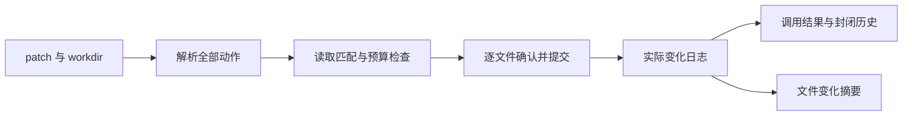

# 用 JSON 补丁修改本地文件

本增量交付一个能报告真实文件变化的 `apply_patch`。模型提供补丁文本，工具先计算变化，再提交文件修改；既复用已有 JSON function tool 协议，又保留 Codex 补丁标记的使用方式。

前面的目录快照提供路径基准，现有工具分发与历史提交提供调用闭环。该工具不依赖进程会话算法；只是安排在进程工具后交付。后续图片工具同样复用调用闭环，不依赖补丁解析器。

## 工具协议与补丁语言

参数只包含 `patch` 和 `workdir`。两者在严格 JSON schema 中都是 required，`patch` 为完整文本，`workdir` 为字符串或 null；null 使用会话工作目录，相对工作目录相对于会话目录解析。拒绝额外字段，参数总量继续受 64 KiB 限制。

使用 `*** Begin Patch` / `*** End Patch` 包裹补丁。支持 Add File、Delete File、Update File，以及 Update 内的 Move to、上下文块和 End of File 标记。工具描述应给出准确的 JSON 包装与必要格式示例，不复制 Codex freeform 工具中“不要包成 JSON”的说明。

模型调用必须来自完整合法的 `function_call`。助手正文中展示的补丁不执行，Shell 正文也不自动重解析成补丁工具调用。不增加 `custom_tool_call`、Code Mode 或新工具路由层。

## 提交之前先验证整份变化

先解析全部动作并确认路径，再读取需要的旧内容、匹配更新上下文、计算新内容，最后判断动作数量和输出报告能否装入预算。格式、路径、旧内容匹配或预算错误在写入前返回；不能第一份文件已经写完，才开始解析第二份动作。

上下文采取精确匹配。旧内容已改变时要求重新读取；同一上下文有多个可能位置时要求增加上下文，不自动挑选位置或忽略空白差异。Move to 可以同时更新内容，但目标存在时不能无条件覆盖。对可识别的大小写别名、规范化后重复目标和动作冲突在准备阶段拒绝。

工作目录是路径解释基准，不是沙箱。支持本机绝对路径与会话相对路径，正确处理中文、空格和 Windows 路径前缀。所有文件定位使用真正的路径值，不使用界面简化后的显示字符串。

首版支持 UTF-8 文本，保留原有 BOM 和正常 LF / CRLF 行尾。新增文件统一使用 UTF-8 无 BOM、LF 行尾；已有文件按其原形式写回。遇到不支持的编码或不能明确处理的混合行尾，返回具体错误，不重编码整个文件来掩盖问题。

每份补丁最多 64 个文件动作，单个读取的文本文件最多 8 MiB，一次准备的旧文本与新文本合计最多 32 MiB。按实际读取与分配持续检查上限，不能只信任初始文件大小。预计动作报告在提交前确认能放入 64 KiB 结果预算，超限就拒绝，不在落盘之后才丢掉变化记录。

## 单文件可靠提交，跨文件保留实际进度

准备与写入之间允许外部程序改变文件，因此每个动作提交前要再次确认相关旧内容或身份条件。单文件更新使用同目录临时文件与受支持的替换方式，避免先截断原文件再写内容；创建、删除、移动各有自己的完成点。

多个文件不组成一个自动回滚事务。结果按动作保留实际源路径、目标路径、变化类型和状态。中途 I/O 失败时，分别列出已完成、失败和未开始动作；若 Move to 实际完成目标写入却未成功移除源文件，要如实报告两个位置的状态。

新建目录、残留临时文件或临时文件清理失败也属于执行事实。不能只返回预计 diff 或“补丁失败”后隐藏已发生的变化。既不自动重放整个补丁，也不通过 Git 重置去撤销用户已有改动。

## 文件写入中的停止需要等待真实结果

取消发生在准备阶段时放弃尚未提交的结果；发生在某个提交操作中时，等待该操作取得结果，再停止剩余动作。已经发生的文件修改保留，取消不等于撤销。

文件工作离开 current-thread Tokio 的阻塞路径，但其任务句柄必须可等待。不能丢弃 `spawn_blocking` 的等待 Future 后就发布终态，让写文件仍在后台继续。原 15 秒期限作为协作式截止请求：停止后续准备或提交，等待已开始操作收敛，报告超时及真实变化。

Runner、Conversation 和 UI 继续使用同一调用身份；普通匹配和 I/O 错误作为工具结果交给模型，历史关系损坏仍是任务失败。错误类型容纳受控的动态路径和系统错误描述，不泄露凭据或完整文件内容到日志。

## 在实际工作区验证文件变化

在专用临时工作目录，通过真实应用分别完成新增、更新、删除、移动并核对磁盘内容；一个多文件补丁核对动作与结果顺序。覆盖中文和带空格路径、UTF-8 BOM、LF / CRLF，以及文件末尾匹配。

输入畸形标记、缺失上下文、多个匹配位置、冲突目标、已存在移动目标、超限文件和不支持编码，确认准备阶段失败时没有文件修改。对真实进程进行受控调试，可以检查准备后被外部改写、提交期间 I/O 失败、截止或 Stop 的行为，记录这是注入验证，不伪称模型自然产生了这些故障。

部分失败时核对磁盘状态与动作报告一致；取消返回后确认没有继续落盘，未开始动作未执行，临时文件的清理状态明确。再次发送新任务读取已完成变化，核对保留历史而不是重新执行失败补丁。

验证与实现一起完成，不新增单元测试、集成测试、回归测试、Benchmark、Example 或持久化故障注入框架。工具卡片的可观察改变通过 BRP 验证，使用公开控件状态与真实输入，最后释放 Pointer；账号和数据目录保持原状。

实现放在现有工具库内，按解析、匹配、文件提交等实际职责划分模块。参考补丁格式与行为，不为取得解析能力整体引入 Codex 执行服务器，不复制或修改上游库，不绕过 unsafe、panic 与 Workspace lint 约束。

同步实际已实现的工具行为、聊天结果显示及模块文档，验证记录留在临时进度文件中。详细机制见[文件补丁设计](../../../docs/design/local-development-tools/03-file-patches.md)。
