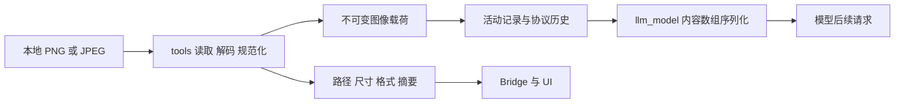

# 把本地图像作为真实工具结果送给模型

本增量让 `view_image` 从本地文件取得图片，并将图像内容送入下一次模型请求。交付标准不是“工具返回了路径”，而是执行结果、协议历史和实际请求都持有同一份可识别的图像。

目录增量提供相对路径基准，既有闭环提供 `call_id` 与历史封闭规则。本工具不依赖补丁算法，只是按统一顺序在补丁后交付。实现完成并完成真实图片往返后，下一增量才能移除诊断工具。

## 工具读取文件，结果保留读取时刻

输入是严格 JSON 对象，唯一字段 `path` 必填。相对路径以固定会话工作目录解释，绝对路径按本机规则使用。工具只负责查看已有图片，不负责截图、点击、OCR 或图片生成。

首版支持 PNG、JPEG 静态图像。检查目标是普通文件、读取实际内容并解码，不能只依据扩展名或 MIME 猜测。文件不存在、路径指向目录、数据损坏或格式不支持，都返回带必要上下文的业务错误。

文件读取与解码离开 current-thread Tokio 的阻塞路径，操作拥有可回收的任务句柄。取消发生后不发布尚未完成的成功结果，等待在途工作收敛后再返回真实终态；不让图像处理在任务结束后继续占用未受管理的资源。

取得图片后建立不可变的规范化编码结果，记录原始格式、原始尺寸、发送尺寸和内容摘要。历史与活动记录共享不可变数据，不在每次展示快照中复制图片。原文件随后被覆盖或删除，不影响旧结果；新的内容必须通过新一次调用读取。

## 真实结果不能寄存在展示字符串中

现有 `ToolResult.output` 和协议 FunctionResult 都是字符串，活动记录封闭步骤时从 `ToolView.output` 收集结果。本增量改变这条保存路径：执行侧持有文本或图片的类型化载荷，ToolView 只保留有界安全摘要。

类型归工具能力的公共值类型所有。`llm_model` 负责协议适配；Conversation 定义活动记录与历史提交，Runner 继续推进任务。Tools 不依赖账号、模型通信、Runtime、Bridge 或 Bevy。图片字节不进入 ECS 反射、BRP 状态或普通日志，也不建立全局附件服务。

普通工具继续输出有界 JSON 文本；图片工具输出文字说明和图片内容。模型层把它序列化为 `function_call_output.output` 的内容数组，包含 `input_text` 与 `input_image`；后者使用符合实际编码的 data URL 和 `detail: high`。不能把整个数组先转成 JSON 字符串再塞回 output，也不能只传一个本地文件路径。

同一完整模型输出与全部对应结果仍封闭为一步。文本、图片混合批次保持调用顺序和 `call_id` 的一一关系。图片步骤已经封闭、下一次模型请求失败时，保留图片历史；原有不完整响应、重复 ID、身份损坏、Steer 与 Queue 规则保持。

## 图片预算与文字预算分开

初始限制集中定义，不增加设置面板：

| 对象 | 限制与处理 |
| --- | --- |
| 原始文件 | 最多 10 MiB；读取时也检查，不只依赖初始 metadata |
| 解码图像 | 最多 2500 万像素，在大规模分配前确认 |
| 发送图像 | 最长边最多 2048 像素，等比缩放 |
| 单张编码结果 | 最多 4 MiB，超过则返回明确错误 |
| 会话累计图片载荷 | 最多 16 MiB，按唯一保留载荷计入，不重复统计共享引用 |
| 完整模型请求 | 最多 32 MiB，计入 Base64 膨胀、图片说明和既有文本历史 |

64 KiB 参数与文字结果上限继续适用于文字，不用于裁断图片。加入图片历史前检查相应图片预算；构造模型请求前检查实际完整序列化大小。请求超限时返回任务错误，保留此前封闭的历史，不静默删除旧图、不截断图片，也不把已确认读取成功的事实改写成“从未执行”。

会话重置或释放时，随历史释放图片。本阶段不增加磁盘持久化、上下文压缩或自动丢弃历史策略。来源中的尺寸与预算只是参考，这里的数值是本阶段选定的上限。

## 能力判断与实际往返

当前模型信息只保留名称和推理设置。实现可以读取服务实际提供的可选输入模态字段，并把确定支持、确定不支持、未知三种情况保留下来；字段缺失不等于支持，也不等于不支持。

明确不支持图片时返回能力错误；未知时通过真实工具结果请求确认。服务拒绝图片输入时保留原始错误类别和请求标识，不能自动换模型、账号、登录方式或切换工具协议。本次验收沿用当前账号和明确选择的模型。

不通过额外 Developer 提示词或提示词比较解决图片链路问题。题面要求查看图片只能驱动调用，不能替代实际图片输入。

## 用可核对的像素与请求证明链路

通过真实应用读取一张内容容易区分的本地 PNG，再读取 JPEG，核对文件内容摘要、发送尺寸、工具调用 ID 和后续请求内容数组。让模型描述图中可观察内容，作为辅助证据；主要核对应用的图像载荷与请求结构，避免把模型猜对一句话当作传输证据。

读取后改写或删除原图，再继续同一会话，确认旧历史仍发送原图；新一次读取应产生新结果。查看实际应用窗口截图时，核对是本轮目标窗口，不使用预制图片、代码绘制的假截图或外部工具代交的图像结果。

覆盖不存在路径、目录、损坏文件、错误扩展名、格式不支持、输入或像素超限、规范化后超限、会话图片预算和整体请求预算。分别确认工具错误与模型请求错误的归属，检查已有历史未被隐式删掉。混合文本与图片的调用批次、图片返回后的 Stop 或网络失败，应仍满足步骤封闭规则。

核对 UI 只展示路径、状态、格式、尺寸和摘要，不输出 Base64；切换页面不丢失展示，回收与关闭不留下图像工作任务。新增界面行为通过 BRP 操作真实应用，按现有焦点和键盘规则输入，最终释放 Pointer 并确认 inactive。

验证不新增测试代码、Benchmark、Example、模拟模型服务或长期验收脚本。执行适用的格式、编译与 Clippy 检查，真实结果写入临时进度记录；不触碰当前登录状态和数据目录。

同步协议结果、会话历史、工具能力与聊天展示的当前文档。静态截图只证明视觉事实，未点击的计数器按钮保持未验证，不由本工具承诺完整 GUI 交互。详细设计见[图片结果](../../../docs/design/local-development-tools/04-image-results.md)与[模块协作](../../../docs/design/local-development-tools/05-integration-and-validation.md)。
