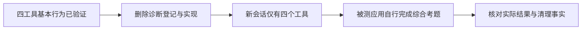

# 移除诊断工具并收口四工具目录

四个真实工具各自具备运行证据之后，删除计算与等待诊断能力，使默认模型工具目录只暴露实际开发工具。这是能力迁移的最后一个产品增量，最终考题作为本增量的全局完成条件，而不是另建一个没有实现产出的验证阶段。

本增量依赖前面的目录、命令、持续进程、补丁和图像能力。考题规格单独放在[本地开发工具考题](../local-development-tools-exam.md)，按用户要求保留独立题面与证据标准；它不是新增的执行引擎或测试基础设施。

## 删除临时能力，不删除调用框架

移除 `diagnostic_calculate`、`diagnostic_wait` 的注册项、实现分支、参数类型、诊断专属 receipt 生成和仅服务这些工具的文字说明。保留目录查找、输入检查、调用关联、业务错误、预算、串行批次和结果反馈。

清理依赖必须基于实际使用关系。唯一标识、时间和 JSON 能力可能仍用于进程会话或真实工具，不能因为诊断工具曾使用某依赖就一并删除。不得用隐藏别名或备用注册路径继续暴露旧工具。

新二进制启动后，新会话的工具目录只包含 `exec_command`、`write_stdin`、`apply_patch`、`view_image`。工具定义与执行实现来自同一目录，未知旧名称正常返回 unknown tool，不把旧调用转成某个新工具。

工具目录仍随创建会话固定。运行中不热替换已有会话的工具集合，不为这个迁移引入动态发现、MCP、插件管理或会话持久化。验证使用重新启动后的新会话；重启不改变现有账号和数据目录。

## 当前文档和历史方案分别处理

当前工具设计、会话模块设计与总体架构应描述实际交付后的四工具能力、工作目录、进程生存范围、JSON 补丁和图片结果。更新 `docs/design/tool_call.md` 中的当前边界与执行机制，不继续把本地文件和 Shell 写成尚未接入。

已有阶段 4 实施方案保留为历史资料，不为了清理名称而篡改原来的设计背景。当前设计文档应反映诊断工具已移除，但不能让用户按照历史示例寻找仍可调用的计算与等待工具。

`docs/design/local-development-tools/` 的目标设计随各增量核对为实际行为；仅完成部分内容时，只更新对应部分，不提前宣称剩余能力已经可用。本轮不修改外部模板、Widgetry 或 BRP 源码。

## 最终目录与原有控制仍然一致

在真实应用的新会话中核对发送给模型的工具声明与界面目录，确认只有四项且无重复。普通聊天仍允许不调用工具直接回答；旧诊断名称的受控输入返回明确错误，不能触发旧执行分支。

围绕此次迁移直接影响的行为，确认工具记录、结果关联、步骤封闭、取消、Steer 和 Queue 仍正常。停止或失败后已完成文件变化与图片结果保留；剩余进程真实回收；清理异常暂停执行，而不是默默启动下一条消息。执行记录不能根据 UI 文本重新猜测图片或进程结果。

新增目录和工具卡片等 GUI 行为继续通过 BRP 对真实应用验证。使用真实焦点与公开输入路径，遵守已知特殊键限制，结束后释放 Pointer 并确认 inactive。不修改宿主应用的 BRP 规则来套用实验项目的截图豁免。

对实际改动执行 Windows x64 编译、格式及适用 Clippy 检查。登录状态、当前账号、凭据和数据目录保持不变；不为了验收重新 OAuth 授权。

## 全局完成条件包括真正的考试

最终考试必须在被测应用中发送独立方案的完整用户题面，由它自己的模型选择工具并执行。开发工具可以启动和观察被测应用，但不能代生成 Downloads 项目、补写计数器代码、运行其构建或代交截图结果。通过 Shell 再启动另一个编程 Agent 代做，也不计作本次四工具考试。

完整证据应同时覆盖：

- 模板生成确由 `exec_command` 执行，路径是实际 Downloads 下的新子目录，未覆盖已有项目。
- `apply_patch` 实际修改实验源码；只有修改规范而没有源码变化，不足以覆盖本次开发场景。
- 运行中取得有效会话 ID，`write_stdin` 至少有一次实际非空输入和一次新输出读取，结果对应同一会话。
- 截图来自目标应用本次运行，`view_image` 的图片载荷确实进入后续模型请求。
- 最终磁盘变化、退出码、工具记录与汇报一致，实验启动的进程已正常关闭或由明确收尾回收。

除此之外，各实施增量要求的取消、参数错误、资源限制与部分失败场景仍需有证据。一次成功考试不能替代这些条件；也不在这里重复执行未受影响的全量历史场景。

故障按证据归类为工具执行或协议问题、模型编程错误、运行环境阻塞、项目流程能力缺失，或尚待定位。模型只完成部分题目、没有完成计数器时，保留已经验证的工具结论；但缺失的工具场景仍为未验证，不能把阶段整体宣布为可靠。若模板的独立 Reviewer 要求因没有子 Agent 而受阻，记录正式交付流程未完成，不伪造审查结果，也不把它当成一个已成功执行工具的失败。

## 收口范围

本阶段不加入沙箱、审批弹窗、提权重试、MCP、Skills、多 Agent、Code Mode、自动项目指令加载或上下文压缩。工具在当前用户权限下执行，工作目录不是访问隔离；用户任务规定的修改范围仍需遵守。

遵守无测试代码、无 Benchmark、无 Example 的项目规则，不把考题变成源码目录下的示例程序或长期测试宿主。Downloads 中的独立实验工程保持在开发仓库之外，开发仓库不复制模板的测试与 Reviewer 规则。

实际修改期间维护临时进度记录，记录已完成增量、验证事实、故障及未完成部分；完成并准备提交时按项目流程清理本任务的临时记录；未完成或尚未提交时保留续接记录。最终修改范围只包含本阶段实现和必要文档，没有额外自动评测平台、提示词对比或无关依赖升级。
