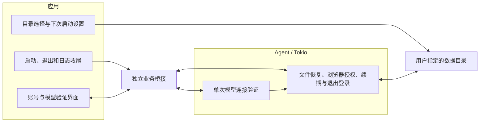

# 目录、账号与首次请求的整体协作

这组增量建立一条可以直接使用的路径：用户指定应用数据目录，应用恢复该目录中的账号，通过 ChatGPT 浏览器授权建立或更新会话，最后完成一次基本模型请求。

应用只提供一种登录方式和一种凭据存储方式。用户选择的数据目录只保存账号登记与当前凭据；应用配置和日志固定在可执行文件旁；认证运行决定账号会话的有效状态；模型通信复用认证运行提供的凭据。它们通过现有三层职责连接，而不是组成一个新的通用登录框架。

实施期间用户已确认新的功能拆分：`crates/login` 集中数据环境和后续认证能力，保持不依赖 Bevy；`crates/login_ui` 集中 Bevy 登录界面；`app` 保留通用配置、日志和应用装配。认证执行仍由 Agent 运行侧协调，但具体能力调用 `login`。该边界取代后续历史方案中“认证全部位于 Agent 内且不新增 crate”的约定，后续增量实施时同步调整对应文档。

图中的连线表示运行时职责关系。目录设置在第二份方案交付，是为了尽早形成完整的目录使用方式；后台认证依赖的是已经确定的数据环境，并不依赖设置按钮本身。其余增量沿认证状态的生命周期展开，再接入真实模型请求。

## 两个固定点

启动时先建立可执行文件旁的 `logs/` 输出，再读取同一位置的 `config/config.ron`，其中同时保存应用设置与用户指定的数据目录。没有有效选择时，在同一 Bevy 运行时中复用 Widgetry `PickDirectory` 显示启动选择界面；确认、检查和保存后复用窗口进入主界面。不生成默认应用数据位置，也不另设启动定位文件。

进入主应用后，本次数据根目录保持固定。设置中更改的位置写入 `config/config.ron` 的目录字段，保留其余设置，下次启动生效。当前进程继续使用原目录中的账号与凭据；配置与日志的位置不变，数据文件复制和删除由用户手动完成。

## 设计文档的位置

[设计入口](../../docs/design/login.md) 串联数据目录、账号界面、认证运行与首次请求。设计正文只说明这些能力本身；实施过程中按对应增量同步到当前有效的文档中。

`docs/` 的正式内容与已实现行为同步。各增量更新实际落地的章节和导航，未实现的其余设计继续作为方案材料保留，不把整个后续方案一次性改写成现状。涉及运行边界、依赖关系和生命周期的变化，同时更新 `docs/design/architecture.md`；对内部库新增的公开能力，补充 `docs/features/` 中对应契约。

## 唯一执行顺序

1. [由用户指定并恢复应用数据目录](01-select-data-directory.md)
2. [查看目录并设置下次启动位置](02-directory-settings.md)
3. [通过后台运行恢复文件认证状态](03-restore-auth-runtime.md)
4. [完成 ChatGPT 浏览器授权](04-browser-login.md)
5. [维持可续期的账号会话](05-renew-session.md)
6. [结束账号会话并清除凭据](06-sign-out.md)
7. [完成一次真实模型连接验证](07-model-request.md)
