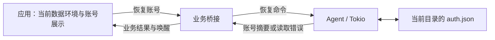
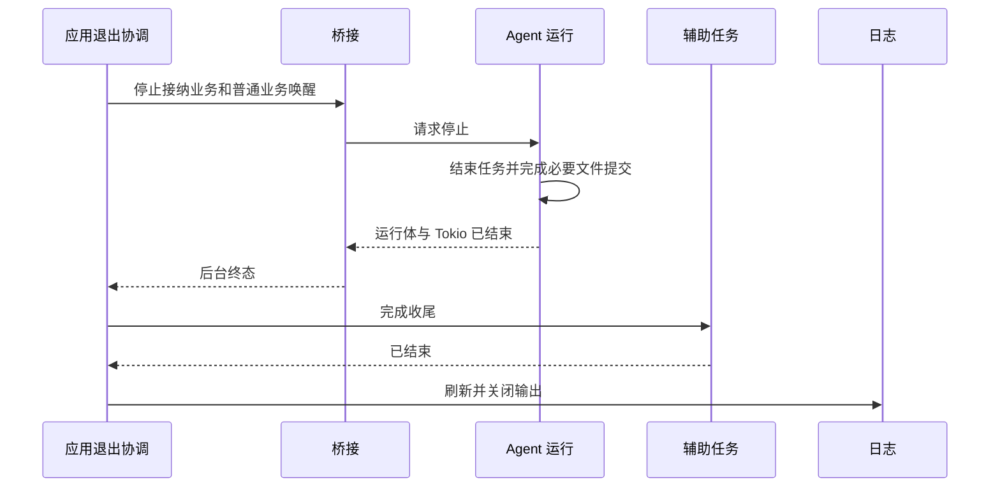

# 通过后台运行恢复文件认证状态

本增量让主窗口从当前数据目录恢复账号状态。它把既有的应用、业务桥接和 Agent 边界实际接通，同时交付一个具体的文件凭据组件。后台运行、消息唤醒和退出收尾都服务于这个可观察行为，不另建演示任务或空转框架。

前面的目录增量已经确定本次根目录并持有占用。此处直接接收该环境中的凭据路径；设置页只影响下次启动。后续浏览器登录、续期和退出复用同一文件组件与运行生命周期。

## 账号记录表达三种生命周期

`auth.json` 按主机标识、账号登记、当前会话组织。主机标识随这份本地数据保留；登记关联实际签发的客户端标识与验证后的账号身份；会话包含会随登录、续期和退出变化的 Token。

| 记录部分 | 必要内容 |
| --- | --- |
| 主机标识 | 稳定的 `ext_agent_host_id` |
| 账号登记 | 固定签发方、实际签发的 `client_id`、已验证的 subject、可用的展示信息 |
| 当前会话 | Access / Refresh / ID Token、Token 类型、实际授权范围、接收时间、有效期与最早可刷新时间 |

主机标识在首次发起授权前保存，登记在身份校验后建立；当前会话可以为空。此处建立这些状态及其文件读写，不为了展示已登录而提前生成假的 Token 或模拟账号。

没有文件表示没有账号记录；只有主机标识表示尚未完成首次登记；登记存在而会话为空表示未登录。已有会话则恢复账号摘要和凭据状态。过期信息属于后续获取可用凭据的判断依据，读取文件本身不触发浏览器。

解析错误、字段相互矛盾、权限错误分别返回存储失败，保留原文件。不能把这些错误当成“文件不存在”，也不自动覆盖为一个空账号。

## 文件组件直接服务认证

凭据文件归属 `agentelier_agent` 内的认证模块，使用当前环境传入的具体路径。本增量只建立恢复所需的读取、结构校验和状态投影；创建主机记录、保存 Token 与受限权限替换在下一增量首次真实写入时加入，不预先堆放暂时没有调用者的写入接口。

只使用一个具体的文件组件，不引入存储后端 Trait、后端枚举或自动降级；不读取 `CODEX_HOME`、其他客户端的 `auth.json`、环境中的 API Key 或浏览器 Cookie。

文件不存在与读取失败分别表达。文件模式是明文序列化加文件访问权限保护，恢复操作只读取已有记录，不另做密钥管理、系统凭据库或加密后端。解析失败不能为了继续流程而截断原文件，也不修改用户目录中的其他文件。

## 让运行事实跨过桥接边界

源码依赖保持 `app → agentelier_bridge → agentelier_agent`。应用不直接依赖 Agent 内部类型；桥接和 Agent 不依赖 Bevy。现有两个空库分别承担业务转换和运行执行，不为认证再拆一个新的顶层 Crate。

应用启动后台后发送恢复账号请求。Agent 在 Tokio 中读取文件并形成账号结果，桥接转换为应用能理解的事件。操作身份贯穿请求与结果，应用只更新当前操作的投影；凭据真相始终由认证模块持有。

应用展示状态分开保存账号摘要、当前操作与错误。恢复时显示“正在读取账号”；没有会话时显示未登录；读取错误时显示原因。尚未实现的浏览器登录按钮不发布虚假的成功结果。

桥接的公开消息只包含操作标识、账号摘要、状态和经过筛选的错误。完整 Token、授权码和原始凭据记录不进入 Bevy Component、Reflect 资源或 BRP 查询结果。敏感类型也不通过派生 Debug 将内容带入日志。

## 通道与唤醒同时成立

应用在启动后台结果生产之前准备好接收通道和唤醒能力。Agent 结果先入队，桥接再调用应用提供的通知能力唤醒 Winit；唤醒消息不承载业务数据。

ECS 以非阻塞方式接收结果，不等待文件操作或 Tokio 任务完成。通道关闭、任务异常和发送失败转成明确的运行结果，不把丢失终态当作正常结束。当前只传递少量账号和操作事件，不建立通用事件总线或无界输出转发体系。

唤醒能力使用与 Bevy 无关的接口传入桥接。主窗口空闲时，文件恢复完成也必须促使界面更新，不能等用户移动鼠标才出现结果。

## 运行实例由应用负责结束

应用拥有后台运行实例的启动和退出；Agent 持有自身任务及其真实结束状态。Tokio 工作不占用 Bevy ECS 主线程。应用侧目录检查、原生对话框和打开目录等辅助任务仍由应用侧管理，不能让 JobManager 代管认证运行。

退出协调继续由应用驱动，关闭普通业务唤醒后也能检查结束结果。Bevy World、消息接收端和日志不能先于需要它们的收尾步骤销毁。同一数据目录的进程占用在所有相关工作与日志结束后释放。

## 实施参照

认证状态、文件读写与缓存职责可参考 Codex 的 `codex-rs/login/src/auth/manager.rs`、`auth/storage.rs` 和 `token_data.rs`，只取与单文件恢复有关的机制。`auth/storage_file_windows.rs` 含平台底层调用，不能原样复制到禁止 `unsafe` 的 Workspace。

后台到界面的主动通知可结合 Widgetry 的任务唤醒机制和 BRP Runtime 的 wake-aware transport 理解；业务桥接仍保持自身非 Bevy 协议。应用继续只装配一套日志 Subscriber 和一套 BRP HTTP Transport，BRP Runtime 与 MCP 工具保持兼容；不在已有 Runtime 之外重复安装 RemoteHttpPlugin。

## 可观察的完成条件

| 场景 | 应取得的结果 |
| --- | --- |
| 当前目录没有凭据 | 主窗口由读取中进入未登录，不搜索其他应用的数据 |
| 只有主机或登记信息 | 保留记录，显示未登录，不重新生成已有主机标识 |
| 凭据文件损坏或不可读 | 显示具体存储错误，原文件没有被覆盖 |
| 合法会话记录恢复 | 显示相应账号摘要；Secret 不出现在 ECS、BRP 和日志中 |
| 窗口空闲时收到恢复结果 | 无需用户输入即可完成界面更新 |
| 恢复过程中关闭应用 | 请求停止后等待真实结束，文件无截断，日志最后结束 |
| 同一目录启动第二实例 | 由已有目录占用机制拒绝并行写入 |

实际运行当前应用验证恢复与结束行为，结合 BRP 输入、截图和非敏感 ECS 状态检查。合法真实会话由浏览器登录增量产生后补充实际重启验证，不为提前通过此项制造伪造登录。文件错误场景直接使用独立的用户指定目录操作，原生界面部分采用实际 Windows 操作。

## 实施约束与文档同步

保持 Windows x64 / MSVC / DX12，命令在 PowerShell 7 执行。新增 Tokio、序列化、文件操作依赖只开启当前需要的 Feature，统一在 Workspace 管理。按实际影响执行格式、编译、Clippy 和清单检查；不编写测试、Benchmark、Example 或额外演示程序。

正式实现采用 Type-Driven Development 表达恢复状态和结束结果，不使用 panic、占位实现或日志代替错误传播。按 `rules/development.md` 维护临时进度，完成独立 Code Review；GUI 验证结束释放 BRP Pointer 并确认 `inactive`。

同步 `docs/design/architecture.md` 中空库、实际依赖、Tokio、消息唤醒和生命周期的变化。将认证设计中已实现的记录、恢复与运行边界写入当前设计，公开库能力的重要契约写入相关模块设计；后续 OAuth 与刷新内容随各自增量同步。
