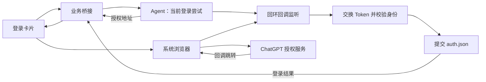

# 完成 ChatGPT 浏览器授权

本增量交付完整的浏览器登录：用户从主窗口发起授权，在系统浏览器完成 ChatGPT 认证，应用校验返回身份并保存自己的文件凭据。首次客户端登记与后续重新授权共用这条流程，不增加登录方式选择器。

前一增量提供文件存储、后台运行、消息身份与界面唤醒。本增量使用这些能力建立真实会话；下一增量再为已经建立的会话提供自动续期。

## 应用自己的登记与账号身份

当前数据目录只维护一份账号登记。首次授权前，生成并保存稳定的 `ext_agent_host_id`，采用随机 UUID 对应的 `urn:uuid:` 标识。文件已经存在这个标识时继续使用，重启、重新登录和同机移动数据目录都不重建它。

首次登记使用动态客户端注册入口；浏览器回调返回实际签发的 `client_id`。这个标识只有与经过校验的身份绑定后，才成为本地账号登记。后续登录使用保存的标识，同一登记的返回身份必须与已有身份一致。

`dynamic_agent_client` 只是首次注册入口，不是可持久化为正式登记、用于刷新或交换 Token 的客户端身份。应用也不使用 Codex 内置的固定客户端标识，不要求用户安装或调用 Codex CLI。

## 采用独立客户端的协议参数

登录协议固定为一个公共 OAuth 客户端，不接收用户配置的任意认证服务地址。

| 协议项 | 本增量使用的内容 |
| --- | --- |
| 授权地址 | `https://auth.openai.com/api/accounts/authorize` |
| Token 地址 | `https://auth.openai.com/api/accounts/oauth/token` |
| 资源 | `https://api.openai.com/v1` |
| 授权类型 | `response_type=code`，PKCE `S256` |
| 请求范围 | `openid profile email offline_access resource.invoke chatgpt.tokens.use.direct` |
| 回调 | `http://127.0.0.1:<本次端口>/auth/callback` |
| 首次登记 | `client_id=dynamic_agent_client`，`agent_name_hint=Agentelier`，稳定的主机标识 |
| 后续授权 | 保存的实际 `client_id` 和同一主机标识，不再发送首次命名提示 |

回调监听先启动，再打开浏览器。端口按可用回环端口选择；同一次尝试的授权请求与授权码交换必须使用完全相同的回调 URI。不同尝试只改变端口，保留 scheme、`127.0.0.1` 和 `/auth/callback`，不替换成 `localhost`。

每次尝试生成新的随机 `state`、OIDC `nonce` 和 PKCE verifier，并只在该尝试内部保存。URL 使用编码库构造，不能靠字符串拼接未编码参数。应用不使用客户端 Secret 或 API Key。

## 回调通过校验后才建立会话

回调先验证 `state`，再处理授权错误或授权码。首次登记必须取得实际签发的客户端标识；后续授权回调可以省略该字段，但提供了不同标识时拒绝结果。

授权码交换使用 form-encoded `authorization_code` 请求，携带实际签发的客户端标识、授权码、PKCE verifier、相同回调 URI 和资源。授权码被明确拒绝时不重复兑换旧码；仍在运行的登记尝试保留已取得的客户端标识，通过新的浏览器尝试取得新码。

从固定 OpenAI 签发方的发现元数据取得 JWKS，校验 ID Token 签名、issuer、audience、有效期和本次 nonce。经过校验的 `sub` 作为账号身份；邮箱仅用于展示。Access Token 中不透明的服务内部字段不作为本地身份判断依据。

首次授权建立账号登记；重新授权先确认身份与已有登记一致，再替换会话。完整 Token、实际授予范围、接收时间、有效期和最早可刷新时间随本次结果整体保存。字段读取和校验失败都返回对应阶段的失败，而不是填入一组看似有效的默认值。

## 首次真实写入与完整记录提交

在已有文件读取组件上加入整记录提交，供本次主机标识保存和登录凭据保存使用。后续刷新、退出复用这一处提交逻辑，不另开写入路径。文件先写入目标同目录的临时文件，确认完整写入与刷新后替换目标，使读取者得到完整的旧记录或新记录。

Token 写入前，临时文件与目标已经具备仅当前用户及必要系统主体可访问的 Windows 权限，替换后仍保持保护。使用现有依赖的安全 Rust 接口完成权限和替换，不解除 Workspace 的 `unsafe_code = forbid`，也不先写秘密再补权限。临时提交失败只清理本次创建的临时物，不清理用户目录中的其他文件。

文件提交成功后才发布登录完成。网络已返回 Token 但文件提交失败时保留本次待保存结果，显示保存失败并允许重试保存；重试不能再次消费同一个授权码。界面没有收到持久化终态前保持操作反馈。

## 身份授权与订阅使用分开显示

用 Token 响应的实际 `scope` 判断 `chatgpt.tokens.use.direct` 是否存在。缺少这个范围时仍保存经过校验的身份会话，显示“账号已登录，订阅授权未开启”，禁用模型验证。

“开启订阅授权”使用同一登记发起浏览器补充同意流程，并明确请求所需范围及 `prompt=consent`。普通重启和凭据读取不自动打开同意页面。重新授权失败时，原有有效会话继续保留。

返回账号可以使用已验证的邮箱作为登录提示。这个最小版本不发送包含原始 ID Token 的 URL 提示，不建立多账号选择器、工作区切换器或其他计费入口。原始 ID Token 仍随会话保存供身份与会话管理使用，退出时清除。

## 登录卡片与操作生命周期

未登录时显示“使用 ChatGPT 登录”。准备期间显示正在准备；回调监听就绪后，应用打开系统浏览器，进入“请在浏览器中完成登录”。浏览器启动属于应用集成，OAuth 网络、回调处理和文件提交属于 Agent 运行。

等待卡片提供“重新打开浏览器”“复制登录链接”和“取消登录”。前两个入口复用当前地址；自动打开失败时保留这些手动入口。主窗口始终保留设置入口，但目录更改仍只在下一次启动生效。

同一时刻只维护一个登录尝试。桥接在授权地址、等待反馈和完成事件中携带操作标识；应用只接收当前尝试的事件。取消请求进入“正在取消”，后台结束监听和当前授权任务后发布实际终态。

取消、超时和成功提交竞争时，以认证运行确定的结果为准。提交已完成就报告成功，取消先完成就停止该尝试，不能出现界面报告取消而旧回调随后悄悄写入凭据。等待时间采用命名常量控制，超时后释放监听，用户重试产生新 state、nonce 和 PKCE。

账号名称或邮箱只取自验证后的信息，未返回套餐名称时不自行推断。错误显示具体阶段和可重试操作；网络、账号状态和当前操作错误分别表达。

## 实施参照与代码边界

Codex 的 `codex-rs/login/src/server.rs`、`oauth/authorization.rs`、`oauth/pkce.rs`、`callback_params.rs` 适合参考监听、随机参数和回调生命周期；`codex-rs/tui/src/onboarding/auth.rs` 适合参考操作标识匹配和取消。

只移植必要机制，不导入整套 Login 库、App Server、CLI、设备码、API Key、企业策略或多供应商分支。协议地址和动态登记采用上表的独立客户端契约，不复制 Codex 特定的旧 Token 地址或固定客户端身份。

UI 使用 BSN 和 Widgetry 公开按钮、文本、Disabled、Loading 能力。完整 Token、授权码、PKCE verifier、完整授权 URL 及原始响应正文不记录到日志，不进入可反射 ECS 状态。授权 URL 只作为当前登录操作的私有交互数据使用。

## 可观察的完成条件

| 场景 | 应取得的结果 |
| --- | --- |
| 空数据目录首次点击登录 | 先保存主机标识，再启动回调和打开浏览器 |
| 用户完成真实授权 | 校验身份、保存文件、显示账号；重新启动恢复同一账号 |
| 浏览器自动打开失败 | 错误可见，重新打开和复制入口仍对应同一次尝试 |
| 重复激活登录入口 | 不产生多个同时有效的监听或授权任务 |
| 取消或等待超时 | 释放当前监听，迟到回调不改变下一次操作 |
| 回调 state 或返回身份不匹配 | 拒绝更新会话，保留已有账号记录 |
| 凭据写入失败后重试 | 不重复交换授权码，不提前显示持久化成功 |
| 订阅范围未授予 | 账号已识别，但验证入口不可用，可明确发起补充授权 |
| 已登记账号重新授权 | 复用实际客户端标识和主机标识，身份匹配后才替换 |

使用真实浏览器与用户账号完成授权验证，密码和验证步骤由用户在授权页面完成。主应用卡片、等待、取消、错误恢复和重启显示通过 BRP 实际输入、截图及非敏感状态验证。原生浏览器、回调和文件条件通过真实运行观察；无法触发的服务端分支按具体原因记录，不通过伪造服务或额外测试程序宣称通过。

关闭应用时确认回调监听、后台任务、Tokio 和辅助任务正常结束，日志最后刷新。BRP 操作完成释放 Pointer 并确认 `inactive`。

## 实施约束与文档同步

保持 Windows x64 / MSVC / DX12，使用 PowerShell 7。依赖只服务 HTTP、OAuth/JWT 校验、随机数和现有 UI，统一在 Workspace 配置；优先使用安全的现成实现，不自行编写密码算法，也不解除 `unsafe_code = forbid`。

按影响执行 Cargo 格式、编译、Clippy、构建及真实运行检查，不添加测试、Benchmark、Example。维护 `rules/development.md` 规定的临时进度并完成独立 Code Review。日志中文正文、英文结构化字段，错误不能静默吞掉。

同步账号界面和认证设计中已经落地的浏览器授权、账号登记及文件提交行为，补充内部库公开业务契约。保持整体架构的依赖方向、状态归属与退出机制，后续续期和退出登录行为随对应增量同步。
