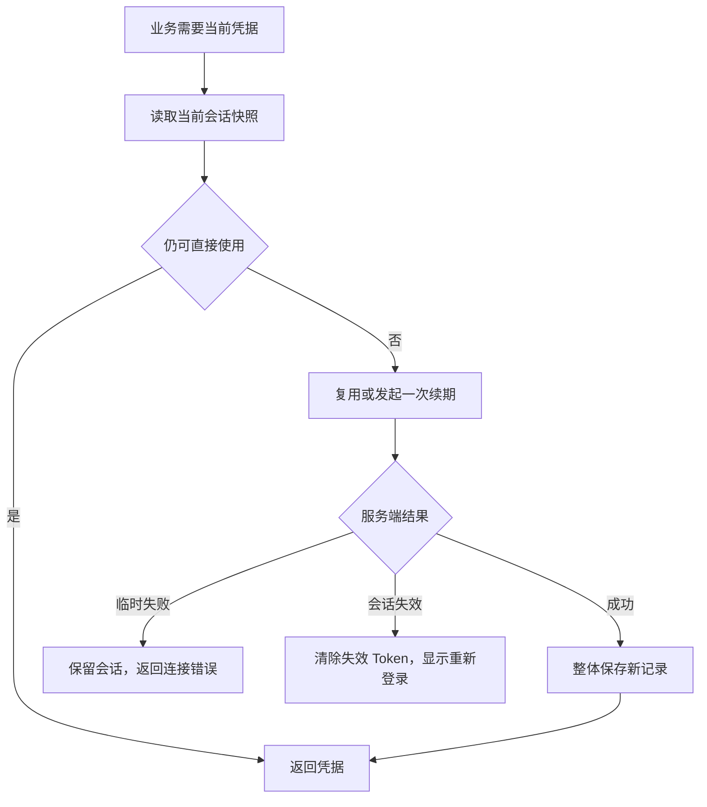

# 维持可续期的账号会话

本增量让已有登录在重启和长期使用后继续可用。业务需要认证时取得当前会话，由认证模块决定直接使用还是续期；并发请求共享同一次续期，新的 Token 整体保存后才成为后续请求的凭据。

前一增量已经能够建立真实会话并恢复账号。本增量集中完成可用凭据的获取、旋转更新和失败分类；下一增量的退出登录会等待这里正在发生的凭据变更收敛。

## 用实际有效时间决定续期

读取 `auth.json` 后恢复会话中的接收时间、Access Token 有效期和 `earliest_refresh_at`。请求前根据实际有效期检查，进入续期窗口时尝试刷新；窗口采用有明确语义的命名常量，不硬编码为固定登录天数。

服务返回的最早可刷新时间限制发起时机。尚未到刷新时间且 Access Token 仍可用时，继续使用；Token 已经不可用而刷新时间仍未到时，返回明确的暂不可用结果，不循环立即请求，也不向模型服务继续发送已过期凭据。

这条路径在取得可用凭据时触发，不添加只为保活而运行的周期任务。启动恢复仍只建立账号状态；Token 是否能够支撑某次调用，由取得凭据的操作判断。

## 一个会话只有一个更新者

同一数据目录已由应用持有进程级独占占用，认证运行内部再串行化会话变更。多个调用同时发现即将过期时，共享正在进行的刷新，不分别消费同一个 Refresh Token。

取得刷新执行权后，核对当前登记与会话代次。如果此前的更新已经完成，等待者直接使用新的结果。登录、刷新、退出的文件提交都经过同一个认证所有者，不额外建立不同模块各自维护的 Token 缓存。

刷新表单发送到 `https://auth.openai.com/api/accounts/oauth/token`，包含 `grant_type=refresh_token`、保存的实际签发客户端标识、当前 Refresh Token 和 `resource=https://api.openai.com/v1`。省略 `scope`，保留原授权；不使用 `dynamic_agent_client` 或 Codex 固定客户端标识。

成功响应中的新 Access Token、替换 Refresh Token、有效期、最早刷新时间和实际范围作为一份记录处理。已有登记身份保持关联，返回的身份信息若有变化，先完成相应身份校验再更新。

## 保存失败不能回到旧的旋转凭据

刷新成功会使旧 Refresh Token 可能不再可用，因此“收到新凭据”和“保存新凭据”需要由认证运行连续持有。

网络返回成功后，认证模块在内存中保存待提交的新记录，通过已有受限权限、同目录临时文件和完整替换机制提交。提交成功后才向等待请求交付新的可用凭据。

写盘失败时保留待提交记录，暂停依赖它的新业务，并显示凭据保存失败。用户重试时先重新保存这份记录，不再次使用磁盘上的旧 Refresh Token 发起交换。持久化错误不能被误报成账号密码问题。

模型操作被取消，不取消认证模块已经开始的 Token 旋转。认证运行独立持有刷新任务，继续完成网络结果判断和必要提交。关闭应用时也必须等待这一更新收敛，再结束 Tokio 和日志输出；不能仅通过丢弃调用者 Future 结束刷新。

## 临时失败与失效会话分别处理

网络故障、服务暂时不可用和未取得可判定响应属于临时或不确定失败。保留账号登记与最后已知的会话，返回当前请求错误，不宣布退出登录。对刷新结果不确定的尝试停止立即重复消费同一旧 Token，先保留可观察错误，再按协议结果恢复。

服务端明确表示刷新凭据不可用时，将该会话标记为需要重新登录，停止继续使用这组 Token，并清空文件中的失效会话。相关错误包括刷新阶段的 `invalid_grant`、`invalid_refresh_token`、`token_expired`、`refresh_token_expired`、`refresh_token_invalidated` 和 `refresh_token_reused`。账号与客户端登记、主机标识继续保留。

清空文件失败时保留明确的存储错误和禁止使用该会话的运行状态，允许重试清理；不能把内存清理冒充为磁盘清理成功。`invalid_client` 属于客户端配置错误，显示对应原因，不让用户陷入重复浏览器登录。

界面中的账号状态和操作反馈分开表达。“正在刷新”可以与已有账号摘要同时显示；一次临时失败不会把界面切回首次登录卡片。

## 请求认证拒绝后的有界恢复

为模型通信提供一次认证恢复能力，保留触发请求所使用的登记身份与凭据代次。收到认证拒绝后，先核对当前会话是否已经更新；同一身份的新记录可以直接重用，否则在刷新条件允许时执行一次续期。

重试只适用于请求尚未进入响应输出阶段且账号身份未变化的情况。恢复后仍拒绝就返回原始分类错误，不无限刷新，不把 `403`、额度不足或不支持的请求当作 Token 到期。

下一次独立用户操作可以重新判断最新状态；同一个网络请求的恢复预算不会因为循环重新构造对象而重置。这里提供认证层的结果与身份约束，实际模型请求重发由模型通信增量接入。

## 实施参照

Codex 的 `codex-rs/login/src/auth/manager.rs` 可参考单一状态所有者、刷新串行化、重新读取与永久失败分类，`auth/storage.rs` 可参考完整记录提交。只保留当前单目录、单会话路径，不复制其外部认证提供者、企业策略、多后端和通用代理分支。

具体有效时间以当前 OAuth Token 响应为准，不照搬 Codex 某个分支的固定天数兜底。项目的文件权限实现仍使用安全 Rust 接口，遵守 `unsafe_code = forbid`。

## 可观察的完成条件

| 场景 | 应取得的结果 |
| --- | --- |
| 新会话再次启动 | 恢复账号，不自动打开浏览器 |
| Access Token 接近到期 | 按返回时间自动续期，用户仍处于同一账号 |
| 多个使用者同时申请凭据 | 只有一次有效刷新，其余使用同一更新结果 |
| 替换凭据成功 | 文件与内存使用同一代次，重启继续使用替换结果 |
| 刷新期间取消业务操作 | 业务结束，已经开始的凭据变更仍完成收尾 |
| 网络暂时失败 | 账号登记和会话保留，错误可重试，不显示已退出 |
| 刷新后无法保存 | 待提交新记录保留，先重试保存而不重复使用旧刷新凭据 |
| 刷新被明确终止 | 禁止使用旧 Token，显示重新登录，保留登记 |

直接运行应用，利用真实 Token 的自然有效期、网络状态和受控目录权限验证相关路径。日志只记录刷新阶段、操作标识、结果类型和脱敏错误，不能为了观察刷新而输出 Token。无法在当前账号和服务条件下触发的分支保留具体记录，不引入伪造授权服务、自动化测试代码或专用 Example。

已产生账号显示变化的路径使用 BRP 检查真实界面与非敏感状态，完成后释放 Pointer 并确认 `inactive`。后续首次模型请求会验证认证恢复与实际网络重试的连接。

## 实施约束与文档同步

在 Windows x64 / MSVC / DX12 环境使用 PowerShell 7。按本增量影响执行格式、编译、Clippy 和必要构建，禁止新增测试、Benchmark、Example；新增依赖和 Feature 只服务当前协议。

按 `rules/development.md` 维护进度、实际运行结果和未完成事项，完成 `rules/code-review.md` 的独立审查。保持 Agent/Tokio 拥有刷新任务，桥接只表达结果，应用辅助 JobManager 不介入认证所有权。

同步认证设计和公开库契约中的可用凭据、共享刷新、保存失败与重新登录语义。保持账号展示与错误区分，日志符合中文正文、英文结构化字段及敏感信息限制。
