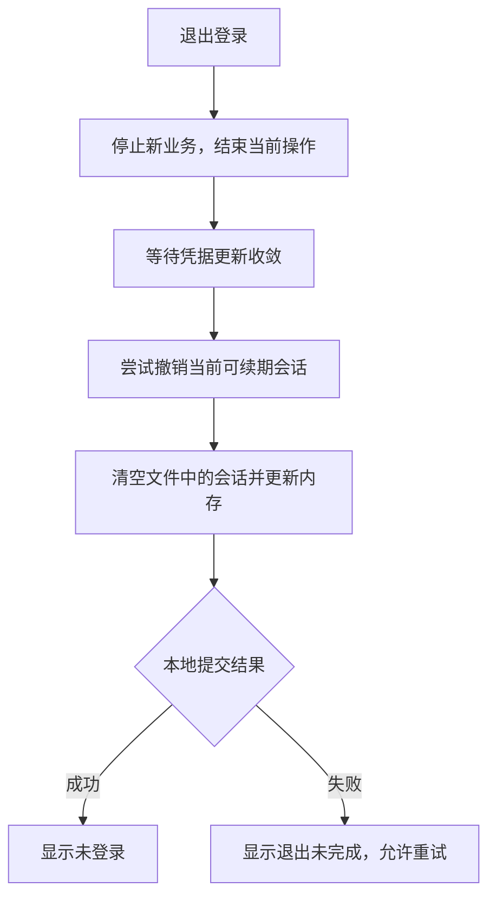
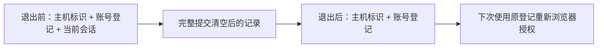

# 结束账号会话并清除凭据

本增量交付账号设置中的“退出登录”。它结束当前账号的使用权限，清除本地 Token，并保留供下一次浏览器登录复用的登记信息。普通关闭应用继续保留会话，两者使用同一套运行收尾能力，但对文件的最终操作不同。

前一增量已经能够串行维护旋转凭据。本增量利用这个所有权结束会话，避免退出以后仍有旧任务把 Token 写回。后续模型请求复用这里的停止接纳、取消和实际结束语义。

## 账号设置中的退出操作

账号区域显示已经校验的账号名称或邮箱，以及当前认证状态。已登录或保留待清理会话时提供“退出登录”；操作进行期间显示“正在退出登录”，禁用重复退出与新的模型操作。

未完成浏览器授权的状态使用已有“取消登录”。退出开始时若仍有后台登录尝试或业务请求，认证运行先停止它们，等待实际终态，不把界面上清空头像当成退出完成。

退出完成后回到未登录卡片，数据与存储设置仍然可用。当前目录、下次启动目录、应用配置和日志保持原样。

## 等待更新后，再使用最新会话撤销

认证运行先停止接纳该账号的新业务，并处理当前登录、模型请求及其回调。正在进行的 Token 更新由认证模块继续持有，等待网络结果与必要提交收敛；退出操作不能同时读取一份旧 Refresh Token 又允许另一任务提交新凭据。

取得最新可用会话后，从固定签发方的 `https://auth.openai.com/.well-known/openid-configuration` 取得 `revocation_endpoint`，发送表单 POST：`token` 为 Refresh Token，`token_type_hint=refresh_token`，`client_id` 为该登记实际签发的客户端标识。

撤销接口返回空 HTTP `200` 作为已确认结果，不要求解析一个成功 JSON。网络失败或 `5xx` 采用有上限的退避重试；重试次数和请求时间使用命名常量，最终仍要给用户一个明确结果，不能永久停在退出中。

远端撤销不会删除客户端登记。没有可用刷新材料时，仍完成本地会话清理，并按实际情况表达远端是否得到确认。

## 清除的是会话，不是整个数据环境

通过已有文件提交入口，将 `auth.json` 中的当前会话置空，清除 Access Token、Refresh Token、ID Token 及仅属于该会话的有效期信息。主机标识、签发方、实际客户端标识和验证后的账号映射继续保留。

因此，退出后 `auth.json` 可以继续存在。验收不能以文件是否被删除判断成败，而要检查它是否还保留能够继续认证的 Token。已有文件夹、配置、日志及用户手动放入的数据均不删除。

提交完成后更新内存账号状态，终止旧会话的使用。所有迟到结果必须携带所属操作或会话身份，旧登录回调、请求结果和刷新结果不能重新激活已经结束的会话。

## 两种失败结果分别反馈

| 结果 | 界面和运行行为 |
| --- | --- |
| 远端撤销确认，本地清理完成 | 显示未登录，后续需要浏览器授权 |
| 远端撤销未确认，本地清理完成 | 显示“已退出本机登录；远端撤销未确认” |
| 本地记录提交失败 | 显示“退出未完成，无法清除本地凭据”，保持禁止新请求并允许重试 |

本地提交失败时，不能把磁盘上的旧凭据说成已经删除。运行中继续禁止新业务，重试清理使用已有退出状态，不恢复普通模型请求。远端已经撤销而本地失败时，仍明确报告本地失败。

反过来，远端暂时不可用不妨碍用户结束本机登录。有限尝试结束后清除本地 Token，保留“远端未确认”结果；不为此引入自动撤销后台守护进程、凭据墓碑或另一份秘密备份文件。

## 关闭应用不是退出账号

直接关闭窗口只触发应用运行收尾：停止新操作，结束登录回调和模型任务，等待已开始的凭据更新，结束 Tokio，再结束辅助工作并刷新日志。当前会话照常保留。

退出登录则在这些账号相关操作收敛以后明确清空会话。下一次启动读取空会话显示未登录；正常关闭后则恢复原有会话。退出登录不更改已经保存的下次启动目录。

## 实施参照

Codex 的 `codex-rs/login/src/auth/manager.rs` 和 `auth/revoke.rs` 可参考本地清理、远端撤销和失败区分；TUI 的登录操作标识可参考迟到结果处理。采用本应用自己的账号登记与会话记录，不照搬删除所有认证存储后端的逻辑。

应用沿现有 `app → bridge → agent` 边界发起退出命令。Agent 持有清理与提交结果，桥接只转译消息；界面以真实终态结束等待。UI 使用 BSN 和 Widgetry 公开状态，不把 Token 放进可反射组件。

## 可观察的完成条件

| 场景 | 应取得的结果 |
| --- | --- |
| 正常退出登录 | 显示未登录，文件无 Token，登记和主机标识保留 |
| 退出后重新启动 | 不自动恢复已清除的会话，提供浏览器登录 |
| 再次登录同一账号 | 复用原客户端登记与主机标识 |
| 仅关闭再启动 | 凭据保留，可正常恢复原账号 |
| 浏览器授权期间结束该账号操作 | 回调被结束，旧页面不能在退出后写回 Token |
| 刷新期间退出 | 等更新收敛后清理，退出结果之后无迟到凭据提交 |
| 远端服务不可达 | 有限尝试后清除本地会话，显示远端撤销未确认 |
| 凭据文件不能更新 | 明确显示退出未完成，允许重试，不能继续发起新请求 |
| 设置了下次启动目录再退出 | 当前与下一次目录设置均保持不变 |

通过 BRP 实际点击账号设置和退出按钮，观察等待、中间状态及最终显示；结合文件结构检查确认 Token 已清空，但不把 Token 值输出到日志或验证记录。浏览器重新授权及操作系统文件权限条件通过实际运行验证。

不能实际触发的轮转竞争或远端分支记录具体限制，不能用睡眠后截图代替真实结束证据。模型请求期间退出的场景在下一增量接入真实请求后完成，验证归属于该实际功能，不另建纯验收方案。

## 实施约束与文档同步

在 Windows x64 / MSVC / DX12 和 PowerShell 7 环境执行适用的格式、编译、Clippy 与真实运行检查。不增加测试、Benchmark、Example；使用现有文件组件和安全 Rust 接口，不引入 Keyring、自动存储后端或额外账号框架。

按 `rules/development.md` 维护根目录临时进度，按 `rules/code-review.md` 完成独立审查。BRP 验证结束释放 Pointer 并确认 `inactive`，正常退出应用，日志最后刷新。

同步账号界面、认证运行和公开库契约中的退出语义。文档明确“清空会话并保留登记”与“关闭应用保留会话”的差别，保持当前数据环境、日志所有权和整体生命周期一致。
