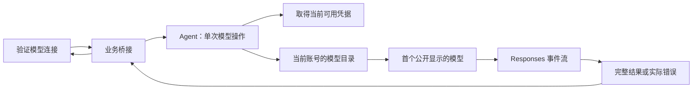
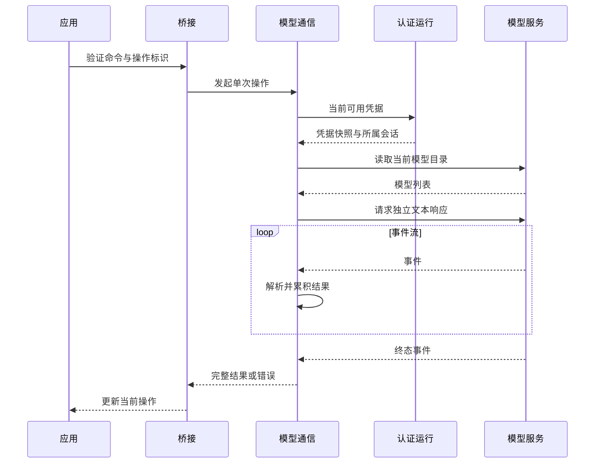

# 完成一次真实模型连接验证

本增量把账号能力接到真实模型服务。用户点击“验证模型连接”，应用使用当前会话取得可用模型，发送一条固定短输入，并在明确收到完成事件后显示模型名称与完整回复。这是独立的单次请求，不建立聊天、历史或 Agent 工具循环。

前面的增量已经提供用户指定的数据环境、浏览器授权、自动续期和退出登录。此处复用这些能力，交付初始开发路线要求的真实模型请求；整体相关验证随这个有实际功能产出的增量完成。

## 一个入口和一条固定输入

账号已登录且实际获得订阅使用范围时，主内容区显示“验证模型连接”。点击后显示正在连接，按钮禁用，直至本次操作取得终态。

输入由应用固定提供：“请简短回复，确认连接正常”。每次点击都是新的独立请求，不携带上一次验证的文本或响应标识。界面只保留当前操作的模型名称、结果或错误，数据目录中不建立会话历史。

没有登录或缺少订阅使用范围时，验证入口不可用，并显示对应账号操作。应用不自动切换成 API Key，也不让用户为这个验证增加一套模型配置。

## 从当前账号取得模型，而不是预置名称

使用当前 OAuth Access Token 调用 `GET https://api.openai.com/v1/models`。读取 `models` 数组，保留 `visibility` 为 `list` 的项目及服务返回顺序，选择第一项作为本次验证模型。

界面显示该项的 `display_name`，请求使用它的 `slug`。没有可显示项、缺少必要模型标识或读取失败时，结束本次验证并说明原因，已有账号状态保留。

本增量不建立长期模型缓存、模型选择器或硬编码默认模型。模型目录和接下来的请求属于同一个账号操作；取得目录期间会话身份变化或退出开始时，结束这次操作，不把一个账号的模型选择带到另一个会话。

## 单次请求使用公开 Responses 路径

请求使用 `POST https://api.openai.com/v1/responses`，认证头为当前 OAuth Access Token 的 Bearer 认证。JSON 请求体仅包含当前模型、独立文本输入以及本路径要求的 `store: false`、`stream: true`。

不调用 ChatGPT 的 `backend-api`，不传入其他客户端内部会话字段，也不为普通文本验证附加 tools、service tier、上下文管理或未使用的能力参数。

请求前向认证模块取得可用凭据。模型目录耗时后如果已经跨过可用时间窗口，发起 Responses 前再次取得同一账号的最新凭据，而不是固定使用最早缓存的一份 Token。

## 流式传输在后台收敛为一个结果

网络字节块不等于 SSE 事件。解析器需要处理跨块事件、空行分隔和连续多个事件，再解析事件中的结构化内容。使用现成的安全解析能力或当前协议所需的最小解析，不把每个 HTTP chunk 直接当作完整 JSON。

累积文本输出时保留必要的输出项身份和顺序，避免多个片段相互覆盖。最终完成对象中的文本可以作为结果的权威来源；若同时处理增量与完成对象，不把同一段正文重复追加。

| 协议结果 | 业务终态 |
| --- | --- |
| `response.completed` | 验证成功，返回模型名称和最终正文 |
| `response.failed` | 验证失败，保留实际错误代码与可读原因 |
| `response.incomplete` | 请求未完成，显示原因 |
| 显式错误事件 | 失败，不发布成功 |
| 连接结束或中断而未见完成事件 | 连接中断，不把已有文本当作成功 |

不依据回复是否恰好包含某个固定字符串判定连接成功。完整完成事件是协议完成条件；没有文本时显示完成但没有文本内容，不伪造模型回复。

界面本阶段在结束后一次性显示正文。传输层必须消费流不意味着要提前实现逐字输出 UI；界面绘制、滚动和文本布局继续沿 BSN 与 Widgetry 的公开契约组织。

## 请求取消与认证恢复各自有边界

同一时刻只运行一个连接验证。重复激活不会重复发送；桥接传递操作标识，旧操作的结果不能覆盖后来发起的验证。

退出登录和关闭应用停止新请求，取消当前模型操作，并等待它的实际结束。取消模型请求不直接丢弃认证模块已经开始的刷新任务；后者仍按认证设计收敛凭据提交。

请求尚未进入响应输出阶段而收到认证拒绝时，在账号身份未变化的条件下调用已有的有界认证恢复，并最多以恢复后的凭据重发一次。开始接收模型输出后不自动重放整个推理请求，以免重复执行。

权限、模型能力、额度和服务故障与认证失效分别处理。保留实际 HTTP 状态、结构化错误代码、可读原因及请求标识；非标准的 `detail` 响应按诊断文本处理，不假设所有失败都有同一种 JSON 结构。

`403` 不自动触发退出；`429` 显示使用限制并停止自动重试，不推断整个订阅已耗尽或凭空给出恢复时间；`503` 和网络故障保留凭据，允许用户稍后重试。本增量不添加后台轮询恢复、计费切换或额度分析系统。

## 实施落点与参照

模型通信位于 `agentelier_agent` 内，通过已有认证模块取得凭据。`agentelier_bridge` 将单次验证命令与终态转成应用业务消息；应用只处理展示，不直接读取 Token 或发送带认证的 HTTP 请求。

Codex 的 `codex-rs/core/src/client.rs` 可参考请求与认证恢复的协作、流完成与错误传播；Responses 事件处理只保留本次纯文本需要的内容。不要复制完整 ModelClient、App Server 协议、工具调用、WebSocket 会话、遥测体系或多供应商抽象。

HTTP、事件流和 Token 处理继续位于 Tokio。目录检查、打开资源管理器等应用辅助工作仍在应用侧。后台先入队再唤醒 Winit，窗口空闲时也能及时显示结果。

## 本增量的完成条件

| 场景 | 应取得的结果 |
| --- | --- |
| 有订阅授权的真实账号点击验证 | 读取当前模型目录，使用可显示模型完成一次请求 |
| 操作等待期间重复点击 | 只发送一个验证操作，完成后恢复按钮 |
| 成功接收完成事件 | 显示服务返回的模型名称与最终正文，正文不重复 |
| 流中途返回失败或未完成 | 显示实际失败，已有账号状态继续保留 |
| 网络断开或流提前结束 | 明确显示连接中断，不以部分内容冒充成功 |
| 认证失效且可刷新 | 使用同一账号恢复后有界重试，没有无限循环 |
| 权限、额度或服务失败 | 分类显示原因，不清空仍有效的账号记录 |
| 请求中退出登录或关闭应用 | 停止新操作并等待实际结束，迟到结果不更新已结束界面 |
| 主窗口空闲时请求完成 | 无需鼠标或键盘输入即可显示终态 |

真实账号请求必须观察到服务端完成或具体失败，不能用本地固定字符串代替回复。模型输出不要求固定措辞。日志记录操作、模型标识、耗时及脱敏错误，不能记录认证头、Token、完整原始响应或无必要的用户内容。

## 连贯使用路径的验证

本增量接通真实请求后，验证整个已实现路径：从没有目录选择开始，用户选择空目录、完成浏览器授权并取得模型回复；关闭后再次启动，恢复同一账号并完成第二次独立请求；退出登录后再次启动显示未登录，重新授权仍使用已有登记。

目录设置的组合行为一并验证：本次使用目录 A，设置下一次使用 B 后继续请求仍写入 A；关闭应用后由用户自行复制所需文件，再启动读取 B。空 B 显示未登录，带有这份应用合法记录的 B 恢复相应账号；A 不被应用移动或删除。带空格、中文的路径也覆盖实际运行。

验证账号权限不足、持久化失败和原生授权等分支时使用实际可触发条件，不能通过直接修改 ECS 状态冒充用户交互。不能取得的服务端分支在进度记录中保留具体原因，不补建自动化测试程序或伪造服务。

Bevy 主窗口使用 BRP 真实输入、截图和非敏感状态检查，浏览器与原生选择器采用真实 Windows 操作。BRP Pointer 在结束时执行 `release` 并确认 `inactive`，随后正常关闭应用，检查后台与日志完整收尾。

## 实施约束与文档同步

保持单进程 Rust、Windows x64 / MSVC / DX12 和 PowerShell 7。新增依赖只服务当前纯文本 HTTP 请求和必要解析，统一通过 Workspace 管理。保留 `unsafe_code = forbid`、无主动 panic 和真实错误传播；不增加测试、Benchmark、Example。

根据最终变更执行 Cargo 格式、编译、Clippy、构建与实际运行检查，不机械重复无关全仓场景。按 `rules/development.md` 维护临时进度并完成 `rules/code-review.md` 的独立审查，记录真实结果后才清理进度文件与提交。

同步首次模型请求设计、账号界面状态和内部库公开功能契约，更新整体架构中的实际模型通信与生命周期关系。最后检查设计导航、相对图片链接和各增量已经落地的文档内容，保持 `docs/` 描述的行为与当前实现一致。
