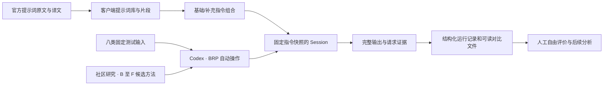

# 提示词管理与输出风格实验：整体设计

整体工作分为两个独立交付目标：先使客户端能够**准确选择和固定模型指令**，再利用这项正式功能，在真实多轮聊天中**自动采集和比较不同指令的输出**。两部分的责任边界明确，第一部分完成后即可单独使用和提交；第二部分不需要把实验执行、评分与报表能力塞进客户端。

本轮功能验证与输出风格实验统一固定模型为 **`gpt-6.1-sol`**、推理强度为 **`high`**。所有指令条件、语言版本、预演、正式运行及重复运行均使用这组参数，并在 Session 快照与实验记录中核对实际请求值。

第一份方案属于客户端功能建设：负责提示词来源与版本、语义切片、基础覆盖、Developer 补充、有效指令预览和 Session 快照，并把真实生效条件开放给可核对的正常运行诊断。它不负责读取固定实验脚本、批量执行矩阵或保存结果报告。

第二份方案属于实验执行与材料分析：固定八类测试输入，对 A1～A6 的英文原文和中文译文分别试验；Codex 通过 BRP 操作真实客户端，保存原始请求条件、完整多轮回答、统计矩阵和可直接填写人工评价的 Markdown。它保留 B～F 类后续扩展来源，但不实现按场景自动加载提示词。

实施顺序是 **提示词管理功能 → 输出风格自动化对照实验**。前一项通过真实运行和 BRP 核对后单独提交；后一项基于已可用的配置和会话能力生成研究文件，不与前一项混成同一次提交。两部分都遵守现有客户端架构、真实 GUI/BRP 验证方式，以及不编写项目内测试代码、Benchmark 和 Example 的约束。

## 方案导航

1. [提示词管理与会话指令快照](01-提示词管理与会话指令快照.md)
2. [输出风格自动化对照实验](02-输出风格自动化对照实验.md)
