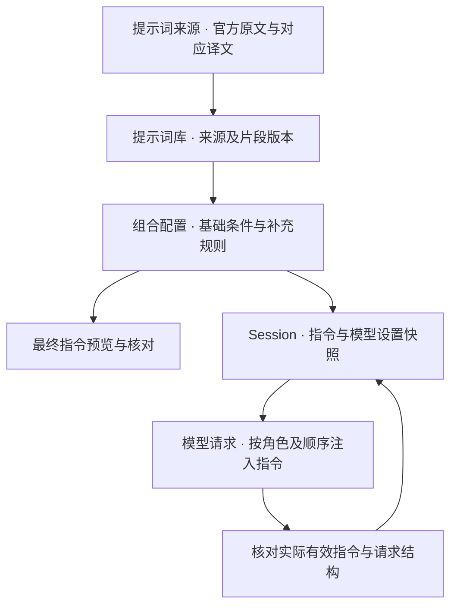
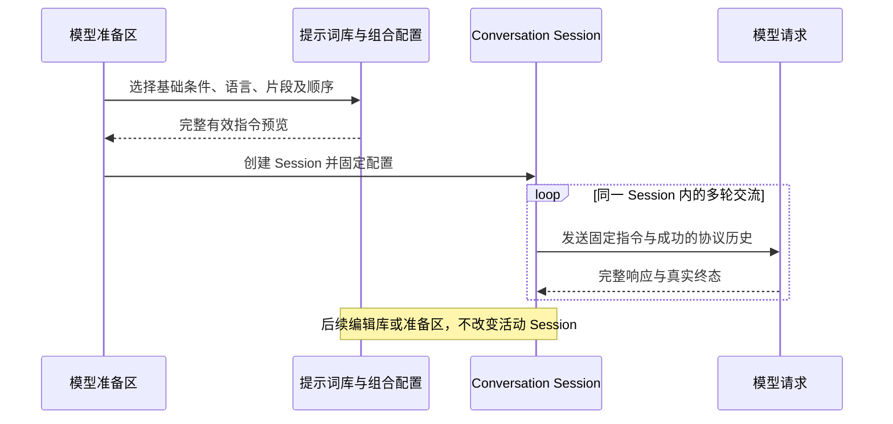

# 提示词管理与会话指令快照

当前客户端支持固定模型及推理设置的内存多轮会话，但聊天请求尚不加载自定义风格提示词。要让同一个问题在不同指令条件下产生可比较的结果，必须先能明确选择指令、确认请求实际使用的内容，并保证一段会话中的指令不会被意外修改。

本方案实现可单独使用的**提示词管理能力**：管理来源文本和语义片段、组合基础指令与补充指令、在创建 Session 时固定配置、核对最终请求。完成后，客户端既能正常进行自定义指令聊天，也为后续外部自动化实验提供可观察、可复现的输入条件。

这里的关键不是堆叠一个复杂的提示词编辑器，而是让**配置是什么、Session 绑定了什么、请求发送了什么**三者能够互相核对。提示词库负责维护材料；组合配置负责选取及排列材料；Conversation 持有会话生效快照；模型请求层负责按协议发送。没有任何一层通过读取界面气泡来重建协议历史。

## 提示词库怎样保存材料

库允许导入、查看、创建、编辑和保存提示词，并且能够复用之前保存的组合配置。对于来源文件，保留来源和修改稿的区别：官方英文原文及已有中文译文作为不被编辑覆盖的来源；需要调整翻译、重新组织文本或创作新规则时，以新条目或新版本保存。实验结果引用的是当时使用的版本，不会因后来编辑而改变。

每个片段至少能够辨认以下信息：

- 片段编号和易读名称；
- 英文或中文，以及其与另一语言片段的配对关系；
- 来源文件、原文对应范围、文本版本和实际全文；
- 完整内容或语义切片的性质；
- 对该片段存在的上下文依赖说明。

长指令按**语义边界**拆分，而不是每隔固定字数切割。切片尽量保留来源原句；片段脱离全文后若需要额外上下文，不应偷偷补写一段新规则，而应显式记录依赖，并在后续组合时决定是否同时包含。这样才不会把文字修改与内容作用混为一项实验变量。

### 需要管理的来源材料

| 来源文件 | 管理用途 |
| --- | --- |
| `codex-prompts/en/model-main.md` | 模型主指令英文原文及 A 类语义片段来源 |
| `codex-prompts/zh/model-main.md` | 对应中文译文，形成中英文配对 |
| `codex-prompts/en/default-base.md`、`codex-prompts/zh/default-base.md` | 默认基础指令的整篇对照资料 |
| `codex-prompts/en/style-excerpt.md`、`codex-prompts/zh/style-excerpt.md` | 核对表达规则摘录，区分原始摘录与重新组合的派生文本 |
| `output-style-research/` | 后续社区规则、示例、历史反馈等候选来源，不混入官方原文 |

中文材料是对应译文，不标记为官方中文原文。英文原文不润色；对应中文先核对语义，不把翻译时额外增加的规则伪装成语言差异。

### 首批片段分类

管理功能需要容纳以下已确定的片段及其英文、中文版本，保留完整文本与切片的来源关系，而不是在程序里硬编码某段固定文案。

| 片段 | 内容 | 对应来源范围 |
| --- | --- | --- |
| A1 | 人格与交流立场 | `# Personality` |
| A2 | 对话适应 | `## Writing style` 首段 |
| A3 | 语言表达与说明方式 | `Writing style` 第 2～3 段 |
| A4 | 段落与列表组织 | `Writing style` 第 4 段 |
| A5a | 词汇、套话与固定句式限制 | `Writing style` 第 5 段 |
| A5b | 结构性对照、空泛过渡等限制 | `Writing style` 第 6 段 |
| A6 | 技术沟通 | `## Technical communication` 中的通用内容，不含 PR 小节 |

上述七个语义单元共十四个语言片段，使用 `A1-EN`、`A1-ZH` 等形式标识。A7（PR 专项写作）不进入本次片段集。分类是实验约定，不声称它们是 Codex 官方发布的片段分类。

完整全文和派生组合需要有不同身份：`model-main` 全文、`default-base` 全文、已有 `style-excerpt` 来源文件，以及按 A1～A6 顺序重组的表达规则集合，不应互相冒充。后者即使内容相似，也不能称为未经修改的官方摘录全文。

## 基础指令与补充指令为什么分开

一个实验配置由**基础指令条件**和**Developer 补充指令**构成。它们是客户端中两个明确的配置槽位，不等于服务器向外公开了两种优先级不同的系统层次。

- **基础指令条件**：保持当前客户端的默认请求行为，或使用指定自定义文本覆盖客户端准备的基础文本。
- **补充指令条件**：在当前基础条件上增加所选片段，能够控制启用项和排列顺序，也可以为空。
- **预设组合**：保存基础条件、片段选择、顺序及语言等信息，供之后创建 Session 时复用。

必须明确区分以下三种情况：

1. **不使用客户端自定义指令**：沿用现有聊天请求；不表示服务端没有不可见指令。
2. **替换客户端基础文本**：把指定文本作为客户端有效基础条件；不能宣称覆盖了服务端内部系统指令。
3. **保留基础条件并追加规则**：用于观察一个片段在既有基础上的增量作用。

Codex 的公开实现提供了类似的区分：按模型选择基础指令、允许覆盖基础指令文件，并额外维护 Developer 补充指令。借鉴的是**管理语义和来源分层**，不是无条件复刻 Codex 的所有上下文管理功能。

尤其要注意，基础文本与补充文本在实际 Responses 请求中可能都表现为 `developer` 角色消息；如果两个配置最终发送的请求完全相同，就不能声称测试了两种不同的指令层次。预览和实验记录要显示的是**具体文本、消息角色、放置位置及先后顺序**，而不只是库里的标签。

## 一次会话怎样固定配置

现有聊天在创建 Session 时固定模型、推理设置与账号身份。新增的提示词配置遵循同一原则：创建 Session 时，把当时的基础文本、补充片段、顺序和来源版本解析为一份**生效指令快照**，此后整个多轮会话都使用这份快照。

本轮功能验证及后续对照实验创建 Session 时，模型固定为 `gpt-6.1-sol`，推理强度固定为 `high`。会话配置、快照与实际请求均须核对这两个值；多轮、重试及不同提示词条件保持一致。这是本轮验证与实验的参数约定，不要求将客户端通用模型选择能力硬编码为这组值。

因此，在准备区切换到其他提示词只影响之后新建的 Session。现有 Session 的重试沿用旧快照；重置当前会话时延续现有“复制当前会话设置”的语义，新建会话则取准备区当前设置。不同配置的正式对照必须使用不同 Session，不能在同一段历史中途换提示词后仍称为独立实验。

快照不能只记录 `A4-ZH` 这样的标识，应包含足以恢复当时请求的完整有效指令、片段来源与版本、内容哈希、配置槽位、消息顺序及请求模型与推理条件。哈希用于快速核对，不替代完整文本。对于不能观察到的服务器端隐藏指令，只记录其不可观测性，不猜测其具体内容。

本阶段不要求持久化整段聊天历史；提示词材料及预设可保存，而现有内存聊天的历史生命周期不因此被改写。

## 界面与现有模块的关系

功能入口保留在模型准备与会话创建相关的现有 UI 中。用户能够浏览或编辑提示词库、选择基础指令、启用并排序补充片段、查看最终有效指令，并用当前配置创建 Session。界面是正式的提示词管理界面，**不是实验仪表盘或测试结果展示界面**。

模块职责延续现有架构：

| 所在职责 | 本次需要承担的行为 |
| --- | --- |
| `chat_ui` | 配置选择、编辑与预览，创建会话时提交已选配置 |
| `conversation` | 固定 Session 有效指令快照、保持多轮及重试的一致性 |
| `llm_model` | 依据实际协议构造有角色及顺序的模型请求 |
| `bridge/conversation` 与 Runtime | 按已有跨运行边界传递配置和执行结果，继续负责操作及任务生命周期 |

提示词库不能直接拥有网络请求，也不能反向控制运行线程；UI 不从气泡文本拼接上下文。实现遵守既有 `ui`、`bridge`、`agent` 职责方向，不为未来实验预先建立通用执行框架。

### 可观察性与 BRP

后续 Codex 会通过 BRP 操作**真实界面**。所以已有的配置控件应能够稳定识别、选择和核对，并能够查看会话实际生效的配置。不能把一个只有原生操作系统文件对话框才能完成的导入动作设为实验的必经步骤；来源材料可以通过应用可访问的文件导入或已保存的预设准备。

对请求正确性的核对不能只看 UI 是否显示“已选择 A1”。需要能检查客户端最终构造的指令文本、角色及顺序，与 Session 快照是否一致。如果现有诊断途径不足，可补充供正常运行调试使用的安全只读状态或配置预览；不因此新建一个只给自动测试使用的执行器。验证码据可以由 BRP 查询、应用运行时状态和必要诊断组成，不输出账号凭据或隐私数据。

## 完成条件与边界

这项能力完成时，应能直接在客户端观察并验证以下行为：

- 原始官方指令和译文可以导入、查看及按语义片段组织；编辑生成新版本，不破坏原文及旧引用。
- 能分别选择“无附加指令”“指定基础文本覆盖”“保留基础并增加补充规则”，并能够检查完整有效文本和顺序。
- 模型固定为 `gpt-6.1-sol`、推理强度固定为 `high` 时，在不同独立 Session 中选择不同片段，实际客户端请求携带对应的正确指令；同一 Session 多轮保持不变。
- 在会话创建后更改库内容或准备区选择，不影响已有会话；失败后重试沿用当时快照。
- BRP 能通过真实界面完成选择、创建和核对；运行时状态或诊断证据能够支持“指令真正生效”的判断，而不只显示操作成功。
- 已有流式回复、协议历史、生成取消及账号身份保护等行为保持一致；有界执行与任务回收语义不被破坏。

功能通过针对性构建与真实 GUI/BRP 行为验证后，可作为**独立功能提交**。相应已实施的模块设计及架构文档同步更新；尚未实施的后续实验内容仍保留在方案区，不提前记为现有功能。

项目不编写或维护单元测试、集成测试、Benchmark、Example 或专用测试执行程序。BRP 是项目允许的真实 GUI 验证方式。实际修改仓库时遵守原有任务进度记录与提交规则；未经明确授权，不为了验证重新登录、退出账号、清空凭据或切换数据目录。

本方案不承担八类输入脚本、批量 BRP 实验调度、结果文件生成、人工评价、动态场景识别或按场景自动切换提示词。这些属于随后独立开展的风格对照实验或更晚的功能设计。
