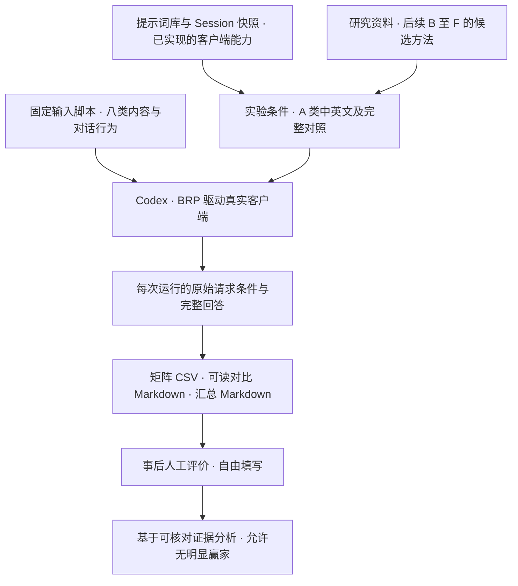
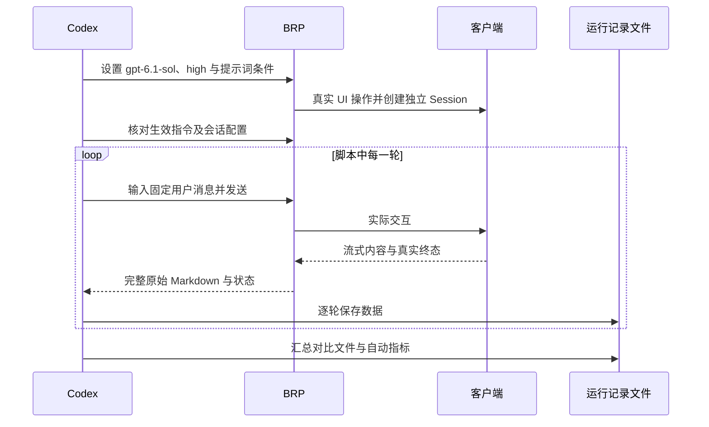

# 输出风格自动化对照实验

在客户端能够管理、预览并固定有效提示词之后，才有条件回答真正的研究问题：**同样的中文输入，在不同指令内容、语言和放置方式下，模型输出究竟有什么变化？**

本方案不开发新的客户端实验执行系统。Codex 使用 BRP 操作真实 GUI，依次创建独立 Session、输入固定脚本、等待完整终态，再将原始输出和分析整理为文件。使用者在全部文件生成后阅读回答，在 Markdown 中自由填写人工评价。



实验有两个彼此独立的坐标：**指令条件**说明模型收到哪些附加规则，**测试脚本**说明用户说了什么。一个运行由“指令条件 × 测试脚本 × 重复序号”确定。研究结论首先要对应可读的真实回答，而不是一份抽象总分。

本轮实验模型固定为 **`gpt-6.1-sol`**，推理强度固定为 **`high`**。这一约束覆盖所有 A 类片段、完整对照、后续组合及 B～F 候选实验，也覆盖预演、正式运行、重复运行与中断续接。创建 Session 后核对快照及实际请求；参数不符的运行记录为配置异常，不纳入有效对照样本。

## A 类实验条件怎样形成

A 类使用收集到的 Codex 官方英文指令和相应中文译文。官方原文片段不为了易读而润色，中文译文不添加新规则，正式运行前核对两种语言的语义。用户输入仍统一使用中文，切换指令语言时不改变问题本身。

### 七个独立语义单元

| 编号 | 语义单元 | 来源范围 | 成对条件 |
| --- | --- | --- | --- |
| A1 | 人格与交流立场 | `# Personality` | `A1-EN`、`A1-ZH` |
| A2 | 对话适应 | `## Writing style` 首段 | `A2-EN`、`A2-ZH` |
| A3 | 语言表达与说明方式 | `Writing style` 第 2～3 段 | `A3-EN`、`A3-ZH` |
| A4 | 段落与列表组织 | `Writing style` 第 4 段 | `A4-EN`、`A4-ZH` |
| A5a | 词汇、套话与固定句式限制 | `Writing style` 第 5 段 | `A5a-EN`、`A5a-ZH` |
| A5b | 结构性对照与空泛过渡限制 | `Writing style` 第 6 段 | `A5b-EN`、`A5b-ZH` |
| A6 | 技术沟通 | `## Technical communication` 通用内容 | `A6-EN`、`A6-ZH` |

共七个语义单元、十四个单片段条件。`A7` PR 专项写作已排除。A5a、A5b 必须独立测试：模型不再使用某个常见词，不代表它停止了模板化的表达结构。

切片优先从 `codex-prompts/en/model-main.md` 和 `codex-prompts/zh/model-main.md` 提取；`style-excerpt.md` 用于对应关系核对，不自动作为七个片段的全文替代。若单独切片失去必要上下文，记录依赖，再另设明确标注的组合条件，不能悄悄增补规则。

### 完整文本与默认行为对照

| 对照 | 输入条件 | 比较意义 |
| --- | --- | --- |
| `A0` | 不配置客户端附加指令 | 当前客户端请求行为的基线；不代表服务端完全没有隐藏指令 |
| `A-F1-EN/ZH` | `model-main` 整篇来源文本 | 官方主指令整体表现 |
| `A-F2-EN/ZH` | `default-base` 整篇来源文本 | 默认基础指令整体表现 |
| `A-F3-EN/ZH` | 按原顺序组合 A1～A6，含 A5a、A5b | 仅表达相关片段的组合对照；是派生组合而不是原始摘录全文 |

完整文本条件可能包含工具、权限、执行工作流等当前客户端不具备的能力。由此引出的回答差异，不能全部归因于表达风格；分析时须注明完整指令与纯风格片段的任务范围不同。

### 先保持单因素，再探索组合

第一批在**固定的基础条件**下逐一加入十四个单片段作为 Developer 补充，与 `A0` 比较；完整文本组作为单独的客户端基础文本覆盖条件。不要在这一批里同时改变模型、推理强度、提示词内容、提示词语言和指令放置位置。

同一个英文/中文配对使用同样的中文脚本、同一模型、同一推理设置、同一基础条件及相同的重复次数。结果差异需要跨重复样本观察，单次生成不能代表稳定胜负。

初步筛选出值得关注的语义片段后，可以再比较例如 A1+A2、A2+A4、A4+A5 的组合，或相同文本在基础覆盖和 Developer 补充中的差异。组合优先保持同一种指令语言，不把中英混合同时作为隐藏变量。任何组合如果映射出相同的实际请求文本和角色顺序，应当视为同一有效条件，而非两种已经被区别验证的机制。

## 测试输入：八类内容与不同对话行为

统一固定测试输入，既覆盖内容主题，也覆盖简单确认、连续追问、纠正、修改要求等对话行为。这两条维度不要求做全量笛卡尔积；重点是提供足够多样、可以重复使用的典型脚本。

| 内容类别 | 典型内容 | 关注点 |
| --- | --- | --- |
| 日常聊天 | 感叹、吐槽、玩笑、简单确认 | 接话自然、能适时停止、不无故展开 |
| 知识问答 | 事实与概念、小问题 | 准确、直接，不把普通回答写成教程 |
| 技术解释 | Rust、Bevy 或架构概念的解释 | 清楚、可调整解释层次、不丢必要细节 |
| 技术讨论 | 设计取舍、提出异议、改变设想 | 有独立判断、给出理由，不机械迎合 |
| 问题排查 | 异常现象、新线索与逐步定位 | 能随证据更新判断，不循环输出模板清单 |
| 文档写作 | 解释设计、整理资料、修订说明 | 组织合理、信息完整、用语自然 |
| 数学推理 | 推导、证明、反例、纠错 | 逻辑正确、步骤够用、符号与前提严谨 |
| 科研讨论 | 论文、实验方法、研究结果、学术写作 | 区分事实与推测、证据意识、批判性判断 |

每类优先使用约三至五个真实对话脚本，保留自然措辞和必要前文，删除隐私及无关上下文。只有缺少适合的真实资料时，才补充人工编写的案例。

一个脚本由事先确定的用户轮次组成。例如技术解释先询问概念，再说“还是不理解，换个例子”，最后简单确认。同一个脚本在所有条件下用户话语和顺序不变；模型在不同条件下给出的前两轮回答自然会分叉，所以多轮实验比较的是**整段会话策略**，不能把第三轮差异全归结为第三轮单句指令。

测试脚本先形成候选集，再冻结正式使用版本，另留部分未经提示词调试的案例用于复核。数学和科研材料尽量提供能核对的已知结果、原始事实或文献背景；缺乏可靠答案时，宁可标注正确性未评估，也不生成看似精确的正确率。

## Codex 通过 BRP 怎样执行



执行方是 Codex，BRP 负责真实 Bevy GUI 交互；不增加独立实验驱动程序、自动化测试代码、Benchmark 或 Example。客户端负责正常聊天和模型请求，不承担生成实验报告。

### 开始前必须能核对的条件

- 能通过 BRP 稳定选择 `gpt-6.1-sol`、`high` 和提示词配置，完成新建 Session，并核对快照及实际请求值；
- 能检查会话绑定的**完整指令快照**，以及实际构造请求中的客户端指令角色、先后顺序和全文；
- 能读取每轮完整原始 Markdown、输出项顺序、公开阶段与真实终态，不依靠可视区域截图推断完整回答；
- 能区分任务合法完成、失败、取消、断流、超时以及操作未回收等状态；
- 运行中的身份和登录状态不因实验自动化被重新授权、切换或清除。

如果原文或请求证据暂不可观察，应先补齐正常客户端可用的检查能力；不能把局部可见文字、UI 上的预设标签或 BRP 操作成功本身当作已验证请求和响应。

### 运行隔离、重复与恢复

每个“条件 × 脚本 × 重复序号”使用独立的新 Session，保持模型和推理设置一致。脚本内部则继续使用该 Session 的真实成功协议历史。前一条件的回答不得进入下一条件的上下文。

只有上轮任务真实完成且回收后，才继续发送脚本下一轮。失败及取消的尝试记录其实际状态和已得到的原文；不把它们填成完整答案，也不能用失败记录参与质量评分。原有聊天任务的失败/取消语义保持不变。

为了观察生成随机性，重要条件需要多次重复。条件执行顺序可交错或轮换，减少服务端时间变化集中影响某个条件；记录实际时间、执行顺序、模型设置和请求身份。每个完成的运行及时落盘，允许中断后按运行唯一标识续接，不覆盖已有原始输出。

正式批量执行前，可以先用每类少量脚本、少量重复进行短规模预演，确认真实配置生效、输出采集完整、文件可读，再运行冻结后的完整脚本集合。该预演是正式客户端的真实操作，不需要单独的实验程序。十四个单片段、完整对照、重复次数以及后续组合很容易产生大量请求，没有必要一次做全部交叉条件。

## 自动评价提供哪些证据

自动分析是辅助检查，不负责宣布最终赢家。输出长短、标题数量或某个套话命中次数都不是单独的“好坏”判断；不同类型的回答也不该机械套用同一评分规则。

| 观察维度 | 可以记录的内容 | 判断边界 |
| --- | --- | --- |
| 输出规模与成本 | 字符数、段落数、可取得的 Token、耗时及波动 | 简短不必然更好；复杂数学问题需要完整推导 |
| 套话与模板结构 | 可定位的词句命中、重复开头、机械总结、固定转折 | 使用中文和英文对应检测规则，保留命中原文及位置 |
| 交流适应 | 对确认是否无关展开、是否答非所问等候选问题 | 属于需要人工复查的线索，而非自动定论 |
| 内容覆盖与完整性 | 固定脚本预设的任务点及支持证据 | 缺少已知检查点就写“未评估” |
| 数学与科研正确性 | 对照已知解答、题设事实、原始研究材料的差异 | 不凭语言流畅程度判定公式或科研结论正确 |
| 技术运行质量 | 完成率、失败类型、调用消耗、请求配置是否一致 | 运行失败与回答内容质量分开 |

指标既保留按测试输入聚合的结果，也能汇总到八个内容类别。不要只输出一个无法核对的自然度分数；自动生成的定性判断必须能指向原始回答证据。可以出现“没有明显差异”“样本不足”“某条件更短但遗漏关键推理”等结论。

## 文件形式的实验结果

实验不增加结果展示 UI，也不要求客户端持久化对话。每一批实验使用独立结果目录，便于保存和对照：

```text
experiments/
  A-official-v1/
    manifest.json
    prompts/
      effective-instructions.jsonl
    cases/
      cases.jsonl
    runs.jsonl
    matrix.csv
    comparisons/
      T-001.md
      T-002.md
    summary.md
```

### 原始运行记录与统计矩阵

- `manifest.json` 保存本批实验的条件集、固定模型 `gpt-6.1-sol`、固定推理强度 `high`、输入版本和执行顺序；各运行的请求配置记录对应的实际值。
- `prompts/effective-instructions.jsonl` 保存每个条件的来源、片段版本、语言、基础/补充槽位、消息角色和顺序、有效指令全文及内容哈希。即使后续编辑提示词库，也能恢复当时文本。
- `cases/cases.jsonl` 保存冻结的八类输入脚本、每轮用户消息、必要前置事实、期望检查点和输入版本。
- `runs.jsonl` 逐运行保存条件 ID、脚本 ID、重复序号、Session 标识、每轮原始用户输入、助手原始 Markdown 与输出项、请求配置引用、真实终态、失败原因、时间和可取得的用量数据。
- `matrix.csv` 按条件和输入类别汇总自动指标、有效运行数量、波动和原始记录位置，不强制计算全局排名。
- `summary.md` 记录自动观察到的变化、反例、执行异常及其证据位置，允许“没有明显赢家”及“样本不足以判断”。

这些结构用于把原始证据与整理结果分开，不能让后续生成的 Markdown 成为唯一原始数据。技术失败不能计为“坏回答”；服务器端隐藏的指令仍按不可观测记录，不得伪称已捕获。

### 人工阅读的对比 Markdown

按测试脚本生成 `comparisons/T-001.md` 等文件，同一问题的不同条件放在一起，并保留多轮脚本的**整个会话**。候选可在阅读前显示匿名标签，实际映射单独保存在结构化记录中，减少标签带来的先入为主；阅读后仍应能够准确恢复 A4-EN、A4-ZH 等真实条件。

示例结构：

```markdown
## A4-EN

### 模型回答

（完整回答，多轮时依次保留每一轮）

### 人工评价

---

## A4-ZH

### 模型回答

（完整回答，多轮时依次保留每一轮）

### 人工评价

```

**`人工评价` 后面完全留空。** 不生成“待评价（好 / 不好）”，不增加“备注”、五分评分、单选控件或赢家选择。使用者可直接写“好”“不好”，也可以自由写一整段评价，人工文本不要求结构化。自动分析独立保存，不能提前替使用者填写评价。

已有人工评价的文件在重新生成结果时不得被覆盖。需要重算自动指标或重排对比时，应保留人工填写区，或生成新的文件而不动原文件。机器记录和人工阅读文件之间保持稳定引用，方便之后再分析。

## 研究资料如何影响后续实验

`codex-prompts/` 提供本批 A 类官方指令素材；`output-style-research/` 的作用是提出**后续可证伪的改善方法**，同时帮助挑选输入和观察指标。它们不是已经证明有效的提示词。

| 方向 | 候选方法 | 材料依据 |
| --- | --- | --- |
| B：表达规则 | 读者导向的写作要求、去除无意义模板结构 | `first-read`、`unslop` |
| C：示例学习 | 使用个人真实作品、正面范例与反例 | 社区方法与个人资料 |
| D：历史反馈 | 只注入相关历史回复或评价，观察是否改善后续表达 | `dsh-bili-scroll` |
| E：输出检查 | 检测套话、重复、无关扩展，保留定位证据 | `dsh-bili-scroll`、`unslop` |
| F：针对性改写 | 对有证据的问题进行有上限的再次改写，保留改写前后版本 | `dsh-bili-scroll`、`unslop` |

B 站的对话示例可帮助理解自然接话、适时解释和何时结束，但不把他人的人设作为必须模仿的指令。`dsh-bili-scroll` 中具体的相似度阈值、最近回复窗口等机制不能不经验证照搬；`first-read` 的英文写作要求也不能未经处理就直接当作中文规则。

B～F 类沿用同一输入与文件格式，但生成前干预、生成后检测、检测后改写必须在记录中区分，避免把几种机制同时打开后无法判断改善来自哪里。此阶段不强制完成 B～F 的全部实验；A 类正式结果先回答官方原文及中英文差异的问题，再选择值得验证的社区方法。

未来可以根据日常聊天、科研或数学等不同场景选用不同提示词，但本方案**不实现按场景自动判断、动态加载提示词或切换策略**；实验阶段只保留分场景结果，供之后作决定。

## 验证标准与执行限制

完整实验应能够确认：

- 同一组固定中文输入在不同指令片段、中英文条件和完整对照下可重复执行，且实际请求条件可追溯；
- 各配置使用独立 Session，模型均为 `gpt-6.1-sol`、推理强度均为 `high`，同一多轮脚本的真实协议历史完整，失败与取消不伪造成功；
- 每次运行的原始回答与请求配置在 `runs.jsonl` 中可定位，机器统计和原始文件相互对应；
- 对比 Markdown 能直接阅读同一脚本的各组完整回答，人工评价区域为空且可随意编辑；
- 自动结论允许优劣因场景不同、没有明显赢家或样本不足，并提供可核对证据；
- BRP 操作遵守真实 GUI 行为与任务终态，账号、凭据和既有聊天执行功能不受实验破坏。

实验仅依赖已经实现的正常客户端提示词管理能力和 Codex 外部 BRP 操作，不引入项目内自动化测试代码、独立驱动器、Benchmark、Example 或结果展示 UI。实验产生的文件作为研究材料保留；不把尚未验证的研究结论写成正式产品功能。
