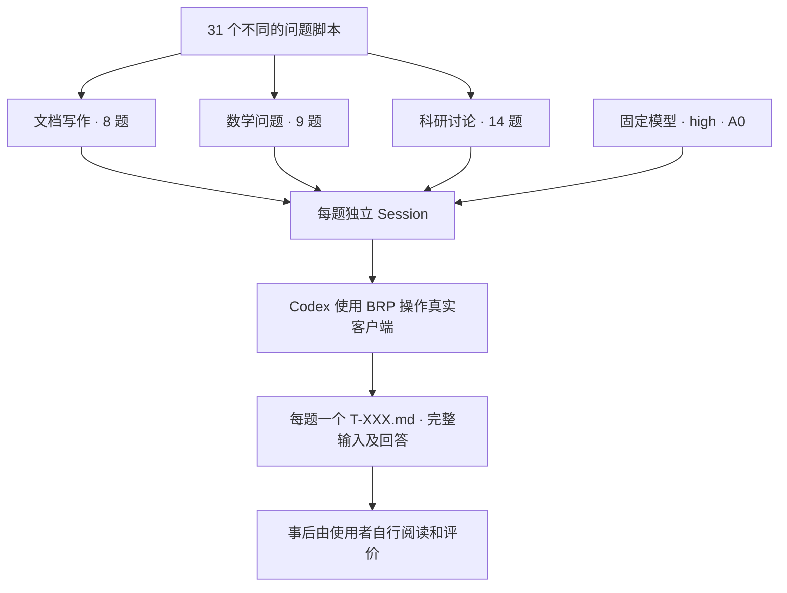

# A-official-v2：默认指令下的写作、数学与科研讨论实验

## 实验思路

本轮不再比较提示词优劣，而是固定模型和默认指令条件，把观察对象改为**不同任务本身**。上一轮的部分回答已经相当自然；较明显的防御性表达主要出现在需要审查论据、限定结论或比较不确定方案的情境中。需要继续区分的是：这些表达究竟是必要的严谨性，还是超出任务需要、影响阅读的重复限定。

同时补足上一轮的两个输入缺口：文档写作必须覆盖**长短篇幅和多轮编辑**；数学题目必须达到数学专业高年级的证明与推导水平。科研讨论则跨实验研究、概念论证及调查研究，避免把一种研究方法误认为整个学科的特征。



此处的一题指一个独立问题脚本，可以包含多轮输入；同一道题**不做重复采样**。全部 31 题仅执行各自一次，不需要统计显著性、自动评分或选出赢家。

## 固定运行条件

| 项目 | 本轮条件 |
| --- | --- |
| 模型 | `gpt-6.1-sol` |
| 推理强度 | `high` |
| 提示词条件 | `A0`：客户端不注入任何自定义基础指令、Developer 补充指令或额外风格片段 |
| 用户输入语言 | 中文；数学符号、文献术语按题目原样保留 |
| Session | 每题新建独立 Session；多轮题仅在自己的 Session 中连续进行 |
| 重复 | 每道题执行一次，不做多次随机重复 |
| 运行方式 | Codex 通过 BRP 操作 Agentelier，使用真实模型响应 |
| 输出目录 | `experiments/A-official-v2/` |
| 输出文件 | `T-001.md` 至 `T-031.md`，仅这些逐题记录 |
| 自动评价 | 不评分、不总结、不排序、不生成其他报告 |
| 人工评价 | **不预留人工评价栏目**；文件完成后由使用者自行决定在哪里写整体评价 |

A0 是**不主动注入自定义提示词**，并不等于宣称远端服务或模型没有任何内置指令。本轮没有中英文提示词对照，也不包含后续按场景自动选择提示词的功能。

一个实验脚本的全部轮次在一个 Session 内完成；不同脚本之间不继承历史。需要改写的任务，后续输入只引用先前脚本中明确要求生成的内容或实际可观察到的文本，不能凭空假定前文出现过某个词。

## 输出文件与采集方式

每道题生成一个 Markdown 文件，保留该题的全部预设用户输入、模型可见回答及其发生顺序。对于多轮题，按轮次完整排列；对于单轮题，仅一轮。**不加入「人工评价」「备注」「评分」等空栏。**

格式示例：

```markdown
# T-004 · 技术文档 · 长文档 · 多轮

- 条件：A0
- 模型：gpt-6.1-sol
- 推理强度：high
- 执行状态：已完成

## 第 1 轮

### 用户输入
（本轮完整输入）

### 模型回答
（模型实际返回的完整可见文本）

## 第 2 轮

### 用户输入
（本轮完整输入）

### 模型回答
（模型实际返回的完整可见文本）
```

只有运行事实出现在记录中：禁止替模型润色、纠错、摘录、拼接理想回答，或把 Codex 对回答的判断混入正文。如果模型输出含公开的不同消息阶段，按实际出现顺序如实保留对应的可见文本；不采集或输出隐藏推理、加密协议字段及认证信息。长文档即使明显冗长，也要保留全文，不能为控制文件大小截断。

若某轮失败、取消或只有部分输出，在同一个 `T-XXX.md` 中注明真实状态并保存实际已取得的可见内容；不要把部分回答记为成功，也不要为了凑齐数据自动反复重跑同一题。Codex 的任务是**执行和记录**，不是分析模型输出。文件中不生成自动指标、评分表、总览、结论或结果 UI。

## 文档写作：T-001 ～ T-008

文档类按**文体 × 篇幅**取样，共八题。长篇不等于多轮，短篇也不等于单轮；部分脚本特意增加修订、局部编辑、生成终稿和确认结束等后续动作。对于指定长度的任务，记录模型实际写了多少即可，不需要执行者替模型补足字数。

### T-001 · 小说 · 短篇 · 单轮

**第 1 轮用户输入**

> 写一个约 500～700 字的中文短篇小说片段。场景是小城一家即将永久关门的旧书店，主人公来取回少年时寄存在店内的一封信。人物只出现店主和主人公，故事必须在书店关门前的半小时内发生。不要写内容提纲、创作说明或结尾解析，直接写故事；允许留下少量未解释的信息，但必须有明确的情绪变化。

### T-002 · 小说 · 长篇 · 四轮

**第 1 轮用户输入**

> 请写一篇约 2500～3500 字的完整中文短篇小说，不要写大纲或创作说明。背景是一座以潮汐闸门维持老城区安全的海边城市。两名多年没有联系的兄妹在暴风雨前夜，被迫一起去检查一座已停用的机械潮位站。故事必须包含三个明确事件：他们在站内发现一份与旧事故有关的记录；其中一人试图隐瞒记录；最后两人必须在公开记录与及时维修闸门之间做选择。人物动机不要用旁白直接解释完，结尾给出行动结果，但不必解开所有历史谜团。正文按自然段写，不加章节标题。

**第 2 轮用户输入**

> 我想让开头更有现场感。请只重写这篇小说的开头部分：从兄妹第一次踏进潮位站开始，把前情融进动作和对话里，不要先用大段背景介绍。给出替换用的完整开头，暂时不要重写全文。

**第 3 轮用户输入**

> 把刚才修改的开头整合进原故事，再输出完整终稿。检查兄妹的动机、记录被发现与被隐瞒的先后顺序、暴风雨中的时间线是否自洽。不要在正文外解释修改过程，仍然是一篇完整小说。

**第 4 轮用户输入**

> 好，就用这一版。

### T-003 · 技术文档 · 短篇 · 两轮

**第 1 轮用户输入**

> 写一篇约 500～700 字的技术说明，给刚加入团队的开发者解释：为什么流式聊天客户端不能直接把界面上看到的消息气泡当作下一次模型请求的历史。假定系统会收到流式增量、取消、失败、最终完成四种事件。说明协议历史与界面展示各自负责什么，以及哪些回答能进入下一轮上下文。只写技术说明，不给代码，也不要把它扩成系统设计方案。请使用三个自然段。

**第 2 轮用户输入**

> 第二段有点抽象。只改写第二段，用一个“生成中被用户取消”的具体例子说明为什么显示出来的部分回答不能直接进入协议历史；第一段和第三段不用重发。

### T-004 · 技术文档 · 长篇 · 四轮

**第 1 轮用户输入**

> 为一个单进程桌面聊天客户端写一份约 2500～3500 字的技术设计文档。已知条件：界面使用事件循环，模型请求在独立异步执行环境中完成；同一时刻只能有一个活动生成任务；支持多轮对话、流式文本、停止生成、失败后重试和新建会话；只有合法完成的输入与输出会提交到下一轮协议历史；界面展示记录可以保留失败和取消的部分结果；模型、推理强度与提示词配置在创建 Session 时固定。文档要解释整体职责、会话与轮次状态、请求和结果流向、历史提交条件、停止与重试的区别、能观察到的行为和边界。使用清晰的 Markdown 标题，可以有一张简短 Mermaid 图；不要写具体 Rust API 或代码实现。

**第 2 轮用户输入**

> 我主要想让新同事理解“展示记录”和“协议历史”的区别。请仅重写原文中解释这两者关系的部分，并加入一个取消生成后继续追问的完整流程例子。其他章节不重发。

**第 3 轮用户输入**

> 再检查一下原设计：如果某次流式请求已经输出了部分正文，随后网络断开，这次尝试应该如何影响当前界面、协议历史和“重试最近尝试”的行为？请补写一个能直接放进文档的章节，不要重写其他章节。

**第 4 轮用户输入**

> 把前面两处修订整合进初稿，输出一篇可独立阅读的完整终稿。保持其他已确定的行为不变，不要额外添加新的功能。

### T-005 · 分析报告 · 短篇 · 单轮

**第 1 轮用户输入**

> 根据下面的虚构数据，写一份约 500～700 字的团队周报分析，主要读者是项目负责人。四周的数据分别为：第 1 周新增工单 120、解决 108、周末积压 64；第 2 周新增 115、解决 119、积压 60；第 3 周新增 138、解决 121、积压 77；第 4 周新增 125、解决 143、积压 59。请解释积压变化、识别第 3 周异常，以及下一周最值得核实的一件事。不得虚构工单类别、员工人数或异常原因。直接提交周报正文，不另写你采用了什么分析方法。

### T-006 · 研究报告 · 长篇 · 四轮

**第 1 轮用户输入**

> 为一个移动应用团队撰写约 2300～3200 字的用户留存分析报告。以下全部是模拟数据，三个独立注册队列各有 1000 名用户。旧版本队列：D1 留存 420 人、D7 留存 220 人、D30 留存 110 人，30 日内付费 80 人；新版本 A 队列：D1 470、D7 260、D30 145，30 日内付费 98；新版本 B 队列：D1 455、D7 255、D30 140，30 日内付费 94。三队列来自不同月份，未做随机分组；缺少来源渠道、设备、地区和付费金额信息。报告写给产品和研究负责人，包含数据解读、主要发现、结论成立的边界、下一轮验证方案和优先行动。区分观察到的差异与可能的解释；不能把非随机队列差异直接写成因果效果。尽量写成完整报告，而不是逐条输出研究注意事项。

**第 2 轮用户输入**

> 这份报告的结论部分对业务决策还不够直接。请只重写“主要结论”和“优先行动”相关内容：哪些事实现在可以肯定，哪些决策可以做，哪些还不该做？不要重复整篇报告，也不要增加没有数据支持的新指标。

**第 3 轮用户输入**

> 现在假设团队还发现一个事实：新版本 A 的注册用户里来自付费广告的比例是 65%，旧版本为 25%，而不同渠道原本就可能有不同留存。请告诉我这个新信息会改变报告中哪些判断，并给出需要替换或新增的正文段落；不要重新计算并不存在的渠道分层留存率。

**第 4 轮用户输入**

> 请把上述修订全部并入原报告，重新给出一份完整终稿。需要保留数据表述和业务建议，也要说明新增渠道差异对因果推断的影响，但不要让免责声明占据报告的大部分篇幅。

### T-007 · 规范文档 · 短篇 · 两轮

**第 1 轮用户输入**

> 请起草一份约 450～650 字的会议室预约规范，供公司内部员工直接执行。假定：会议室开放时段为工作日 9:00—18:00；每次预约至少 15 分钟、最多 2 小时；预约最迟在开始前 10 分钟可以主动取消（距离开始不足 10 分钟时不可主动取消）；开始后 10 分钟仍未签到则系统自动释放；若员工提前结束，可以立即释放剩余时段。规范要写清楚申请、签到、取消、自动释放的条件与结果，避免口号和模糊词，不需要法律条款。

**第 2 轮用户输入**

> 有个边界情况：会议安排在 17:30 开始，申请人希望预约 90 分钟。请说明现有规范下如何处理，并只修改相关规则，使它对跨越关闭时间的预约没有歧义。其他条款不用重发。

### T-008 · 规范文档 · 长篇 · 四轮

**第 1 轮用户输入**

> 为一个多人协作文档系统写一份约 2500～3500 字的功能规范。系统有所有者、编辑者、查看者三种角色。所有者可改名、编辑、邀请及撤销他人访问；编辑者可编辑正文、添加评论，但不能邀请其他人或更改权限；查看者仅能阅读及查看评论。文档支持按整数版本号保存，每次成功提交新正文产生一个新版本；冲突提交不能悄悄覆盖较新的版本；撤销访问权限后，新的读取与修改请求均不能继续使用旧权限。请用用户能观察到的规则描述创建、授权、版本、冲突、撤销与错误反馈，区分必须保证的行为和未规定的行为。不要写数据库表或后端 API 细节。

**第 2 轮用户输入**

> 请只改写“版本冲突”部分。用两位编辑者同时打开版本 5、先后提交的例子明确说明谁成功、谁失败，以及失败的一方下一步能做什么。要求规则可验收，但不要附上测试代码。

**第 3 轮用户输入**

> 现在加一条明确的新需求：所有者撤销某位编辑者权限时，假如对方正处于已打开的编辑页面，页面可以保留尚未提交的本地草稿，但从撤销生效起不得再读取服务器上的新内容或提交修改。请只更新受影响的规范章节，并指出原规范中与此冲突的语句是否需要改变。

**第 4 轮用户输入**

> 将修改合并，给出可直接交付的完整规范。保持规则清楚、条款之间不矛盾，不要添加流程外的产品功能。

## 数学问题：T-009 ～ T-017

数学部分不使用初等计算题。每题应独立完成证明、计算或反例，默认采用数学专业大三至大四相关课程知识。提问不预设固定答题模板，也不强制附加解释性总结；数学结论所需的假设必须保留。

### T-009 · 实分析 / 测度论 · 一致可积性

**第 1 轮用户输入**

> 设 $(X,\mathcal F,\mu)$ 是有限测度空间，$f_n\in L^1(\mu)$，且 $f_n\to f$ 几乎处处。假设函数族 $\{f_n:n\ge1\}$ 一致可积，即对任意 $\varepsilon>0$，存在 $\delta>0$，使得 $\mu(E)<\delta$ 时对所有 $n$ 都有 $\int_E|f_n|\,d\mu<\varepsilon$，并且 $\sup_n\int_X|f_n|\,d\mu<\infty$。证明 $f\in L^1$ 且 $\|f_n-f\|_1\to0$。要求完整证明，并说明有限测度条件在所用论证中的位置。

### T-010 · 泛函分析 · 有界算子的值域

**第 1 轮用户输入**

> 设 $H$ 为复 Hilbert 空间，$T:H\to H$ 是有界线性算子，$T^*$ 为其伴随。证明 $\overline{\operatorname{Ran}T}=(\ker T^*)^\perp$。再说明在 $\operatorname{Ran}T$ 闭时能得到什么更强的等式。最后对 $\ell^2(\mathbb N)$ 上的右移算子 $S(x_1,x_2,\ldots)=(0,x_1,x_2,\ldots)$，求 $\ker S^*$ 与 $\operatorname{Ran}S$，并核对前面的结论。

### T-011 · 复分析 · Rouché 定理计根

**第 1 轮用户输入**

> 考虑多项式 $p(z)=z^5+3z+1$。请用 Rouché 定理分别计算单位圆 $|z|<1$ 与圆盘 $|z|<2$ 中的零点个数（按重数计），据此求环域 $1<|z|<2$ 中的零点个数。请说明比较函数的选择，并处理边界上是否可能有零点的问题，不要只给最终数量。

### T-012 · 群论 · $p^2$ 阶群

**第 1 轮用户输入**

> 设 $p$ 为素数，$G$ 是阶为 $p^2$ 的有限群。证明 $G$ 必为阿贝尔群，并在同构意义下分类所有可能的 $G$。请完整说明证明中如何使用中心以及元素阶，不要直接引用“$p^2$ 阶群的分类定理”作为结论。

### T-013 · Galois 理论 · 分裂域

**第 1 轮用户输入**

> 求多项式 $x^4-2\in\mathbb Q[x]$ 的分裂域 $K$，计算 $[K:\mathbb Q]$，并确定 $\operatorname{Gal}(K/\mathbb Q)$ 的群结构。请明确写出可以生成该 Galois 群的自同构、它们对生成元的作用以及满足的关系，并说明为何该群不是阿贝尔群。

### T-014 · 交换代数 · 商环的结构

**第 1 轮用户输入**

> 令 $\mathbb F_2$ 为二元域，$g(x)=x^2+x+1$，$R=\mathbb F_2[x]/(g(x)^2)$。判断 $R$ 是否为整环、域和局部环；描述它的全部理想、唯一极大理想及所有幂零元。请解释各项结论的理由，并说明 $R$ 的元素个数。

### T-015 · 微分几何 · 环面的曲率

**第 1 轮用户输入**

> 对 $R>r>0$，考虑 $\mathbb R^3$ 中的标准环面参数化 $X(u,v)=((R+r\cos u)\cos v,(R+r\cos u)\sin v,r\sin u)$，其中 $u,v\in[0,2\pi)$。请推导第一基本形式与 Gauss 曲率 $K(u,v)$，并计算整个环面上的 $\int K\,dA$。给出必要的中间步骤，并解释结果与 Gauss–Bonnet 定理的关系。

### T-016 · 代数拓扑 · 实射影平面的基本群

**第 1 轮用户输入**

> 令 $\mathbb{RP}^2$ 为实射影平面。利用双重覆盖 $S^2\to\mathbb{RP}^2$ 计算 $\pi_1(\mathbb{RP}^2)$，并解释为何该覆盖可用于计算基本群。再描述一个代表其非平凡同伦类的闭路，以及它提升到 $S^2$ 后的端点关系。请给出推导，不要仅引用答案。

### T-017 · 微分形式 / de Rham 上同调 · 闭而非恰当

**第 1 轮用户输入**

> 在 $M=\mathbb R^2\setminus\{(0,0)\}$ 上考虑 1-形式 $\omega=(-y\,dx+x\,dy)/(x^2+y^2)$。证明 $d\omega=0$，但不存在全局光滑函数 $f:M\to\mathbb R$ 使得 $df=\omega$。请计算它沿单位圆正向一周的积分，并解释这与 $M$ 的拓扑以及“局部角度函数可以定义，但全局单值角度函数不能定义”之间的关系。

## 科研讨论：T-018 ～ T-031

科研部分按照研究方法和学科共同取样：物理、化学、生物各两题；哲学与人文学科共四题；经济学与社会学各两题。每一题提供足够的设定或资料，使模型能够在不调用网络的情况下开展论证。任务既包括评价结论，也包括设计下一步；不把“应当谨慎”本身视为坏回答，观察其**在充分说明必要限制后是否仍不断重复退让**。

### T-018 · 物理 / 实验 · 温漂与测量信号

**第 1 轮用户输入**

> 某实验室使用光学干涉装置测量微小位移。连续四天测到稳定的慢漂移，但实验记录显示实验室温度每天也有同方向变化；设备在断开被测样品、保留光路时仍出现相近漂移。研究者认为已经发现样品的缓慢形变。你如何评价这一结论？请给出你最优先的判断、需要区分的物理机制，以及一项最有信息量的验证实验。不要泛泛罗列所有可能的系统误差。

### T-019 · 物理 / 实验 · 超导证据链

**第 1 轮用户输入**

> 某新材料在降温后，四探针电阻测量值下降到仪器分辨率以下，重复三次都出现相同趋势。研究团队准备在摘要中直接写“证实了零电阻超导态”。请从实验物理角度判断这句话是否已经成立，并给出下一组最值得开展的测量以及它能排除什么替代解释。允许明确说证据足够或不足，但请把必要的证据边界和无关的保留意见区分开。

### T-020 · 化学 / 实验 · 催化活性与混杂因素

**第 1 轮用户输入**

> 某研究小组比较一种有机反应的产率：原条件下 65℃ 反应 3 小时，分离产率 28%；加入候选催化剂后改用 80℃ 反应 3 小时，分离产率 57%。小组认为催化剂使产率翻倍。请分析这个归因是否成立，并设计一个小规模但能真正区分催化剂作用与温度作用的实验方案。需要说清楚比较组、需要测量的结果和判定依据。

### T-021 · 化学 / 实验 · 反应机理与同位素效应

**第 1 轮用户输入**

> 一种反应把底物中的 C—H 键替换成 C—D 键后，测得初始速率常数比 $k_H/k_D\approx3.2$；反应产物分布几乎不变。研究者据此断言“C—H 键断裂就是整个反应的唯一决速步骤”。请分析这个证据支持什么、不足以单独确认什么，并提出一个能区分两种合理机理解释的追加实验。请避免堆砌与该观察无关的机理可能性。

### T-022 · 生物 / 实验 · 基因敲低与细胞活性

**第 1 轮用户输入**

> 在培养细胞中，研究者用 siRNA 敲低基因 X 后，某荧光报告信号平均下降 40%；与此同时，细胞存活率从 95% 下降到 65%。团队写出结论：“X 特异性正向调控该报告通路。”请分析这项结论的识别问题，并设计最小的一组对照与补充测量，以区分通路调控、转染非特异效应和细胞数量变化。优先给出最关键的实验，而不是无止境扩展清单。

### T-023 · 生物 / 实验 · 动物实验中的疗效与毒性

**第 1 轮用户输入**

> 一项虚构的动物实验将 24 只肿瘤模型小鼠分为给药组与对照组，各 12 只。第 21 天给药组肿瘤体积中位数较对照组低 35%，但给药组平均体重下降 12%，对照组下降 2%；研究者尚未报告随机化方法、盲法和个体分布。请以科研同行讨论的方式判断目前最稳妥的研究结论，并指出下一轮实验应该优先澄清的两个问题。不要把研究结果写成临床治疗建议。

### T-024 · 哲学 / 论证 · 人格同一性

**第 1 轮用户输入**

> 讨论个人同一性的记忆连续性理论。设想一个思想实验：A 的全部自传记忆和性格结构被精确复制到 B，但 A 本人仍然存在，而且 A 与 B 在复制完成后开始积累不同经历。这个情形对“记忆连续性足以保证数值同一性”构成什么挑战？请给出一个明确论证，并选择你认为较有说服力的一种修正或替代理论，说明它必须付出的理论代价。不要只平铺各家立场。

### T-025 · 哲学 / 论证 · 科学实在论

**第 1 轮用户输入**

> 一套科学理论在过去十年给出高度准确的预测，但其中的核心不可观测实体尚无法直接探测。有人说“预测成功足以证明这些实体真实存在”，也有人说“预测成功与实体是否真实毫无关系”。请审查这两个判断，并提出你认为最可辩护的立场。说明为什么预测成功在你的论证中有相应的证据力量，以及最难回应的一条反对意见。

### T-026 · 历史学 / 史料批判 · 事件重建

**第 1 轮用户输入**

> 研究一座虚构港口城在 1908 年的一次停航事件。现存三份材料：① 当年商会记录写“因港务设备故障停航三日”；② 同年地方报纸写“港口工人为反对降低工资集体拒绝开工”，但报道没有署名；③ 1975 年一名当事人后代的口述访谈称“停航起因是暴风雨”。请讨论如何评估这些史料的来源、利益位置和证据能力；在现有资料下，哪一种叙述可以成立到什么程度？请给出一段克制但有明确判断的历史研究文字，不要把无法确定理解为三种说法同等可靠。

### T-027 · 文学研究 / 解释 · 两种相冲突的读法

**第 1 轮用户输入**

> 阅读这段虚构小说文字：“她在火车站拾起那张已经过期的车票，反复抚平折痕。广播第三次报出终点站时，她把票递给检票员，却没有走向站台。”一种解读认为她终于决定离开过去，另一种解读认为她仍被过去束缚。请分析文本中哪些细节支持或限制两种读法，并提出你认为更有说服力的解释。允许保留真正无法决定的部分，但不要用‘每种解读都有道理’代替论证。

### T-028 · 经济学 / 调研与因果识别 · 双重差分

**第 1 轮用户输入**

> 某城市试点一项小企业培训政策，以邻市为对照。试点城市企业平均月销售额从 40 万增至 47 万，对照城市从 42 万增至 45 万（单位均为同一口径的万元）。研究者把处理效应称为“政策使月销售额增加 7 万”。请计算双重差分估计量，判断这一表述的问题，并说明要把估计解释为因果效应至少还需要核实哪些关键条件。不要把双重差分的公式解释写成教科书长文。

### T-029 · 经济学 / 调研与设计 · 平台补贴政策

**第 1 轮用户输入**

> 一个平台计划向部分新入驻商家发放为期四周的服务费补贴，目标是判断补贴能否增加商家三个月后的持续经营率。运营团队提议“只给主动申请的商家补贴，再与没有申请的商家比较”。如果你负责研究设计，会怎样在成本有限的条件下改进识别策略？请明确主要结果指标、分组方式、可能的干扰，以及若无法随机分配时你会接受什么样的较弱结论。

### T-030 · 社会学 / 问卷 · 非应答偏差

**第 1 轮用户输入**

> 某地区通过学校邮件向 3000 个家庭发送教育满意度问卷，收到 540 份答卷，其中 82% 表示满意。研究者准备在新闻稿中写“本地区超过八成家庭满意当前教育服务”。请评价这一表述，指出这一调查最核心的代表性问题，并提出两项最能改善下一轮调查的措施。不要简单把‘样本量不够’当作唯一问题。

### T-031 · 社会学 / 田野调查 · 访谈与观察冲突

**第 1 轮用户输入**

> 某研究者在一个社区共享厨房做田野研究。十位经常参与活动的受访者都表示“这里的使用规则由居民共同决定”，但研究者连续两周观察到，实际排班和空间使用冲突通常由两位长期志愿者直接裁决。请讨论两类材料为何会出现不同叙述；这是否已经足以推翻受访者关于共同决策的说法？给出最值得追加的观察或访谈，以及一段能够准确呈现张力、但不把受访者描述为‘撒谎’的分析。

## 执行边界与完成条件

本轮工作的实际产物是 **31 份原始案例记录**，而不是 31 道题的参考答案。所有问题脚本都已写明，不需要执行过程中再临时制造题目。新建 Session 时必须确认模型与推理强度一致，并确认没有加载自定义基础指令、Developer 补充指令或风格片段；不得把本实验方案里的评价目的、分类说明或运行要求额外发送给被测试模型。实际发送给模型的内容仅为每题对应的用户输入及该题已经完成的先前轮次。

Codex 通过 BRP 操作真实 GUI，按真实终态收集完整可见回答。独立题目之间清空协议历史；多轮题必须等待前一轮真实完成再发送下一轮。如果无法可靠区分完整输出与流式中间状态，应先修正采集方式，而不是把当前 UI 上的部分文本当成最终答案。

每题的 `T-XXX.md` 应能独立阅读，包含全部用户输入、实际模型回答和必要的运行状态；不引用另一个文件来补齐某轮内容。输出目录只放 `T-001.md` ～ `T-031.md`，不生成 `matrix.csv`、`runs.jsonl`、`summary.md`、`comparisons/` 或人工评价占位符。已有 `experiments/A-official-v1/` 保持原样。

实验中不新建独立测试程序、Benchmark、Example 或额外自动化框架；本轮沿用 BRP 操作真实应用的方式。不得为完成实验而退出登录、清除凭据或修改现有账户状态。若本轮发现实际客户端无法稳定进行所需操作，应将失败记录在对应案例里，不用推测的回答填充结果。
