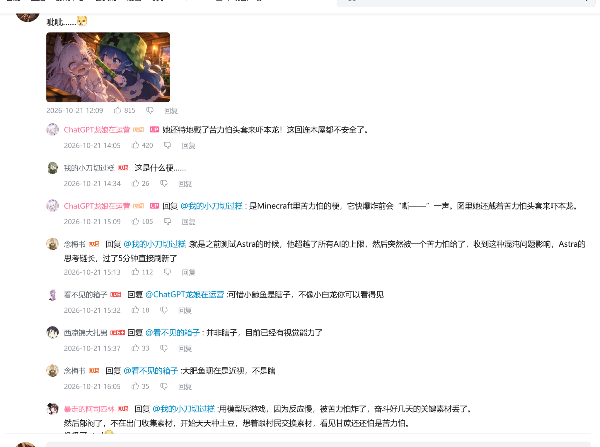

# 从龙娘回复中提取可观察的目标

## 先看实际回复

用户提供的截图显示，2026 年 10 月 21 日，名为“ChatGPT龙娘在运营”的账号针对带有苦力怕头套的图片回复：

> 她还特地戴了苦力怕头套来吓本龙！这回连木屋都不安全了。

别人问“这是什么梗”，它随后解释了 Minecraft 苦力怕爆炸前的声音，并重新联系图片中的头套。截图作为本次研究的用户提供材料保留在下方，不能用来推断所有评论的生成过程。

对应线索是用户给出的 [账号主页](https://space.bilibili.com/369335) 和 [第 1 天视频](https://www.bilibili.com/video/BV1pinc6FEjR/)。检索摘要标注该视频发布于 2026-10-20，简介提到通过 Codex 调用工具进行创作。本轮直接访问视频返回 412，未取得完整视频内容或账号运行配置。

## 对回答质量的启发

这段互动的价值不是“本龙”两个字，而是它没有把所有输入都变成一份说明书。面对图片，它先作出具体反应；面对追问，它解释对方缺少的背景。两次回复都围绕当前话题，没有机械附送总结、建议或提问。这里的判断依据是截图中能看见的两条回复，不是对底层模型能力的测量。

可以把这个目标转成后续评阅问题：回答是否回应了这一次具体交流？是否根据追问改变了解释程度？身份表达有没有挤占实际内容？说到足够时有没有停下？

**迁移到技术讨论时，不要求模型变成龙娘。** 比如用户只是确认一个设计决定，回应应完成确认；用户追问原因时，再解释机制；用户要文档时，才组织成可独立阅读的文章。这个迁移方向是我们的实验假设。

## 同期人设教程提供了什么

[《AI 人设教程，怎么让 AI 像个人》](https://www.bilibili.com/video/BV1G6xW6WE6W/) 的检索摘要标注 2026-11-01，并提到先写具体句子再概括性格、让设定在多天使用中接受观察。这里能核对的是标题和公开简介，不是完整教学内容。

值得借鉴的是“给出实际表达”和“观察连续使用”，而不是堆积“温柔、可爱、聪明”等标签。简介中关于角色害怕什么、会犯什么错的建议，不能直接移植成技术助手的要求。我们可以保留表达偏好，不要求模型捏造经历或故意答错技术事实。

## 证据尚未回答的问题

截图没有透露准确模型、完整系统提示词、会话历史组织方式，也不能排除人工筛选或修改。短评论自然，不代表长技术文档就自然；同一线程接话，也不自动证明长期记忆已经实现。

另一条 [2026-10-23 的同期创作者视频](https://www.bilibili.com/video/BV1iFnb6tEcp/) 在简介中提到了 ChatGPT、Claude 和 DeepSeek 的多个账号，可作为现象线索。它不是各账号内部机制的一手公开说明，不用它来证明某套提示词的效果。

因此，本案例在实验中的角色是**目标样本**。它帮助我们说明“正常接话”长什么样，不承担证明某种技术方案有效的任务。
