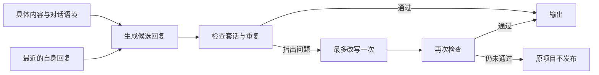

# dsh 中真正值得借用的部分

## 公开记录描述的处理链

[dsh-bili-scroll](https://github.com/c1overzz/dsh-bili-scroll) 的 [2026-10-25 更新记录](https://github.com/c1overzz/dsh-bili-scroll/blob/main/CHANGELOG.md) 明确针对评论的模板感增加了处理：取最近五条自己的评论作为上下文，检查套话和相似内容，命中后把原因返回模型，最多改写一次。记录给出的相似度阈值分别是与历史评论比较 0.55、与现有热评比较 0.5。

其 [任务说明](https://github.com/c1overzz/dsh-bili-scroll/blob/main/prompts/duty.md) 还要求回复指向具体视频细节，并区分内部运行记录与面向使用者的文字。以上是作者公开的流程和设定，不是本次运行得到的效果结果。

## 可转成实验变量的做法

**提供相关语境。** 评论依赖视频和楼层，技术回答依赖当前问题、已经确认的设计和读者背景。我们要比较的是相同任务下，哪些上下文确实帮助回答，而不是给模型塞尽可能多的资料。

**反馈具体的表达问题。** 与其说“别有 AI 味”，不如指出“这一段没有新信息”“这条风险没有触发条件”“用户只做了确认，不需要下一步建议”。这些是我们根据项目目标提出的反馈类别，不是该仓库现成的中文技术写作规则。

**保留有用范例。** 历史回复可以帮助发现重复，但自动把所有历史输出当作好范例也可能强化坏习惯。后续可以分别比较“未经筛选的历史”与“人工挑选的合适范例”。

**把修改前后都留下。** 发布前检查是一个独立干预。要判断它有没有价值，就得分别看初稿和改稿，确认有没有丢掉技术事实、必要条件或恰当的不确定性。

## 不直接搬入的内容

B 站搜索、推荐流、定时运行、账号登录、评论投递和运营限额都不属于本项目需求。短评论相似度阈值也不能直接拿来裁判技术文档：后者合理地重复术语、接口名和约束。

发布时“再不通过就不发”的策略，对交互助手也不合适。聊天系统不能因为风格检查失败就悄悄吞掉回答。若第二阶段尝试改写机制，应明确呈现失败或保留原答，并记录额外延迟；这仍是待实验方案。

**第一阶段不加入风格拦截器。** 它只保留模型原始输出和提示词条件。否则基线已经被自动加工，无法判断模型本来的表现。
