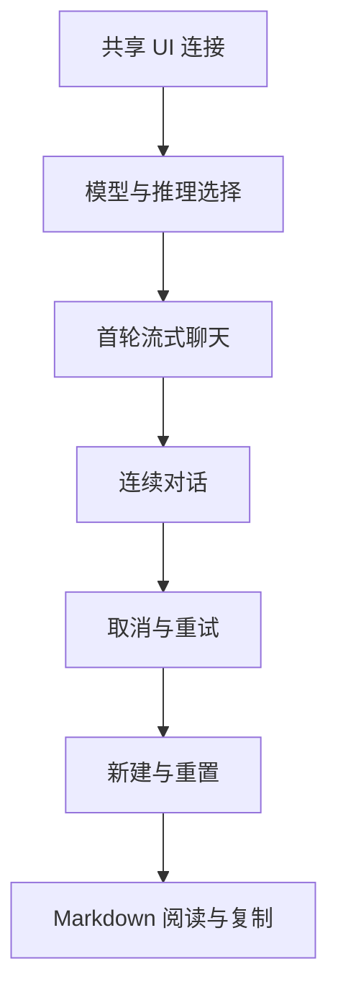

# 把独立请求连成连续对话

整体方案先让登录与聊天共用同一条执行连接，提供模型和推理强度选择，再建立流式 Turn 与多轮协议历史，最后补齐 Markdown 阅读和原文复制能力。每份方案交付一项可独立观察的功能，逐步得到完整的聊天界面。

## 模块怎样合作

UI 的 `agent_host` 负责共享 Connection，`login_ui` 和 `chat_ui` 分别接收自己的业务事件。执行侧由现有 Runtime 管理任务，Conversation 管理会话状态，LLM Model 管理模型协议。Markdown 展示保持 UI 领域内的独立职责，不参与请求历史管理。

图表示交付能力的组织顺序。实现过程中保留已有账号恢复、凭据更新与关闭链，不破坏当前可用功能。

## 按顺序实施

| 顺序 | 方案 | 完成后可观察的结果 |
| --- | --- | --- |
| 01 | [共享连接宿主](01-shared-host.md) | 登录页仍正常工作，后台由公共 UI 宿主持有 |
| 02 | [模型选择](02-model-selection.md) | 可以指定模型完成连接验证 |
| 03 | [推理设置](03-reasoning.md) | 只提交所选模型支持的 effort，未知时使用默认 |
| 04 | [首轮流式聊天](04-streaming-turn.md) | 输入任意文本，实时看到同一轮回复增长 |
| 05 | [多轮协议历史](05-multiturn.md) | 后续追问使用完整有效历史 |
| 06 | [停止当前生成](06-cancellation.md) | 停止有可见过程和唯一终态 |
| 07 | [重试失败尝试](07-retry.md) | 使用原输入重试而不重复污染历史 |
| 08 | [新建与重置](08-session-reset.md) | 能以固定模型与推理设置开启空白、独立的上下文 |
| 09 | [基础 Markdown 文本](09-markdown-prose.md) | 标题、段落、强调、引用和链接可阅读 |
| 10 | [列表与代码](10-markdown-code-lists.md) | 列表层级与代码缩进正确显示 |
| 11 | [表格与任务列表](11-markdown-tables.md) | GFM 表格可读，窄窗口可横向浏览 |
| 12 | [原文与复制](12-source-copy.md) | 可以复制原始回答及代码片段 |

执行顺序使后续增量建立在已经实现的交互与会话能力上。UI 阅读能力虽然可以分别开发，仍按这一条顺序收敛功能。

## 设计依据

完整行为与边界见 [设计入口](../../docs/design/chat-foundation/README.md)。执行某个增量时，具体范围与验证要求以该方案正文为准。

各增量在自身范围内同步正式架构与相关模块设计，不把尚未实施的设计写成当前事实。验证与修复随功能一起完成，不另建纯验收阶段。

## 贯穿全程的工作方式

实际修改前维护根目录临时进度记录，使用类型表达状态并小步实现。保持 Windows x64、MSVC、DX12、PowerShell 7 和现有 Workspace 约束；UI 使用 BSN 与 Widgetry 公共 API。执行编译、格式、Clippy 和必要的真实应用/BRP 检查，不编写测试代码、Benchmark 或 Example。验证时保护当前账号凭据，不擅自退出或重新授权。

第一阶段不增加聊天持久化、压缩、工具调用、提示词管理、自动输出改写或评分。
