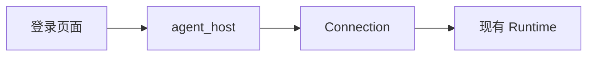

# 01：把共享连接从登录页面移到公共宿主

本增量只改变后台连接的 UI 所有者，让后续聊天页面能够复用已有执行环境。完成后，现有登录、目录设置和模型连接验证的可观察行为保持不变。

## 当前起点与目标结构

当前登录 UI 中的 AccountRuntime 持有 Connection、凭据路径、浏览器操作和收尾状态，并读取所有后台结果。新增 `crates/ui/agent_host/`，只迁出 Connection 的启动、提交、事件读取、唤醒和收尾。账号授权地址与浏览器辅助 Job 留在 login_ui。

公共宿主是唯一 Connection 事件接收者。它将带业务类型的事件分发给页面，不在宿主里复制 AccountState，也不在登录页留下第二条读取路径。

## 实施范围

增加 `agentelier_agent_host` 并接入 Workspace。调整 login_ui 的认证接入和 application 的生命周期装配，让它们调用新宿主。启动仍以已经准备的数据环境为依据，不创建第二份目录占用或凭据缓存。

Connection 的业务转换继续由现有 Account/LLM Model Bridge 承担。agent_host 只使用公开连接能力，不把业务状态规则迁入通用 application。跨层依赖保持 UI → Bridge → Agent。

迁移时同时处理 application 的 begin_shutdown、is_finished 与 finish 调用。关闭仍先停止业务接纳，等待真实任务与认证提交结束，再清理辅助 Job、日志和目录；普通关闭保留账号。

## 可交付的结果

应用只有一个后台 Runtime 和一个公共接收系统；登录页面可以恢复账号、执行现有允许的账号操作并完成模型连接验证。切换设置页和返回不会丢失在途状态。

## 验证与文档

完成受影响 crate 的编译、格式和 Clippy 检查。通过真实应用与 BRP 观察启动恢复、模型验证、设置页切换和正常关闭，结合运行状态确认线程确实回收。不要为验证擅自退出、重新授权、清除凭据或切换数据目录。

更新当前架构页与认证运行相关文档，只描述本增量已经完成的所有权变化。实际修改维护临时进度记录；不新增测试程序、Benchmark、Example 或另一个全局日志 Subscriber。

设计依据：[职责分配](../../docs/design/chat-foundation/02-architecture.md)。下一项：[模型选择](02-model-selection.md)。
