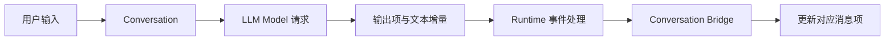

# 04：完成一轮真实的流式聊天

本增量将固定连接探测变成任意用户输入，并让回复在生成期间逐步可见。交付的是第一轮完整交互链，后续历史续接由下一项增加。

## 从配置创建一次会话

模型与推理强度的准备区已经可用。Conversation 接收这两项设置，创建内存 ChatSession 与固定设置快照；用户输入被接纳时创建 Turn 并分配身份。会话身份、Turn 身份与现有 operation 关联，不能只依赖一个全局“当前文本”字段。

聊天 UI 增加消息区域与多行输入，使用 Widgetry TextField 和 ScrollArea。Enter 发送、Shift+Enter 换行，IME 预编辑或候选提交不触发发送。业务接纳后才清空输入；失败保留草稿。生成期间可以编辑草稿，但不能重复提交。

## 把增量传到正确位置

LLM Model 接收显式模型、effort 和用户输入，沿用既有凭据获取、同账号校验及一次输出前认证恢复。Runtime 启动独立请求任务，保持账号命令处理可以继续运行。

增量带输出项与内容段身份。相邻片段可以有序合并，但不丢文字，不跨消息项合并；公开 commentary 与最终回答分段保留。UI 每帧批量应用变化，不为每个网络块创建气泡。

结果先入队再唤醒。控制路径不能被满文本队列阻塞，发送等待必须可取消，以保留应用关闭能力。收到完成前先交付其前面的全部文本；完成对象按项校准正文，不能再次追加整篇答案。

## 终态与长回答

只有合法 response.completed 才视为成功；失败、incomplete、错误和无终态断流均保留实际原因。完整响应无正文时显示状态，不伪造模型文字。禁止调用工具，本阶段遇到需要执行工具的结果明确失败。

连接超时沿用既有策略，读流采用初始 120 秒的具名空闲超时；持续收到合法事件的长生成不沿用旧请求总时长 120 秒限制。保留单事件和总流大小上限及明确错误。

终态与任务回收分别确认，执行未回收前不开放下一操作。普通关闭继续取消并回收任务、等待必要认证提交，不能随页面重建销毁执行体。

## 完成与验证

真实输入一个短问题与一个长文档请求，观察首段、增量、中间状态、完成校准和按钮状态。检查没有重复正文、错误归入正文、切页后丢失响应或额外 Runtime。先以纯文本展示保证通信正确，不把 Markdown 适配混入这一增量。

通过 BRP 实际输入和截图验证，结合状态查询确认终态与回收；IME 不能由工具覆盖的部分记录并在本机验证。执行静态检查，更新聊天与流式行为文档。保护账号状态，不新增测试、Benchmark 或 Example。

设计依据：[流式链](../../docs/design/chat-foundation/04-streaming.md)、[界面输入](../../docs/design/chat-foundation/05-ui-markdown.md)。前置：[推理设置](03-reasoning.md)。下一项：[多轮历史](05-multiturn.md)。
