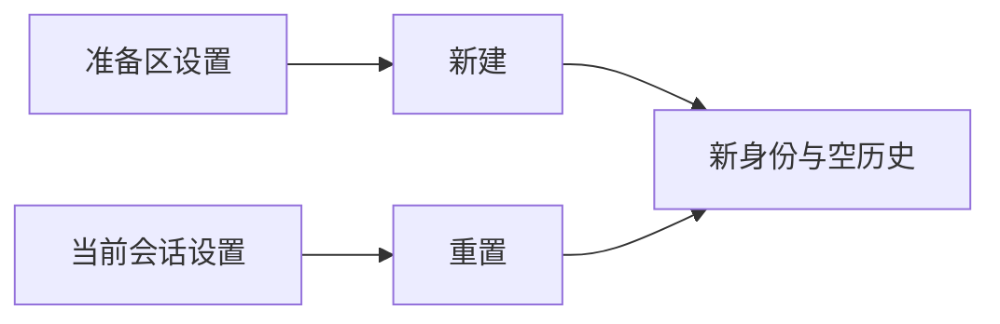

# 08：用新建和重置获得独立上下文

本增量建立两个明确操作：新建使用准备区设置，重置沿用当前 Session 设置。两者都创建全新的聊天身份和空历史。

## 固定快照与准备草稿分离

活动 Session 的模型 slug 和推理选择在创建时复制。准备区是下一次会话的配置，修改它不能影响当前会话，也不能让下一轮突然切换模型或推理强度。

新建将准备区的完整设置复制到新 Session。重置复制当前活动快照，不受准备区未使用修改影响。清空前说明当前对话未持久化，确认后同时清除展示记录与协议历史。

本阶段只有一个活动 Session，不添加历史会话列表或切换器。关闭程序不恢复聊天。

## 操作只在空闲时发生

生成、取消中或任务未回收时禁用新建与重置，避免清空后旧任务继续写入。控制侧也执行相同接纳规则，不能只依赖 UI 禁用。迟到事件按 Session/Turn/operation 关联隔离。

账号自然续期不触发重置；账号身份改变后旧会话不能继续发送，需要新建。不要把聊天重置实现成认证退出或切换数据目录。

## 完成与验证

在旧会话告诉模型一个临时标记，再重置并观察安全请求投影中的历史为空；不能仅以模型声称“不记得”证明隔离。修改准备区模型或推理强度后继续旧会话，核对旧快照不变；新建后核对新设置生效。

通过 BRP 检查忙碌时禁用、清空提示和新界面内容，确认新建不改变账号。执行编译、格式、Clippy，更新会话模块设计。遵守 BSN 构造、无测试/Benchmark/Example 与进度记录要求。

设计依据：[会话体验](../../docs/design/chat-foundation/01-experience.md)、[设置快照](../../docs/design/chat-foundation/03-session.md)。前置：[重试](07-retry.md)。下一项：[Markdown 文本](09-markdown-prose.md)。
